# Plan de développement officiel d'Aydra

## 1. Présentation et objectif

État de référence : **28 octobre 2026**. Ce document organise le développement à deux, à partir du code et des décisions présents dans le dépôt. Il n'autorise aucune modification des données, migration réelle, nouvelle dépendance ou appel transporteur. La mission de rédaction ne modifie que ce fichier.

Ordre imposé : **fondations techniques → tout le Central → jalon C-999 → métier des boutiques → jalon T-999**. Le provisionnement technique d'une BDD, de son profil et de son propriétaire local est nécessaire au Central ; il ne vaut pas réalisation du catalogue, des commandes ou des finances de la boutique.

L'inventaire comporte **305 tâches et jalons : 13 fondations, 174 Central, 118 boutiques**. Les 174 lignes centrales couvrent notamment les **137 actions administratives distinctes des 26 modules** ; les parcours publics/propriétaire, mécanismes financiers et recettes nécessaires sont ajoutés séparément. Les tables ne sont pas assimilées à autant de fonctionnalités.

Ce plan réutilise le travail déjà présent. Une ligne dont le code est implémenté appelle une recette ou une correction ciblée, pas une réécriture. Aucune nouvelle fonctionnalité commerciale n'est déduite d'une simple possibilité technique.

## 2. Sources et architecture réellement constatée

### 2.1 Références exactes

Les quatre sources demandées ont été lues et croisées, y compris leurs notes, contraintes, historiques et annexes. Le fichier appelé « instructions » dans la mission est réellement **instructionn.txt**.

| Code utilisé dans les tableaux | Chemin exact depuis la racine | Usage |
|---|---|---|
| S | [documentation et recherche/Schema-BDD-SaaS-Ecommerce-UUID.md](<../documentation et recherche/Schema-BDD-SaaS-Ecommerce-UUID.md>) | Conception complète, C1–C10, T1–T26, invariants §§6–13, décisions finales et inventaire. Le numéro T19 n'existe pas dans ce classement. |
| DC | [documentation et recherche/Diagramme-BDD-Centrale-Complet.md](<../documentation et recherche/Diagramme-BDD-Centrale-Complet.md>) | Entités, champs, relations et explications centrales : 27 tables actives réellement présentes dans le bloc Mermaid. |
| DT | [documentation et recherche/Diagramme-BDD-Boutique-Complet.md](<../documentation et recherche/Diagramme-BDD-Boutique-Complet.md>) | 59 tables locales, variantes typées, contraintes, scénarios et explications des champs. |
| I | [instructionn.txt](../instructionn.txt) | Règles §§1–2 et 26 modules administratifs ; 137 codes distincts après suppression des répétitions explicatives. |
| architecture | [documentation et recherche/architecture a suivre pour faire le code.txt](<../documentation et recherche/architecture a suivre pour faire le code.txt>) | Organisation, décisions récentes §§24–46, cache, scopes, autorisations, domaines et déploiements. |
| règles | [AGENTS.md](../AGENTS.md) | Décisions permanentes, périmètres autorisés et vérifications. |
| suivi | [documentation et recherche/Suivi-Developpement-Aydra.md](<../documentation et recherche/Suivi-Developpement-Aydra.md>) | Historique de réalisation ; ses résultats datés ne sont pas des tests réexécutés par cet audit. |
| API transporteur | [documentation et recherche/ECOTRACK API.postman_collection.json](<../documentation et recherche/ECOTRACK API.postman_collection.json>) | Contrat à confronter aux réponses réelles uniquement lors de la recette autorisée du connecteur. |
| mission | [prout.txt](../prout.txt) | Périmètre de ce plan, Central avant Tenant et fichier de suivi unique. |

Les chemins courts des tableaux sont des chemins **depuis la racine du dépôt**, pas depuis docs. Une référence à database/migrations indique une structure prévue, jamais la preuve d'une interface métier opérationnelle. Les chemins futurs donnés dans I sont des propositions à adapter au classement actuel, pas des fichiers existants affirmés.

### 2.2 Architecture observée

Aydra est un **monolithe Laravel modulaire en couches MVSC** : responsabilité technique, puis contexte, puis module métier. Les Controllers coordonnent, les Form Requests valident/autorisent, les DTO PHP transportent lorsqu'ils sont utiles, les Services exécutent le métier, Eloquent représente les données et Blade/Livewire affiche.

| Couche | Emplacement réel et exemple |
|---|---|
| Entrée HTTP | public/index.php ; bootstrap/app.php ; routes/web.php |
| Routes centrales | routes/central.php ; routes/central/admin.php ; routes/central/admin/users.php ; routes/central/settings.php |
| Routes boutique | routes/tenant.php charge routes/storefront.php dans le contexte Tenant |
| Controllers | app/Http/Controllers/Central/Admin/Users/UserController.php ; app/Http/Controllers/Storefront/StorefrontController.php |
| Validation | app/Http/Requests/Central/Users/UpdateUserRequest.php ; app/Http/Requests/Central/Domains/StoreDomainRequest.php |
| DTO | app/DTOs/Central/Users/UserData.php ; app/DTOs/Central/Tenants/TenantData.php |
| Métier | app/Services/Central/Users/UserManagementService.php ; app/Services/Central/Tenants/TenantCreator.php |
| Autorisations | app/Policies/Central/UserPolicy.php ; app/Services/Central/Authorization/AuthorizationMutation.php |
| Données | app/Models/Central/Users/User.php ; app/Models/Tenant/Users/User.php ; modèles rangés par module depuis le 27 octobre |
| Compatibilité | app/Models/User.php et app/Models/Tenant.php restent des alias vides ; morphs et factories historiques préservés |
| Interface | resources/views/central/pages/admin ; resources/views/tenant ; app/Livewire ; composants Livewire de pages |
| Persistance | database/migrations/central et database/migrations/tenant ; seeders séparés Central/Tenant |
| Tenancy | app/Tenancy/Bootstrappers ; config/tenancy.php ; app/Providers/TenancyServiceProvider.php |
| Tests | tests/Central, tests/Tenant, tests/TestCase.php ; Pest et bases MySQL temporaires protégées |
| Exploitation | app/Console/Commands/Central/LocalProvisioningWorker.php ; deployment/supervisor/aydra-provisioning.conf |

Parcours central réel : **Blade/Livewire → routes centrales → middleware central → Form Request/Policy → Controller → Service → Eloquent/MySQL → Redirect ou réponse → Blade/Livewire**. La validation d'un Form Request est exécutée avant le corps de l'action du Controller. Fortify peut exécuter ses propres Controllers/pipelines/actions/réponses, au lieu d'un Controller d'authentification maison.

Une BDD centrale et une BDD par boutique ; Storefront utilise la BDD de cette boutique, sans troisième BDD. Hors tenancy, mysql désigne la base centrale ; Stancl bascule la connexion par défaut puis la restaure. Les modèles portent leur contexte explicite. IDs numériques internes, UUID publics et références inter-BDD ; pas de FK SQL entre bases. Alias, PK composites Spatie et types polymorphes ne sont pas remplacés globalement.

Les droits centraux sont individuels et datés via Spatie ; les rôles sont des profils de départ, sans propagation d'une édition à leurs membres. Les permissions SaaS ne vont jamais aux commerçants. Les droits Tenant restent indépendants et natifs selon T24. AuthorizationMutation utilise DB::transaction(..., 3) et Gate acteur/action/cible, sans verrou root global ni nouvelle vérification de connexion dans cette classe.

### 2.3 Versions constatées

composer.lock : Laravel **13.34.0**, Fortify **1.41.0**, Stancl Tenancy **3.10.1**, Spatie Permission **8.3.0**, Activity Log **5.0.0**, Livewire **4.4.7**, Flux **2.20.1**, libphonenumber **9.0.41**. L'exécutable de projet est PHP 8.5 ; les mentions Laravel 12/PHP 8.4/Tenancy 4 dans certaines recherches ne décrivent pas ces versions installées.

package.json : Tailwind 4, Vite 8, vite-plus 0.3.0 et @laravel/passkeys ^0.2.0. Il s'agit ici des contraintes du manifeste frontend, pas d'une affirmation sur chaque paquet effectivement chargé dans le navigateur.

## 3. Règles de suivi et identifiants

- F-xxx : technique nécessaire ; C-xxx : Central ; T-xxx : boutique. C-999 et T-999 sont les jalons obligatoires.
- Les IDs sont stables : ne pas les renuméroter après un tri. Une tâche ajoutée prend un nouvel ID libre ; actualiser ses prérequis, la matrice et les graphes ensemble.
- Responsable initial : **Non attribué** partout. Valeurs autorisées : Mourad, Merrakchi, Non attribué. La proposition du §14 ne vaut pas affectation.
- Suivi : modifier directement [ ] en [x] et Statut en Terminé après la recette. Une case dans une table Markdown n'est pas nécessairement interactive.
- Statut de travail : À faire / En cours / Terminé / Bloqué / Annulé. Code existant : Implémentée / Partiellement implémentée / Non implémentée / À vérifier.
- **Implémentée ne signifie pas recette exécutée aujourd'hui.** Les parcours déjà raccordés restent À faire pour leur validation finale ; leur travail consiste à vérifier/réutiliser. Les deux constats documentaires du socle effectivement achevés sont cochés.
- Partiellement implémentée indique un mécanisme utile existant, avec son manque décrit. La présence d'une migration ou d'un modèle seul ne suffit jamais à classer une fonctionnalité comme implémentée.
- Une dépendance est un prérequis de développement/intégration, pas nécessairement une action à répéter à chaque requête. Exemple : supporter les avoirs avant de clôturer le remboursement ne signifie pas émettre un avoir pour un achat jamais facturé.
- Les vagues sont calculées : 1 + maximum des vagues des prérequis, ou 1 sans prérequis. **Aucun lien entre deux tâches de même vague.** Une tâche d'une vague ultérieure peut être disponible si tous ses propres prérequis sont terminés ; les barrières F-013 et C-999 restent obligatoires.
- Les dépendances sont distinctes des conflits Git : deux tâches sans lien peuvent partager un service, une route ou le catalogue de permissions. Réserver ces fichiers ou intégrer des changements courts, sans inventer un faux prérequis métier.
- Bloqué s'emploie pour un obstacle concret consigné, pas pour toutes les tâches futures. Aucun conflit de données n'est résolu automatiquement.
- Les exclusions validées sont au §16 et ne deviennent pas des fonctionnalités à refaire sous un nouveau nom.

## 4. Synthèse de l'audit du code

### 4.1 Présent et réutilisable

Les neuf fichiers de modules chargés par routes/central/admin.php sont users, staff, tenants, domains, deployments, features, roles, permissions et countries. Ils raccordent routes, Requests, Controllers, Services, Policies, modèles et vues. Les tests correspondants existent dans tests/Central/Feature/Admin ; leur présence ne prouve pas une réussite lors de cet audit.

Les parcours centraux d'inscription/connexion/approbation, invitations, profil, photo, rôles et droits individuels sont présents. UserApprovalService synchronise compte/dossier dans une seule décision ; UserManagementService réutilise la version de dossier sans demander une nouvelle approbation pour une édition. RegistrationJourney distingue les six états et ne prépare pas toutes les données de page pour une simple décision de redirection.

TenantCreator/Provisioner, les jobs et TenantDeploymentService gèrent préparation technique, réservation, reprises, versions et activation éligible. DomainService/DnsInspector/VerificationService gèrent normalisation, DNS, HTTPS et domaine principal ; ils ne configurent pas un fournisseur DNS ni n'émettent des certificats.

FeatureCatalogService gère le catalogue commercial, distinct des permissions. Les pays et leur cache de lecture existent. Le profil shop et le propriétaire local sont préparés automatiquement au provisionnement ; cela ne constitue pas une boutique fonctionnelle.

### 4.2 Partiel ou absent

| Groupe | Constat et manque concret |
|---|---|
| M09 plans | Modèles Plan/PlanFeature et FreePlanCatalog présents. Le plan gratuit de deux boutiques existe ; aucun parcours administratif complet de versionnement/édition des offres n'est chargé. |
| M10–11 | DefaultSubscription, quota de création et sélection de boutiques dans TenantStatusService présents. Interfaces d'abonnements/échéances/quotas, cycle payant complet et consommation générique feature_usage à compléter. |
| M13–16 | Tables géographiques/transporteurs/mappings/bureaux prévues par les migrations. Absence des Controllers/Services/interfaces de gestion de ces modules dans les routes chargées. |
| M17 | media et ProfilePhotoService présents ; ce dernier ne remplace pas la bibliothèque administrative des justificatifs financiers et ses protections de preuve. |
| M18–23 | Schéma de facturation à cinq tables présent. Aucun ensemble de Services/Controllers/interfaces d'émission, rapprochement, remboursement ou envoi de documents correspondant n'est identifié. |
| M24 | Activités déjà écrites et modèle Spatie central présent ; consultation/export généraux à développer. |
| M25 | app/Services/Central/Dashboard/Dashboard.php renvoie les noms des boutiques et isStaff. Ce n'est pas le dashboard administratif/financier décrit par I. |
| M26 | Worker et rattrapage de provisionnement présents. Exploitation/rapprochement général des abonnements et finances pas raccordés. |
| Tenant | Modèles User/Role/Permission/Shop/Media/Activity et quelques services Dashboard/Diagnostics préparés ; pas de Services métier produits, commandes, stock, retours ou finance. Routes d'authentification et dashboard Tenant non activées. |
| Vitrine | routes/storefront.php n'expose que l'accueil ; StorefrontController renvoie une page texte 503 de préparation et peut rediriger vers le principal prêt. Aucun checkout/catalogue fonctionnel n'en découle. |
| Données d'essai | Les seeders locaux 20 produits/50 commandes sont des fixtures ; pas la preuve de traitements métier exécutables. Ne pas les lancer pour établir l'état réel d'un module. |

### 4.3 Contrôles exécutés et limites

Inventaire transversal des couches, lecture des entrées/routes/services concernés, des relations/modèles, configurations, migrations, seeders, vues et tests ; examen croisé du schéma et des diagrammes. **410 fichiers PHP applicatifs/configuration/routes/migrations/tests/bootstrap hors cache ont été analysés par le parseur PHP installé : aucune erreur de syntaxe signalée.** Ce contrôle n'exécute ni Eloquent ni les vues Blade compilées et ne remplace pas une analyse de type ou un test.

Les entités des deux blocs Mermaid ont été extraites : **27 centrales et 59 locales**, conformes à l'annexe de S. Ce nombre exclut les tables techniques Laravel (migrations, sessions, cache, jobs, tokens, passkeys selon contexte). Les anciennes tables supprimées dans l'historique ne sont pas réintroduites.

Pas de suite Pest, Pint, PHPStan, compilation frontend, migration, seeder ou appel transporteur exécuté pour cette mission documentaire. tests/TestCase.php crée et nettoie des BDD MySQL : il n'a pas été invoqué. Aucun état de MySQL réel, de SMTP, de worker ou de certificat de production n'est certifié par cette lecture statique.

Écart confirmé sans correction applicative : routes/central/admin/users.php:29 et routes/central/admin/staff.php:20 limitent encore le renvoi d'invitation par throttle:6,1, contrairement à la décision du 27 octobre. Voir C-013. Les divergences historiques sont détaillées au §17.

## 5. Tableau de développement des fondations

Ces tâches sont techniques. Les checks de recette peuvent nécessiter un accord de test distinct ; aucun code boutique commercial n'est développé pendant cette phase.


| ID | Vague | Module | Fonctionnalité | Prérequis | Responsable | Suivi | Statut | Code existant | Critère de réalisation / manque | Références |
|---|---:|---|---|---|---|---|---|---|---|---|
| F-001 | 01 | Fondations | Établir la base de travail et les versions réelles | — | Non attribué | [x] | Terminé | Implémentée | Sources, architecture, limites et dépendances installées relevées ; aucun redéveloppement du socle. | AGENTS.md ; composer.lock ; package.json |
| F-002 | 01 | Fondations | Comparer les contraintes actives au schéma MySQL | — | Non attribué | [ ] | À faire | À vérifier | Recette en lecture seule des FK/UK/CHECK, types, colonnes générées, 27+59 tables métier ; distinguer historique de migrations et schéma réellement déployé. | S §§3,6,annexe ; database/migrations/central ; database/migrations/tenant |
| F-003 | 01 | Fondations | Qualifier le banc de tests isolés et les caches de test | — | Non attribué | [x] | Terminé | Implémentée | Harnais existant réutilisé ; autorisation avant CREATE/DROP de bases de test, faux e-mails et vrais jobs isolés ; aucun test sur les boutiques réelles. | tests/TestCase.php ; tests/Pest.php ; architecture §22 |
| F-004 | 02 | Fondations | Valider le cycle de connexion central/tenant et sa terminaison | F-001, F-003 | Non attribué | [ ] | À faire | Partiellement implémentée | Central par défaut hors tenancy ; deux tenants isolés ; retour central après exception ; guards, cache Spatie, audit, fichiers et jobs séparés. | config/tenancy.php ; app/Tenancy/Bootstrappers ; tests/Tenant/Tenancy/TenancyFoundationTest.php |
| F-005 | 02 | Fondations | Valider les contrats ID, UUID, alias, morphs et factories | F-001 | Non attribué | [ ] | À faire | Implémentée | Types historiques et alias conservés ; PK internes, UUID publics, binding et relations locales ; aucune fausse FK inter-BDD. | app/Models ; tests/Central/Unit/ModelOrganizationTest.php ; S §§3.1,7.6 |
| F-006 | 02 | Fondations | Qualifier les autorisations et écritures atomiques partagées | F-001, F-003 | Non attribué | [ ] | À faire | Partiellement implémentée | Policy acteur/action/cible, versions, verrous métier, audit atomique et cache Spatie après rollback ; pas de verrou root global réintroduit. | app/Services/Central/Authorization/AuthorizationMutation.php ; architecture §§41–42 |
| F-007 | 03 | Fondations | Contrôler les routes, frontières HTTP et diagnostics | F-004, F-006 | Non attribué | [ ] | À faire | Partiellement implémentée | Auth/verified/contextes, UUID et réponses 403/404/503 ; diagnostics seulement local+debug+loopback ; aucune donnée interne publique. | routes ; bootstrap/app.php ; tests/Central/Feature/Authorization/RouteSecurityTest.php |
| F-008 | 03 | Fondations | Qualifier les contrats de médias et preuves immuables | F-002, F-005 | Non attribué | [ ] | À faire | Partiellement implémentée | Photos déjà présentes ; compléter intégrité des pièces probantes : parent réel, hash, droits, stockage privé, pas de remplacement d'un document figé. | S C9,7.6 ; app/Concerns/HasProfilePhoto.php ; app/Models/Central/Media/Media.php |
| F-009 | 03 | Fondations | Qualifier worker, scheduler et reprise asynchrone | F-004, F-006 | Non attribué | [ ] | À faire | Partiellement implémentée | Configuration centrale de queue réutilisée ; démarrage supervisé Windows/production, afterCommit, erreurs observables et reprise vérifiés sans consommer de vrais jobs pendant l'audit. | config/queue.php ; routes/console.php ; deployment/supervisor/aydra-provisioning.conf |
| F-010 | 03 | Fondations | Définir les contrats de référentiels et cache de lecture | F-004, F-005 | Non attribué | [ ] | À faire | Partiellement implémentée | UUID/versions et API de lecture autorisées ; cache isolé/invalidation après commit ; pas de cache de décision quota/permission/statut. | app/Services/Central/Countries/CountryCatalog.php ; architecture §36 ; S §7.3 |
| F-011 | 03 | Fondations | Qualifier unicité et normalisation des coordonnées | F-002, F-006 | Non attribué | [ ] | À faire | Partiellement implémentée | Un e-mail et au plus un téléphone E.164 par compte central ; doublons historiques présentés sans suppression ; portée Tenant indépendante. | app/Services/Central/Users/PhoneNumberNormalizer.php ; S décision 19 octobre ; tests/Central/Integration/UserContactConcurrencyTest.php |
| F-012 | 04 | Fondations | Établir les scénarios de charge et l'observabilité | F-001, F-009 | Non attribué | [ ] | À faire | À vérifier | Mesurer connexions multi-BDD, files, requêtes et journaux nettoyés ; budgets documentés pour 10 000 boutiques sans promettre de SLA non mesuré. | S §§13,13.1 ; app/Services/Central/Diagnostics/DatabaseDiagnostics.php |
| F-013 | 05 | Fondations | Valider le socle avant de compléter le Central | F-002, F-004, F-005, F-006, F-007, F-008, F-009, F-010, F-011, F-012 | Non attribué | [ ] | À faire | À vérifier | Recette du socle et écarts consignés ; ces tâches techniques ne constituent pas un démarrage du métier boutique. | S §§3,6–7,13 ; architecture §§22,38 |


## 6. Tableau exhaustif des fonctionnalités Central

Toutes les capacités de I sont recensées une fois ; les occurrences répétées en prose n'ajoutent pas une action. Les lignes sont triées par vague et ID, et non alphabétiquement. Les actions d'un module peuvent donc se trouver à plusieurs endroits : rechercher son numéro Mxx ou son code de permission.

Les tables typed subscriptions, saas_billing_settings, saas_invoices et saas_transfers conservent leur structure documentée. L'ancien exemple de fichier SubscriptionInstallment.php ne justifie pas une nouvelle table. Les autorisations détaillées futures ne doivent pas enrichir silencieusement les rôles des utilisateurs actuels.

| ID | Vague | Module | Fonctionnalité | Prérequis | Responsable | Suivi | Statut | Code existant | Critère de réalisation / manque | Références |
|---|---:|---|---|---|---|---|---|---|---|---|
| C-001 | 06 | Parcours central | Connexion, déconnexion et récupération de compte | F-013 | Non attribué | [ ] | À faire | Implémentée | Fortify central et erreurs neutres ; reset signé/borné et redirections internes selon état, jamais URL externe. | S §7.8 ; app/Providers/FortifyServiceProvider.php ; app/Http/Responses/Central/Auth/LoginResponse.php |
| C-015 | 06 | Noyau financier | Garantir les types, rattachements et clés des opérations financières | F-013 | Non attribué | [ ] | À faire | Non implémentée | Règles/compteurs, facture/avoir, paiement/remboursement restent dans leurs tables typées ; même owner/devise/origine, clés serveur et contraintes existantes. | S C8.1–C8.4,§6.7 |
| C-016 | 06 | Noyau financier | Valider les paramètres fiscaux et d'émission prévus | F-013 | Non attribué | [ ] | À faire | À vérifier | Désigner la validation humaine des règles/identité/taxes/périodes/déclencheurs ; aucune conformité juridique supposée par le schéma. | S C8,§14 décisions encore requises |
| C-003 | 07 | Parcours central | Vérification d'e-mail et renvoi sécurisé | C-001 | Non attribué | [ ] | À faire | Implémentée | Liens invalides/expirés/déjà utilisés traités, preuve réelle et confirmation vers login ; renvoi public limité. | app/Http/Responses/Central/Auth/VerifiedEmailResponse.php ; app/Services/Central/Auth/RegistrationVerificationNotification.php |
| C-005 | 07 | Parcours central | Édition du profil sans réapprobation et preuve de contact indépendante | C-001 | Non attribué | [ ] | À faire | Implémentée | Nom/e-mail/téléphone/pays/professionnel ne modifient jamais la décision ; nouvel e-mail non vérifié ; suspension conservée. | architecture §39 ; routes/central/settings.php ; tests/Central/Feature/Settings/ProfileUpdateTest.php |
| C-007 | 07 | Parcours central | Qualifier les réglages 2FA et passkeys centraux | C-001 | Non attribué | [ ] | À faire | À vérifier | Parcours natif déjà préparé : vérifier enregistrement/défi/suppression, limites par identité et compatibilité navigateur ; pas de nouvelle dépendance. | S §7.8 ; app/Http/Controllers/Central/Auth/PasskeyEndpointsController.php ; routes/central/settings.php |
| C-008 | 07 | Parcours central | Vérification de contact par challenges documentés | C-001, F-011 | Non attribué | [ ] | À faire | Partiellement implémentée | Réutiliser la preuve e-mail Fortify ; déterminer les usages réels de contact_verifications pour téléphone, expiration/essais/hash, sans prétendre qu'un SMS a été envoyé. | S C1 contact_verifications ; database/migrations/central |
| C-009 | 07 | Parcours central | Attribution et maintien du plan gratuit de base | C-001 | Non attribué | [ ] | À faire | Implémentée | Offre système free/shops=2 conservée ; pas de compte de démonstration au seeding normal. | S C4 ; app/Services/Central/Plans/FreePlanCatalog.php ; app/Services/Central/Subscriptions/DefaultSubscription.php |
| C-013 | 07 | Dette confirmée | Aligner les renvois administratifs sur la décision sans throttle | C-001 | Non attribué | [ ] | À faire | Partiellement implémentée | Écart constaté : renvois users/staff portent encore throttle:6,1 ; correction future limitée à ces routes, auth/Policy/CSRF préservés. | architecture §35 ; routes/central/admin/users.php:29 ; routes/central/admin/staff.php:20 |
| C-017 | 07 | M01 Utilisateurs | Consulter et rechercher les utilisateurs — `saas.users.view` | F-013, C-001 | Non attribué | [ ] | À faire | Implémentée | Policy central et compte protégé ; version/état attendu sous verrou, audit ; édition sans réapprobation, refus motivé et aucune boutique automatique. | I M01 ; S C1 ; DC C1 ; app/Services/Central/Users/UserManagementService.php ; app/Services/Central/Users/UserApprovalService.php ; routes/central/admin/users.php |
| C-019 | 07 | M01 Utilisateurs | Modifier un compte utilisateur — `saas.users.update` | F-013, C-001, F-011 | Non attribué | [ ] | À faire | Implémentée | Policy central et compte protégé ; version/état attendu sous verrou, audit ; édition sans réapprobation, refus motivé et aucune boutique automatique. | I M01 ; S C1 ; DC C1 ; app/Services/Central/Users/UserManagementService.php ; app/Services/Central/Users/UserApprovalService.php ; routes/central/admin/users.php |
| C-022 | 07 | M01 Utilisateurs | Suspendre un utilisateur — `saas.users.suspend` | F-013, C-001 | Non attribué | [ ] | À faire | Implémentée | Policy central et compte protégé ; version/état attendu sous verrou, audit ; édition sans réapprobation, refus motivé et aucune boutique automatique. | I M01 ; S C1 ; DC C1 ; app/Services/Central/Users/UserManagementService.php ; app/Services/Central/Users/UserApprovalService.php ; routes/central/admin/users.php |
| C-023 | 07 | M01 Utilisateurs | Réactiver un utilisateur — `saas.users.activate` | F-013, C-001 | Non attribué | [ ] | À faire | Implémentée | Policy central et compte protégé ; version/état attendu sous verrou, audit ; édition sans réapprobation, refus motivé et aucune boutique automatique. | I M01 ; S C1 ; DC C1 ; app/Services/Central/Users/UserManagementService.php ; app/Services/Central/Users/UserApprovalService.php ; routes/central/admin/users.php |
| C-024 | 07 | M01 Utilisateurs | Archiver un utilisateur — `saas.users.archive` | F-013, C-001 | Non attribué | [ ] | À faire | Implémentée | Policy central et compte protégé ; version/état attendu sous verrou, audit ; édition sans réapprobation, refus motivé et aucune boutique automatique. | I M01 ; S C1 ; DC C1 ; app/Services/Central/Users/UserManagementService.php ; app/Services/Central/Users/UserApprovalService.php ; routes/central/admin/users.php |
| C-025 | 07 | M01 Utilisateurs | Consulter son dossier professionnel — `saas.users.legal.view` | F-013, C-001 | Non attribué | [ ] | À faire | Implémentée | Policy central et compte protégé ; version/état attendu sous verrou, audit ; édition sans réapprobation, refus motivé et aucune boutique automatique. | I M01 ; S C1 ; DC C1 ; app/Services/Central/Users/UserManagementService.php ; app/Services/Central/Users/UserApprovalService.php ; routes/central/admin/users.php |
| C-026 | 07 | M01 Utilisateurs | Consulter l'historique administratif d'un utilisateur — `saas.users.history.view` | F-013, C-001 | Non attribué | [ ] | À faire | Implémentée | Policy central et compte protégé ; version/état attendu sous verrou, audit ; édition sans réapprobation, refus motivé et aucune boutique automatique. | I M01 ; S C1 ; DC C1 ; app/Services/Central/Users/UserManagementService.php ; app/Services/Central/Users/UserApprovalService.php ; routes/central/admin/users.php |
| C-027 | 07 | M02 Personnel SaaS | Consulter les administrateurs du SaaS — `saas.staff.view` | F-013, C-001 | Non attribué | [ ] | À faire | Implémentée | Personnel seulement, jamais commerçant/root ; délégation de droits valides, dates conservées et renouvellement motivé distinct ; invitation à usage unique. | I M02 ; S C2.1 ; DC C2.1 ; app/Services/Central/Users/StaffManagementService.php ; app/Services/Central/Authorization/CentralPermissionAssignmentService.php ; routes/central/admin/staff.php |
| C-030 | 07 | M02 Personnel SaaS | Modifier les informations d'un administrateur — `saas.staff.update` | F-013, C-001 | Non attribué | [ ] | À faire | Implémentée | Personnel seulement, jamais commerçant/root ; délégation de droits valides, dates conservées et renouvellement motivé distinct ; invitation à usage unique. | I M02 ; S C2.1 ; DC C2.1 ; app/Services/Central/Users/StaffManagementService.php ; app/Services/Central/Authorization/CentralPermissionAssignmentService.php ; routes/central/admin/staff.php |
| C-032 | 07 | M02 Personnel SaaS | Consulter ses permissions effectives — `saas.staff.permissions.view` | F-013, C-001 | Non attribué | [ ] | À faire | Implémentée | Personnel seulement, jamais commerçant/root ; délégation de droits valides, dates conservées et renouvellement motivé distinct ; invitation à usage unique. | I M02 ; S C2.1 ; DC C2.1 ; app/Services/Central/Users/StaffManagementService.php ; app/Services/Central/Authorization/CentralPermissionAssignmentService.php ; routes/central/admin/staff.php |
| C-035 | 07 | M02 Personnel SaaS | Suspendre un administrateur — `saas.staff.suspend` | F-013, C-001 | Non attribué | [ ] | À faire | Implémentée | Personnel seulement, jamais commerçant/root ; délégation de droits valides, dates conservées et renouvellement motivé distinct ; invitation à usage unique. | I M02 ; S C2.1 ; DC C2.1 ; app/Services/Central/Users/StaffManagementService.php ; app/Services/Central/Authorization/CentralPermissionAssignmentService.php ; routes/central/admin/staff.php |
| C-036 | 07 | M02 Personnel SaaS | Réactiver un administrateur — `saas.staff.activate` | F-013, C-001 | Non attribué | [ ] | À faire | Implémentée | Personnel seulement, jamais commerçant/root ; délégation de droits valides, dates conservées et renouvellement motivé distinct ; invitation à usage unique. | I M02 ; S C2.1 ; DC C2.1 ; app/Services/Central/Users/StaffManagementService.php ; app/Services/Central/Authorization/CentralPermissionAssignmentService.php ; routes/central/admin/staff.php |
| C-037 | 07 | M02 Personnel SaaS | Archiver un administrateur — `saas.staff.archive` | F-013, C-001 | Non attribué | [ ] | À faire | Implémentée | Personnel seulement, jamais commerçant/root ; délégation de droits valides, dates conservées et renouvellement motivé distinct ; invitation à usage unique. | I M02 ; S C2.1 ; DC C2.1 ; app/Services/Central/Users/StaffManagementService.php ; app/Services/Central/Authorization/CentralPermissionAssignmentService.php ; routes/central/admin/staff.php |
| C-038 | 07 | M03 Rôles SaaS | Consulter les rôles SaaS — `saas.roles.view` | F-013, C-001 | Non attribué | [ ] | À faire | Implémentée | Nom et composition/durées uniques ; profils de départ sans propagation aux membres ; système protégé ; suppression seulement sans références. | I M03 ; S C2.1 ; DC C2.1 ; app/Services/Central/Roles/RoleManager.php ; app/Policies/Central/RolePolicy.php ; routes/central/admin/roles.php |
| C-039 | 07 | M03 Rôles SaaS | Créer un rôle SaaS — `saas.roles.create` | F-013, C-001 | Non attribué | [ ] | À faire | Implémentée | Nom et composition/durées uniques ; profils de départ sans propagation aux membres ; système protégé ; suppression seulement sans références. | I M03 ; S C2.1 ; DC C2.1 ; app/Services/Central/Roles/RoleManager.php ; app/Policies/Central/RolePolicy.php ; routes/central/admin/roles.php |
| C-040 | 07 | M03 Rôles SaaS | Modifier le nom et les informations d'un rôle — `saas.roles.update` | F-013, C-001 | Non attribué | [ ] | À faire | Implémentée | Nom et composition/durées uniques ; profils de départ sans propagation aux membres ; système protégé ; suppression seulement sans références. | I M03 ; S C2.1 ; DC C2.1 ; app/Services/Central/Roles/RoleManager.php ; app/Policies/Central/RolePolicy.php ; routes/central/admin/roles.php |
| C-041 | 07 | M03 Rôles SaaS | Supprimer un rôle personnalisable inutilisé — `saas.roles.delete` | F-013, C-001 | Non attribué | [ ] | À faire | Implémentée | Nom et composition/durées uniques ; profils de départ sans propagation aux membres ; système protégé ; suppression seulement sans références. | I M03 ; S C2.1 ; DC C2.1 ; app/Services/Central/Roles/RoleManager.php ; app/Policies/Central/RolePolicy.php ; routes/central/admin/roles.php |
| C-042 | 07 | M03 Rôles SaaS | Consulter les permissions associées à un rôle — `saas.roles.permissions.view` | F-013, C-001 | Non attribué | [ ] | À faire | Implémentée | Nom et composition/durées uniques ; profils de départ sans propagation aux membres ; système protégé ; suppression seulement sans références. | I M03 ; S C2.1 ; DC C2.1 ; app/Services/Central/Roles/RoleManager.php ; app/Policies/Central/RolePolicy.php ; routes/central/admin/roles.php |
| C-043 | 07 | M03 Rôles SaaS | Ajouter ou retirer des permissions d'un rôle — `saas.roles.permissions.update` | F-013, C-001 | Non attribué | [ ] | À faire | Implémentée | Nom et composition/durées uniques ; profils de départ sans propagation aux membres ; système protégé ; suppression seulement sans références. | I M03 ; S C2.1 ; DC C2.1 ; app/Services/Central/Roles/RoleManager.php ; app/Policies/Central/RolePolicy.php ; routes/central/admin/roles.php |
| C-044 | 07 | M03 Rôles SaaS | Définir ou modifier la durée de chaque permission du rôle — `saas.roles.durations.update` | F-013, C-001 | Non attribué | [ ] | À faire | Implémentée | Nom et composition/durées uniques ; profils de départ sans propagation aux membres ; système protégé ; suppression seulement sans références. | I M03 ; S C2.1 ; DC C2.1 ; app/Services/Central/Roles/RoleManager.php ; app/Policies/Central/RolePolicy.php ; routes/central/admin/roles.php |
| C-045 | 07 | M03 Rôles SaaS | Consulter les administrateurs possédant un rôle — `saas.roles.assignments.view` | F-013, C-001 | Non attribué | [ ] | À faire | Implémentée | Nom et composition/durées uniques ; profils de départ sans propagation aux membres ; système protégé ; suppression seulement sans références. | I M03 ; S C2.1 ; DC C2.1 ; app/Services/Central/Roles/RoleManager.php ; app/Policies/Central/RolePolicy.php ; routes/central/admin/roles.php |
| C-046 | 07 | M04 Catalogue permissions | Consulter et rechercher le catalogue des permissions — `saas.permissions.view` | F-013, C-001 | Non attribué | [ ] | À faire | Implémentée | Catalogue paginé en lecture seule ; recherche et groupes ; aucun bouton/action/permission d'édition de libellé. | I M04 ; S C2.1 ; DC C2.1 ; app/Services/Central/Authorization/PermissionCatalogService.php ; routes/central/admin/permissions.php |
| C-047 | 07 | M05 Boutiques centrales | Consulter et rechercher toutes les boutiques — `saas.tenants.view` | F-013, C-001 | Non attribué | [ ] | À faire | Implémentée | Métadonnées centrales seulement ; propriétaire, BDD et UUID protégés ; quota frais et historique ; archivage sans DROP ; suspension préservée. | I M05 ; S C1 ; DC C1 ; app/Services/Central/Tenants/TenantManagementService.php ; app/Services/Central/Tenants/TenantStatusService.php ; routes/central/admin/tenants.php |
| C-050 | 07 | M05 Boutiques centrales | Suspendre une boutique — `saas.tenants.suspend` | F-013, C-001 | Non attribué | [ ] | À faire | Implémentée | Métadonnées centrales seulement ; propriétaire, BDD et UUID protégés ; quota frais et historique ; archivage sans DROP ; suspension préservée. | I M05 ; S C1 ; DC C1 ; app/Services/Central/Tenants/TenantManagementService.php ; app/Services/Central/Tenants/TenantStatusService.php ; routes/central/admin/tenants.php |
| C-052 | 07 | M05 Boutiques centrales | Archiver une boutique — `saas.tenants.archive` | F-013, C-001 | Non attribué | [ ] | À faire | Implémentée | Métadonnées centrales seulement ; propriétaire, BDD et UUID protégés ; quota frais et historique ; archivage sans DROP ; suspension préservée. | I M05 ; S C1 ; DC C1 ; app/Services/Central/Tenants/TenantManagementService.php ; app/Services/Central/Tenants/TenantStatusService.php ; routes/central/admin/tenants.php |
| C-053 | 07 | M05 Boutiques centrales | Consulter l'historique administratif d'une boutique — `saas.tenants.history.view` | F-013, C-001 | Non attribué | [ ] | À faire | Implémentée | Métadonnées centrales seulement ; propriétaire, BDD et UUID protégés ; quota frais et historique ; archivage sans DROP ; suspension préservée. | I M05 ; S C1 ; DC C1 ; app/Services/Central/Tenants/TenantManagementService.php ; app/Services/Central/Tenants/TenantStatusService.php ; routes/central/admin/tenants.php |
| C-055 | 07 | M06 Domaines | Consulter les domaines des boutiques — `saas.domains.view` | F-013, C-001 | Non attribué | [ ] | À faire | Implémentée | Hôte normalisé/unique même archivé ; expected_state, preuves séparées, appels externes bornés hors verrou ; aucun certificat généré par ce module. | I M06 ; S C1 ; DC C1 ; app/Services/Central/Domains/DomainService.php ; app/Services/Central/Domains/DomainVerificationService.php ; routes/central/admin/domains.php |
| C-061 | 07 | M07 Déploiements | Consulter les déploiements des BDD boutiques — `saas.deployments.view` | F-013, C-001 | Non attribué | [ ] | À faire | Implémentée | Cible/version prévues serveur ; autorisation par action ; reservation/idempotence/verrou commun ; corrélation historique et erreur nettoyée ; vrai job isolé en recette. | I M07 ; S C7 ; DC C7 ; app/Services/Central/Tenants/TenantDeploymentService.php ; app/Services/Central/Tenants/TenantProvisioner.php ; routes/central/admin/deployments.php |
| C-065 | 07 | M07 Déploiements | Consulter les erreurs techniques nettoyées — `saas.deployments.errors.view` | F-013, C-001 | Non attribué | [ ] | À faire | Implémentée | Cible/version prévues serveur ; autorisation par action ; reservation/idempotence/verrou commun ; corrélation historique et erreur nettoyée ; vrai job isolé en recette. | I M07 ; S C7 ; DC C7 ; app/Services/Central/Tenants/TenantDeploymentService.php ; app/Services/Central/Tenants/TenantProvisioner.php ; routes/central/admin/deployments.php |
| C-066 | 07 | M08 Fonctionnalités commerciales | Consulter les fonctionnalités commerciales — `saas.features.view` | F-013, C-001 | Non attribué | [ ] | À faire | Implémentée | Code stable/réservé, création inactive ; shops protégé ; références figent les champs techniques et bloquent archivage ; offre liée interdit désactivation. | I M08 ; S C2 ; DC C2 ; app/Services/Central/Plans/FeatureCatalogService.php ; routes/central/admin/features.php |
| C-067 | 07 | M08 Fonctionnalités commerciales | Créer une fonctionnalité — `saas.features.create` | F-013, C-001 | Non attribué | [ ] | À faire | Implémentée | Code stable/réservé, création inactive ; shops protégé ; références figent les champs techniques et bloquent archivage ; offre liée interdit désactivation. | I M08 ; S C2 ; DC C2 ; app/Services/Central/Plans/FeatureCatalogService.php ; routes/central/admin/features.php |
| C-068 | 07 | M08 Fonctionnalités commerciales | Modifier les paramètres d'une fonctionnalité — `saas.features.update` | F-013, C-001 | Non attribué | [ ] | À faire | Implémentée | Code stable/réservé, création inactive ; shops protégé ; références figent les champs techniques et bloquent archivage ; offre liée interdit désactivation. | I M08 ; S C2 ; DC C2 ; app/Services/Central/Plans/FeatureCatalogService.php ; routes/central/admin/features.php |
| C-069 | 07 | M08 Fonctionnalités commerciales | Activer ou désactiver une fonctionnalité — `saas.features.activate` | F-013, C-001 | Non attribué | [ ] | À faire | Implémentée | Code stable/réservé, création inactive ; shops protégé ; références figent les champs techniques et bloquent archivage ; offre liée interdit désactivation. | I M08 ; S C2 ; DC C2 ; app/Services/Central/Plans/FeatureCatalogService.php ; routes/central/admin/features.php |
| C-070 | 07 | M08 Fonctionnalités commerciales | Archiver une fonctionnalité inutilisée — `saas.features.archive` | F-013, C-001 | Non attribué | [ ] | À faire | Implémentée | Code stable/réservé, création inactive ; shops protégé ; références figent les champs techniques et bloquent archivage ; offre liée interdit désactivation. | I M08 ; S C2 ; DC C2 ; app/Services/Central/Plans/FeatureCatalogService.php ; routes/central/admin/features.php |
| C-071 | 07 | M09 Plans et offres | Consulter les plans et leurs versions — `saas.plans.view` | F-013, C-001 | Non attribué | [ ] | À faire | Non implémentée | Version d'offre immuable après utilisation ; quotas typés cohérents ; pas de suppression d'historique ni d'override utilisateur ; cache public invalidé. À compléter : interface/Policy/service de ce module non raccordés de bout en bout. | I M09 ; S C4 ; DC C4 ; app/Models/Central/Plans/Plan.php ; app/Services/Central/Plans/FreePlanCatalog.php |
| C-073 | 07 | M09 Plans et offres | Modifier les informations modifiables d'un plan — `saas.plans.update` | F-013, C-001 | Non attribué | [ ] | À faire | Non implémentée | Version d'offre immuable après utilisation ; quotas typés cohérents ; pas de suppression d'historique ni d'override utilisateur ; cache public invalidé. À compléter : interface/Policy/service de ce module non raccordés de bout en bout. | I M09 ; S C4 ; DC C4 ; app/Models/Central/Plans/Plan.php ; app/Services/Central/Plans/FreePlanCatalog.php |
| C-078 | 07 | M10 Abonnements | Consulter et rechercher les abonnements — `saas.subscriptions.view` | F-013, C-001 | Non attribué | [ ] | À faire | Partiellement implémentée | Lignes abonnement type 1/échéance type 2 ; historique et périodes sans chevauchement interdit ; offre payante attribuée explicitement par droit, pas par paiement. À compléter : interface/Policy/service de ce module non raccordés de bout en bout. Scope propriétaire/boutique et rattachement au même propriétaire ; dates/prix/renouvellement à effet prévu, pas d'écrasement historique. | I M10 ; S C4 ; DC C4 ; app/Models/Central/Subscriptions/Subscription.php ; app/Services/Central/Subscriptions/DefaultSubscription.php |
| C-084 | 07 | M10 Abonnements | Consulter les échéances de paiement — `saas.subscriptions.installments.view` | F-013, C-001 | Non attribué | [ ] | À faire | Non implémentée | Lignes abonnement type 1/échéance type 2 ; historique et périodes sans chevauchement interdit ; offre payante attribuée explicitement par droit, pas par paiement. À compléter : interface/Policy/service de ce module non raccordés de bout en bout. Scope propriétaire/boutique et rattachement au même propriétaire ; dates/prix/renouvellement à effet prévu, pas d'écrasement historique. | I M10 ; S C4 ; DC C4 ; app/Models/Central/Subscriptions/Subscription.php ; app/Services/Central/Subscriptions/DefaultSubscription.php |
| C-086 | 07 | M10 Abonnements | Consulter l'historique des abonnements — `saas.subscriptions.history.view` | F-013, C-001 | Non attribué | [ ] | À faire | Non implémentée | Lignes abonnement type 1/échéance type 2 ; historique et périodes sans chevauchement interdit ; offre payante attribuée explicitement par droit, pas par paiement. À compléter : interface/Policy/service de ce module non raccordés de bout en bout. Scope propriétaire/boutique et rattachement au même propriétaire ; dates/prix/renouvellement à effet prévu, pas d'écrasement historique. | I M10 ; S C4 ; DC C4 ; app/Models/Central/Subscriptions/Subscription.php ; app/Services/Central/Subscriptions/DefaultSubscription.php |
| C-087 | 07 | M11 Quotas | Consulter les quotas et leur consommation — `saas.quotas.view` | F-013, C-001 | Non attribué | [ ] | À faire | Non implémentée | Plafonds issus de l'offre ; usage par portée/période ; recalcul ne lève ni suspension ni préparation ; pas de dépassement concurrent. À compléter : interface/Policy/service de ce module non raccordés de bout en bout. | I M11 ; S C5 ; DC C5 ; app/Services/Central/Tenants/TenantStatusService.php |
| C-089 | 07 | M11 Quotas | Consulter les décisions et changements de quotas — `saas.quotas.history.view` | F-013, C-001 | Non attribué | [ ] | À faire | Non implémentée | Plafonds issus de l'offre ; usage par portée/période ; recalcul ne lève ni suspension ni préparation ; pas de dépassement concurrent. À compléter : interface/Policy/service de ce module non raccordés de bout en bout. | I M11 ; S C5 ; DC C5 ; app/Services/Central/Tenants/TenantStatusService.php |
| C-090 | 07 | M12 Pays | Consulter les pays — `saas.countries.view` | F-013, C-001 | Non attribué | [ ] | À faire | Implémentée | Noms FR/EN/AR facultatif, ISO/indicatif cohérents ; seuls pays actifs sélectionnables, références historiques conservées ; cache après commit. | I M12 ; S C1 ; DC C1 ; app/Services/Central/Countries/CountryService.php ; routes/central/admin/countries.php |
| C-091 | 07 | M12 Pays | Ajouter un pays — `saas.countries.create` | F-013, C-001 | Non attribué | [ ] | À faire | Implémentée | Noms FR/EN/AR facultatif, ISO/indicatif cohérents ; seuls pays actifs sélectionnables, références historiques conservées ; cache après commit. | I M12 ; S C1 ; DC C1 ; app/Services/Central/Countries/CountryService.php ; routes/central/admin/countries.php |
| C-092 | 07 | M12 Pays | Modifier les informations d'un pays — `saas.countries.update` | F-013, C-001 | Non attribué | [ ] | À faire | Implémentée | Noms FR/EN/AR facultatif, ISO/indicatif cohérents ; seuls pays actifs sélectionnables, références historiques conservées ; cache après commit. | I M12 ; S C1 ; DC C1 ; app/Services/Central/Countries/CountryService.php ; routes/central/admin/countries.php |
| C-093 | 07 | M12 Pays | Activer ou désactiver un pays — `saas.countries.activate` | F-013, C-001 | Non attribué | [ ] | À faire | Implémentée | Noms FR/EN/AR facultatif, ISO/indicatif cohérents ; seuls pays actifs sélectionnables, références historiques conservées ; cache après commit. | I M12 ; S C1 ; DC C1 ; app/Services/Central/Countries/CountryService.php ; routes/central/admin/countries.php |
| C-094 | 07 | M12 Pays | Archiver un pays non utilisé — `saas.countries.archive` | F-013, C-001 | Non attribué | [ ] | À faire | Implémentée | Noms FR/EN/AR facultatif, ISO/indicatif cohérents ; seuls pays actifs sélectionnables, références historiques conservées ; cache après commit. | I M12 ; S C1 ; DC C1 ; app/Services/Central/Countries/CountryService.php ; routes/central/admin/countries.php |
| C-095 | 07 | M13 Wilayas et communes | Consulter les wilayas et communes — `saas.geography.view` | F-013, C-001 | Non attribué | [ ] | À faire | Non implémentée | Pays→wilaya→commune cohérents ; unicité de code dans sa portée ; import contrôlé sans écraser un historique ; cache et invalidation. | I M13 ; S C5 ; DC C5 ; database/migrations/central |
| C-099 | 07 | M13 Wilayas et communes | Activer ou désactiver une zone — `saas.geography.activate` | F-013, C-001 | Non attribué | [ ] | À faire | Non implémentée | Pays→wilaya→commune cohérents ; unicité de code dans sa portée ; import contrôlé sans écraser un historique ; cache et invalidation. | I M13 ; S C5 ; DC C5 ; database/migrations/central |
| C-100 | 07 | M13 Wilayas et communes | Archiver une zone autorisée — `saas.geography.archive` | F-013, C-001 | Non attribué | [ ] | À faire | Non implémentée | Pays→wilaya→commune cohérents ; unicité de code dans sa portée ; import contrôlé sans écraser un historique ; cache et invalidation. | I M13 ; S C5 ; DC C5 ; database/migrations/central |
| C-101 | 07 | M14 Transporteurs communs | Consulter les transporteurs — `saas.carriers.view` | F-013, C-001 | Non attribué | [ ] | À faire | Non implémentée | Référentiel public partagé, état/version stables ; aucun secret transporteur central ; désactivation sans réinterpréter les snapshots locaux ; cache. | I M14 ; S C10 ; DC C10 ; database/migrations/central |
| C-102 | 07 | M14 Transporteurs communs | Ajouter un transporteur — `saas.carriers.create` | F-013, C-001 | Non attribué | [ ] | À faire | Non implémentée | Référentiel public partagé, état/version stables ; aucun secret transporteur central ; désactivation sans réinterpréter les snapshots locaux ; cache. | I M14 ; S C10 ; DC C10 ; database/migrations/central |
| C-103 | 07 | M14 Transporteurs communs | Modifier les informations d'un transporteur — `saas.carriers.update` | F-013, C-001 | Non attribué | [ ] | À faire | Non implémentée | Référentiel public partagé, état/version stables ; aucun secret transporteur central ; désactivation sans réinterpréter les snapshots locaux ; cache. | I M14 ; S C10 ; DC C10 ; database/migrations/central |
| C-104 | 07 | M14 Transporteurs communs | Activer ou désactiver un transporteur — `saas.carriers.activate` | F-013, C-001 | Non attribué | [ ] | À faire | Non implémentée | Référentiel public partagé, état/version stables ; aucun secret transporteur central ; désactivation sans réinterpréter les snapshots locaux ; cache. | I M14 ; S C10 ; DC C10 ; database/migrations/central |
| C-105 | 07 | M14 Transporteurs communs | Archiver un transporteur autorisé — `saas.carriers.archive` | F-013, C-001 | Non attribué | [ ] | À faire | Non implémentée | Référentiel public partagé, état/version stables ; aucun secret transporteur central ; désactivation sans réinterpréter les snapshots locaux ; cache. | I M14 ; S C10 ; DC C10 ; database/migrations/central |
| C-106 | 07 | M15 Correspondances transporteurs | Consulter les correspondances géographiques — `saas.carrier-mappings.view` | F-013, C-001 | Non attribué | [ ] | À faire | Non implémentée | Correspondance transporteur/zone canonique et version/source ; scope d'unicité réel ; import/rejet de conflits sans fusion arbitraire. | I M15 ; S C10 ; DC C10 ; database/migrations/central |
| C-110 | 07 | M15 Correspondances transporteurs | Archiver une correspondance — `saas.carrier-mappings.archive` | F-013, C-001 | Non attribué | [ ] | À faire | Non implémentée | Correspondance transporteur/zone canonique et version/source ; scope d'unicité réel ; import/rejet de conflits sans fusion arbitraire. | I M15 ; S C10 ; DC C10 ; database/migrations/central |
| C-111 | 07 | M16 Points de retrait | Consulter les bureaux de retrait — `saas.pickup-points.view` | F-013, C-001 | Non attribué | [ ] | À faire | Non implémentée | Localisation via geographic_areas sans wilaya/commune recopiées ; code transporteur versionné, coordonnées/adresse utiles ; cache de lecture. | I M16 ; S C10 ; DC C10 ; database/migrations/central |
| C-115 | 07 | M16 Points de retrait | Activer ou désactiver un bureau — `saas.pickup-points.activate` | F-013, C-001 | Non attribué | [ ] | À faire | Non implémentée | Localisation via geographic_areas sans wilaya/commune recopiées ; code transporteur versionné, coordonnées/adresse utiles ; cache de lecture. | I M16 ; S C10 ; DC C10 ; database/migrations/central |
| C-116 | 07 | M16 Points de retrait | Archiver un bureau — `saas.pickup-points.archive` | F-013, C-001 | Non attribué | [ ] | À faire | Non implémentée | Localisation via geographic_areas sans wilaya/commune recopiées ; code transporteur versionné, coordonnées/adresse utiles ; cache de lecture. | I M16 ; S C10 ; DC C10 ; database/migrations/central |
| C-117 | 07 | M17 Médias centraux | Consulter les fichiers centraux — `saas.media.view` | F-013, C-001 | Non attribué | [ ] | À faire | Non implémentée | Parent polymorphe et connexion centraux ; droit par fichier, upload validé, lecture privée ; preuve attachée immuable, archives limitées aux pièces retirables. À compléter : interface/Policy/service de ce module non raccordés de bout en bout. | I M17 ; S C9 ; DC C9 ; app/Services/Central/Users/ProfilePhotoService.php ; app/Models/Central/Media/Media.php |
| C-118 | 07 | M17 Médias centraux | Importer un fichier autorisé — `saas.media.upload` | F-013, C-001 | Non attribué | [ ] | À faire | Non implémentée | Parent polymorphe et connexion centraux ; droit par fichier, upload validé, lecture privée ; preuve attachée immuable, archives limitées aux pièces retirables. À compléter : interface/Policy/service de ce module non raccordés de bout en bout. | I M17 ; S C9 ; DC C9 ; app/Services/Central/Users/ProfilePhotoService.php ; app/Models/Central/Media/Media.php |
| C-119 | 07 | M17 Médias centraux | Télécharger un fichier privé autorisé — `saas.media.download` | F-013, C-001 | Non attribué | [ ] | À faire | Non implémentée | Parent polymorphe et connexion centraux ; droit par fichier, upload validé, lecture privée ; preuve attachée immuable, archives limitées aux pièces retirables. À compléter : interface/Policy/service de ce module non raccordés de bout en bout. | I M17 ; S C9 ; DC C9 ; app/Services/Central/Users/ProfilePhotoService.php ; app/Models/Central/Media/Media.php |
| C-120 | 07 | M17 Médias centraux | Archiver un fichier dont le retrait est permis — `saas.media.archive` | F-013, C-001 | Non attribué | [ ] | À faire | Non implémentée | Parent polymorphe et connexion centraux ; droit par fichier, upload validé, lecture privée ; preuve attachée immuable, archives limitées aux pièces retirables. À compléter : interface/Policy/service de ce module non raccordés de bout en bout. | I M17 ; S C9 ; DC C9 ; app/Services/Central/Users/ProfilePhotoService.php ; app/Models/Central/Media/Media.php |
| C-121 | 07 | M18 Règles et numérotation SaaS | Consulter les règles de facturation — `saas.billing-rules.view` | F-013, C-001 | Non attribué | [ ] | À faire | Non implémentée | Règles/compteurs typés dans saas_billing_settings ; snapshot/version historique ; compteur réservé sous verrou, jamais éditable librement. | I M18 ; S C8.1 ; DC C8.1 ; database/migrations/central |
| C-122 | 07 | M18 Règles et numérotation SaaS | Créer une règle de facturation — `saas.billing-rules.create` | F-013, C-001, C-015 | Non attribué | [ ] | À faire | Non implémentée | Règles/compteurs typés dans saas_billing_settings ; snapshot/version historique ; compteur réservé sous verrou, jamais éditable librement. | I M18 ; S C8.1 ; DC C8.1 ; database/migrations/central |
| C-123 | 07 | M18 Règles et numérotation SaaS | Modifier une règle encore modifiable — `saas.billing-rules.update` | F-013, C-001, C-015 | Non attribué | [ ] | À faire | Non implémentée | Règles/compteurs typés dans saas_billing_settings ; snapshot/version historique ; compteur réservé sous verrou, jamais éditable librement. | I M18 ; S C8.1 ; DC C8.1 ; database/migrations/central |
| C-126 | 07 | M18 Règles et numérotation SaaS | Consulter les compteurs et numérotations — `saas.billing-sequences.view` | F-013, C-001, C-015 | Non attribué | [ ] | À faire | Non implémentée | Règles/compteurs typés dans saas_billing_settings ; snapshot/version historique ; compteur réservé sous verrou, jamais éditable librement. | I M18 ; S C8.1 ; DC C8.1 ; database/migrations/central |
| C-127 | 07 | M19 Factures SaaS | Consulter et rechercher les factures — `saas.invoices.view` | F-013, C-001 | Non attribué | [ ] | À faire | Non implémentée | Facture et lignes de même propriétaire/échéance/devise ; PREPARING récupérable, numéro réservé et PDF privé hashé ; émission immuable/idempotente. | I M19 ; S C8.1 ; DC C8.1 ; database/migrations/central |
| C-131 | 07 | M20 Avoirs SaaS | Consulter les avoirs — `saas.credit-notes.view` | F-013, C-001 | Non attribué | [ ] | À faire | Non implémentée | Avoir vers facture/lignes originales du même propriétaire/devise, motif et plafonds ; émission fige correction sans changer l'original ni rembourser automatiquement. | I M20 ; S C8.1 ; DC C8.1 ; database/migrations/central |
| C-134 | 07 | M21 Paiements SaaS | Consulter les paiements déclarés — `saas.payments.view` | F-013, C-001 | Non attribué | [ ] | À faire | Non implémentée | Déclaration distincte de fonds vérifiés ; preuves privées immuables ; paiements partiels/allocation sous plafond et contrepassations, sans activation d'offre automatique. | I M21 ; S C8.3 ; DC C8.3 ; database/migrations/central |
| C-138 | 07 | M22 Remboursements SaaS | Consulter les remboursements — `saas.refunds.view` | F-013, C-001 | Non attribué | [ ] | À faire | Non implémentée | Remboursement externe enregistré sans virement automatique ; source réellement encaissée, décision/exécution/vérification distinctes, plafonds et contrepassation liée. | I M22 ; S C8.3 ; DC C8.3 ; database/migrations/central |
| C-144 | 07 | M23 Envois de documents SaaS | Consulter les envois des documents — `saas.deliveries.view` | F-013, C-001 | Non attribué | [ ] | À faire | Non implémentée | PDF déjà émis seulement ; intention distincte du résultat, destinataire contrôlé ; file après commit, état UNCERTAIN traité avant réessai, pas de double envoi. | I M23 ; S C8.2 ; DC C8.2 ; database/migrations/central |
| C-147 | 07 | M24 Journal central | Consulter et rechercher les activités centrales — `saas.activity.view` | F-013, C-001 | Non attribué | [ ] | À faire | Non implémentée | Lecture/export autorisés et paginés ; acteurs/UUID/corrélation utiles ; secrets et pièces exclus ; aucune édition libre ni accès aux journaux internes des boutiques. À compléter : interface/Policy/service de ce module non raccordés de bout en bout. | I M24 ; S C6 ; DC C6 ; app/Models/Central/Audit/Activity.php ; config/activitylog.php |
| C-148 | 07 | M24 Journal central | Exporter les activités autorisées — `saas.activity.export` | F-013, C-001 | Non attribué | [ ] | À faire | Non implémentée | Lecture/export autorisés et paginés ; acteurs/UUID/corrélation utiles ; secrets et pièces exclus ; aucune édition libre ni accès aux journaux internes des boutiques. À compléter : interface/Policy/service de ce module non raccordés de bout en bout. | I M24 ; S C6 ; DC C6 ; app/Models/Central/Audit/Activity.php ; config/activitylog.php |
| C-151 | 07 | M26 Exploitation centrale | Consulter les opérations techniques centrales — `saas.operations.view` | F-013, C-001 | Non attribué | [ ] | À faire | Non implémentée | Opérations bornées/idempotentes, suivi et erreurs nettoyés ; permissions détaillées, aucun doublon de permission de relance de déploiement. À compléter : interface/Policy/service de ce module non raccordés de bout en bout. | I M26 ; S C5,C8 ; DC C5,C8 ; routes/console.php ; app/Console/Commands/Central |
| C-002 | 08 | Parcours central | Inscription publique guidée sans création de boutique | C-001, C-003, C-009 | Non attribué | [ ] | À faire | Implémentée | Coordonnées normalisées, pays actifs, compte PENDING, plan gratuit, modale et une seule notification ; aucune boutique créée. | S C1 ; app/Actions/Central/Auth/Fortify/CreateNewUser.php ; tests/Central/Feature/Auth/RegistrationTest.php |
| C-004 | 08 | Parcours central | Session limitée et parcours prioritaire du commerçant | C-001, C-003 | Non attribué | [ ] | À faire | Implémentée | verification→pending/rejected→setup/preparing→ready ; polling privé 15 s ; contrôles serveur et pas de boucle. | S C1 ; app/Services/Central/Auth/RegistrationJourney.php ; app/Http/Middleware/Central/Auth/EnsureActiveCentralAccount.php |
| C-006 | 08 | Parcours central | Photo privée centrale et avatar par défaut | C-005, F-008 | Non attribué | [ ] | À faire | Implémentée | Ajout/retrait/téléchargement autorisés, ancien fichier géré sans fuite ; défaut commun sans ligne media. | S C9 ; app/Services/Central/Users/ProfilePhotoService.php |
| C-014 | 08 | Parcours central | Présentation publique/compte des offres et droits lisibles | C-009 | Non attribué | [ ] | À faire | Non implémentée | Afficher versions commercialisées et différences de droits documentés ; cache de présentation, décisions de quota toujours fraîches. | S C4,§7.2 ; architecture §36 |
| C-018 | 08 | M01 Utilisateurs | Créer un compte utilisateur — `saas.users.create` | F-013, C-001, C-009, F-011 | Non attribué | [ ] | À faire | Implémentée | Policy central et compte protégé ; version/état attendu sous verrou, audit ; édition sans réapprobation, refus motivé et aucune boutique automatique. | I M01 ; S C1 ; DC C1 ; app/Services/Central/Users/UserManagementService.php ; app/Services/Central/Users/UserApprovalService.php ; routes/central/admin/users.php |
| C-028 | 08 | M02 Personnel SaaS | Créer et inviter un administrateur — `saas.staff.invite` | F-013, C-001, C-039, C-043 | Non attribué | [ ] | À faire | Implémentée | Personnel seulement, jamais commerçant/root ; délégation de droits valides, dates conservées et renouvellement motivé distinct ; invitation à usage unique. | I M02 ; S C2.1 ; DC C2.1 ; app/Services/Central/Users/StaffManagementService.php ; app/Services/Central/Authorization/CentralPermissionAssignmentService.php ; routes/central/admin/staff.php |
| C-033 | 08 | M02 Personnel SaaS | Attribuer ou retirer individuellement les permissions du personnel (transition Spatie validée le 21 octobre 2026) — `saas.staff.permissions.update` | F-013, C-001, C-032 | Non attribué | [ ] | À faire | Implémentée | Personnel seulement, jamais commerçant/root ; délégation de droits valides, dates conservées et renouvellement motivé distinct ; invitation à usage unique. | I M02 ; S C2.1 ; DC C2.1 ; app/Services/Central/Users/StaffManagementService.php ; app/Services/Central/Authorization/CentralPermissionAssignmentService.php ; routes/central/admin/staff.php |
| C-054 | 08 | M05 Boutiques centrales | Modifier la priorité d'activation des boutiques d'un propriétaire — `saas.tenants.priority.update` | F-013, C-001, C-009 | Non attribué | [ ] | À faire | Implémentée | Métadonnées centrales seulement ; propriétaire, BDD et UUID protégés ; quota frais et historique ; archivage sans DROP ; suspension préservée. | I M05 ; S C1 ; DC C1 ; app/Services/Central/Tenants/TenantManagementService.php ; app/Services/Central/Tenants/TenantStatusService.php ; routes/central/admin/tenants.php |
| C-072 | 08 | M09 Plans et offres | Créer un nouveau plan — `saas.plans.create` | F-013, C-001, C-067 | Non attribué | [ ] | À faire | Non implémentée | Version d'offre immuable après utilisation ; quotas typés cohérents ; pas de suppression d'historique ni d'override utilisateur ; cache public invalidé. À compléter : interface/Policy/service de ce module non raccordés de bout en bout. | I M09 ; S C4 ; DC C4 ; app/Models/Central/Plans/Plan.php ; app/Services/Central/Plans/FreePlanCatalog.php |
| C-096 | 08 | M13 Wilayas et communes | Ajouter une zone géographique — `saas.geography.create` | F-013, C-001, C-091 | Non attribué | [ ] | À faire | Non implémentée | Pays→wilaya→commune cohérents ; unicité de code dans sa portée ; import contrôlé sans écraser un historique ; cache et invalidation. | I M13 ; S C5 ; DC C5 ; database/migrations/central |
| C-097 | 08 | M13 Wilayas et communes | Modifier une zone géographique — `saas.geography.update` | F-013, C-001, C-091 | Non attribué | [ ] | À faire | Non implémentée | Pays→wilaya→commune cohérents ; unicité de code dans sa portée ; import contrôlé sans écraser un historique ; cache et invalidation. | I M13 ; S C5 ; DC C5 ; database/migrations/central |
| C-098 | 08 | M13 Wilayas et communes | Importer des wilayas et communes — `saas.geography.import` | F-013, C-001, C-091 | Non attribué | [ ] | À faire | Non implémentée | Pays→wilaya→commune cohérents ; unicité de code dans sa portée ; import contrôlé sans écraser un historique ; cache et invalidation. | I M13 ; S C5 ; DC C5 ; database/migrations/central |
| C-124 | 08 | M18 Règles et numérotation SaaS | Activer ou désactiver une règle — `saas.billing-rules.activate` | F-013, C-001, C-016, C-122 | Non attribué | [ ] | À faire | Non implémentée | Règles/compteurs typés dans saas_billing_settings ; snapshot/version historique ; compteur réservé sous verrou, jamais éditable librement. | I M18 ; S C8.1 ; DC C8.1 ; database/migrations/central |
| C-125 | 08 | M18 Règles et numérotation SaaS | Créer une nouvelle version de règle — `saas.billing-rules.versions.create` | F-013, C-001, C-015, C-122 | Non attribué | [ ] | À faire | Non implémentée | Règles/compteurs typés dans saas_billing_settings ; snapshot/version historique ; compteur réservé sous verrou, jamais éditable librement. | I M18 ; S C8.1 ; DC C8.1 ; database/migrations/central |
| C-149 | 08 | M25 Dashboard administratif | Consulter le tableau de bord général — `saas.dashboard.view` | F-013, C-001, C-017, C-047, C-078 | Non attribué | [ ] | À faire | Non implémentée | Indicateurs définis avec dates/source, agrégats centraux ; droit financier distinct ; pas de requêtes sur les commandes privées Tenant ; aucune table dashboard ajoutée. À compléter : interface/Policy/service de ce module non raccordés de bout en bout. | I M25 ; S C5 ; DC C5 ; app/Services/Central/Dashboard/Dashboard.php |
| C-010 | 09 | Parcours central | Première boutique obligatoire puis créations supplémentaires explicites | C-004, C-009 | Non attribué | [ ] | À faire | Implémentée | Compte approuvé+preuve e-mail ; nom choisi ; verrou propriétaire/quota/idempotence ; jamais de création à l'inscription/approbation. | S §7.1 ; app/Services/Central/Tenants/TenantCreator.php ; routes/central.php |
| C-020 | 09 | M01 Utilisateurs | Approuver le compte et valider son dossier — `saas.users.approve` | F-013, C-001, C-018 | Non attribué | [ ] | À faire | Implémentée | Policy central et compte protégé ; version/état attendu sous verrou, audit ; édition sans réapprobation, refus motivé et aucune boutique automatique. | I M01 ; S C1 ; DC C1 ; app/Services/Central/Users/UserManagementService.php ; app/Services/Central/Users/UserApprovalService.php ; routes/central/admin/users.php |
| C-021 | 09 | M01 Utilisateurs | Refuser le compte et rejeter son dossier avec motif obligatoire — `saas.users.reject` | F-013, C-001, C-018 | Non attribué | [ ] | À faire | Implémentée | Policy central et compte protégé ; version/état attendu sous verrou, audit ; édition sans réapprobation, refus motivé et aucune boutique automatique. | I M01 ; S C1 ; DC C1 ; app/Services/Central/Users/UserManagementService.php ; app/Services/Central/Users/UserApprovalService.php ; routes/central/admin/users.php |
| C-029 | 09 | M02 Personnel SaaS | Renvoyer une invitation — `saas.staff.invite.resend` | F-013, C-001, C-028 | Non attribué | [ ] | À faire | Implémentée | Personnel seulement, jamais commerçant/root ; délégation de droits valides, dates conservées et renouvellement motivé distinct ; invitation à usage unique. | I M02 ; S C2.1 ; DC C2.1 ; app/Services/Central/Users/StaffManagementService.php ; app/Services/Central/Authorization/CentralPermissionAssignmentService.php ; routes/central/admin/staff.php |
| C-031 | 09 | M02 Personnel SaaS | Attribuer, retirer ou remplacer ses rôles — `saas.users.roles.assign` | F-013, C-001, C-043, C-028 | Non attribué | [ ] | À faire | Implémentée | Personnel seulement, jamais commerçant/root ; délégation de droits valides, dates conservées et renouvellement motivé distinct ; invitation à usage unique. | I M02 ; S C2.1 ; DC C2.1 ; app/Services/Central/Users/StaffManagementService.php ; app/Services/Central/Authorization/CentralPermissionAssignmentService.php ; routes/central/admin/staff.php |
| C-034 | 09 | M02 Personnel SaaS | Renouveler explicitement une attribution de rôle ou de permission (avec la fonctionaliter déjà existante de atribution et creation de role) — `saas.staff.assignments.renew` | F-013, C-001, C-033 | Non attribué | [ ] | À faire | Implémentée | Personnel seulement, jamais commerçant/root ; délégation de droits valides, dates conservées et renouvellement motivé distinct ; invitation à usage unique. | I M02 ; S C2.1 ; DC C2.1 ; app/Services/Central/Users/StaffManagementService.php ; app/Services/Central/Authorization/CentralPermissionAssignmentService.php ; routes/central/admin/staff.php |
| C-074 | 09 | M09 Plans et offres | Définir les fonctionnalités et quotas d'un plan — `saas.plans.features.update` | F-013, C-001, C-069, C-072 | Non attribué | [ ] | À faire | Non implémentée | Version d'offre immuable après utilisation ; quotas typés cohérents ; pas de suppression d'historique ni d'override utilisateur ; cache public invalidé. À compléter : interface/Policy/service de ce module non raccordés de bout en bout. | I M09 ; S C4 ; DC C4 ; app/Models/Central/Plans/Plan.php ; app/Services/Central/Plans/FreePlanCatalog.php |
| C-077 | 09 | M09 Plans et offres | Archiver une offre autorisée — `saas.plans.archive` | F-013, C-001, C-072 | Non attribué | [ ] | À faire | Non implémentée | Version d'offre immuable après utilisation ; quotas typés cohérents ; pas de suppression d'historique ni d'override utilisateur ; cache public invalidé. À compléter : interface/Policy/service de ce module non raccordés de bout en bout. | I M09 ; S C4 ; DC C4 ; app/Models/Central/Plans/Plan.php ; app/Services/Central/Plans/FreePlanCatalog.php |
| C-107 | 09 | M15 Correspondances transporteurs | Créer une correspondance — `saas.carrier-mappings.create` | F-013, C-001, C-096, C-102 | Non attribué | [ ] | À faire | Non implémentée | Correspondance transporteur/zone canonique et version/source ; scope d'unicité réel ; import/rejet de conflits sans fusion arbitraire. | I M15 ; S C10 ; DC C10 ; database/migrations/central |
| C-108 | 09 | M15 Correspondances transporteurs | Modifier une correspondance — `saas.carrier-mappings.update` | F-013, C-001, C-096, C-102 | Non attribué | [ ] | À faire | Non implémentée | Correspondance transporteur/zone canonique et version/source ; scope d'unicité réel ; import/rejet de conflits sans fusion arbitraire. | I M15 ; S C10 ; DC C10 ; database/migrations/central |
| C-109 | 09 | M15 Correspondances transporteurs | Importer les codes des transporteurs — `saas.carrier-mappings.import` | F-013, C-001, C-096, C-102 | Non attribué | [ ] | À faire | Non implémentée | Correspondance transporteur/zone canonique et version/source ; scope d'unicité réel ; import/rejet de conflits sans fusion arbitraire. | I M15 ; S C10 ; DC C10 ; database/migrations/central |
| C-112 | 09 | M16 Points de retrait | Ajouter un bureau — `saas.pickup-points.create` | F-013, C-001, C-096, C-102 | Non attribué | [ ] | À faire | Non implémentée | Localisation via geographic_areas sans wilaya/commune recopiées ; code transporteur versionné, coordonnées/adresse utiles ; cache de lecture. | I M16 ; S C10 ; DC C10 ; database/migrations/central |
| C-113 | 09 | M16 Points de retrait | Modifier un bureau — `saas.pickup-points.update` | F-013, C-001, C-096, C-102 | Non attribué | [ ] | À faire | Non implémentée | Localisation via geographic_areas sans wilaya/commune recopiées ; code transporteur versionné, coordonnées/adresse utiles ; cache de lecture. | I M16 ; S C10 ; DC C10 ; database/migrations/central |
| C-114 | 09 | M16 Points de retrait | Importer les bureaux officiels — `saas.pickup-points.import` | F-013, C-001, C-096, C-102 | Non attribué | [ ] | À faire | Non implémentée | Localisation via geographic_areas sans wilaya/commune recopiées ; code transporteur versionné, coordonnées/adresse utiles ; cache de lecture. | I M16 ; S C10 ; DC C10 ; database/migrations/central |
| C-011 | 10 | Parcours central | Provisionnement technique et activation éligible sans seconde approbation | C-010, F-009 | Non attribué | [ ] | À faire | Implémentée | BDD réservée boutique_{slug_initial}, profil singleton+propriétaire local, après commit ; ACTIVE seulement après succès et quota ; échec reprenable. | S C7,§7.1 ; app/Services/Central/Tenants/TenantProvisioner.php ; app/Jobs/Central/ProvisionTenantDatabase.php |
| C-075 | 10 | M09 Plans et offres | Créer une nouvelle version d'un plan — `saas.plans.versions.create` | F-013, C-001, C-074 | Non attribué | [ ] | À faire | Non implémentée | Version d'offre immuable après utilisation ; quotas typés cohérents ; pas de suppression d'historique ni d'override utilisateur ; cache public invalidé. À compléter : interface/Policy/service de ce module non raccordés de bout en bout. | I M09 ; S C4 ; DC C4 ; app/Models/Central/Plans/Plan.php ; app/Services/Central/Plans/FreePlanCatalog.php |
| C-076 | 10 | M09 Plans et offres | Activer ou désactiver la commercialisation d'un plan — `saas.plans.activate` | F-013, C-001, C-074 | Non attribué | [ ] | À faire | Non implémentée | Version d'offre immuable après utilisation ; quotas typés cohérents ; pas de suppression d'historique ni d'override utilisateur ; cache public invalidé. À compléter : interface/Policy/service de ce module non raccordés de bout en bout. | I M09 ; S C4 ; DC C4 ; app/Models/Central/Plans/Plan.php ; app/Services/Central/Plans/FreePlanCatalog.php |
| C-163 | 10 | Contrats centraux | Publier les lectures centrales autorisées aux boutiques | C-099, C-104, C-109, C-115, F-010 | Non attribué | [ ] | À faire | Non implémentée | Géographie/transporteurs/bureaux par UUID et version, cache invalidé ; pas d'accès SaaS aux secrets/données locales et pas d'appel privé carrier central. | S C10,§7.3 ; architecture §36 |
| C-012 | 11 | Parcours central | Domaine initial et disponibilité centrale d'une boutique | C-011 | Non attribué | [ ] | À faire | Implémentée | Résolution centrale par domaine, aucune initialisation si accès bloqué ; le placeholder public 503 n'est pas une vitrine e-commerce. | app/Http/Middleware/Tenant/EnsureTenantAvailable.php ; app/Http/Middleware/Tenant/FinishTenantRequest.php ; routes/tenant.php |
| C-048 | 11 | M05 Boutiques centrales | Créer une boutique depuis l'administration — `saas.tenants.create` | F-013, C-001, C-010, C-011 | Non attribué | [ ] | À faire | Implémentée | Métadonnées centrales seulement ; propriétaire, BDD et UUID protégés ; quota frais et historique ; archivage sans DROP ; suspension préservée. | I M05 ; S C1 ; DC C1 ; app/Services/Central/Tenants/TenantManagementService.php ; app/Services/Central/Tenants/TenantStatusService.php ; routes/central/admin/tenants.php |
| C-049 | 11 | M05 Boutiques centrales | Modifier les informations centrales d'une boutique — `saas.tenants.update` | F-013, C-001, C-011 | Non attribué | [ ] | À faire | Implémentée | Métadonnées centrales seulement ; propriétaire, BDD et UUID protégés ; quota frais et historique ; archivage sans DROP ; suspension préservée. | I M05 ; S C1 ; DC C1 ; app/Services/Central/Tenants/TenantManagementService.php ; app/Services/Central/Tenants/TenantStatusService.php ; routes/central/admin/tenants.php |
| C-051 | 11 | M05 Boutiques centrales | Réactiver une boutique éligible — `saas.tenants.activate` | F-013, C-001, C-011 | Non attribué | [ ] | À faire | Implémentée | Métadonnées centrales seulement ; propriétaire, BDD et UUID protégés ; quota frais et historique ; archivage sans DROP ; suspension préservée. | I M05 ; S C1 ; DC C1 ; app/Services/Central/Tenants/TenantManagementService.php ; app/Services/Central/Tenants/TenantStatusService.php ; routes/central/admin/tenants.php |
| C-062 | 11 | M07 Déploiements | Lancer un provisionnement autorisé — `saas.deployments.provision` | F-013, C-001, C-011, F-009 | Non attribué | [ ] | À faire | Implémentée | Cible/version prévues serveur ; autorisation par action ; reservation/idempotence/verrou commun ; corrélation historique et erreur nettoyée ; vrai job isolé en recette. | I M07 ; S C7 ; DC C7 ; app/Services/Central/Tenants/TenantDeploymentService.php ; app/Services/Central/Tenants/TenantProvisioner.php ; routes/central/admin/deployments.php |
| C-063 | 11 | M07 Déploiements | Lancer une migration vers une version prévue — `saas.deployments.migrate` | F-013, C-001, C-011, F-009 | Non attribué | [ ] | À faire | Implémentée | Cible/version prévues serveur ; autorisation par action ; reservation/idempotence/verrou commun ; corrélation historique et erreur nettoyée ; vrai job isolé en recette. | I M07 ; S C7 ; DC C7 ; app/Services/Central/Tenants/TenantDeploymentService.php ; app/Services/Central/Tenants/TenantProvisioner.php ; routes/central/admin/deployments.php |
| C-064 | 11 | M07 Déploiements | Relancer un déploiement en échec — `saas.deployments.retry` | F-013, C-001, C-011, F-009 | Non attribué | [ ] | À faire | Implémentée | Cible/version prévues serveur ; autorisation par action ; reservation/idempotence/verrou commun ; corrélation historique et erreur nettoyée ; vrai job isolé en recette. | I M07 ; S C7 ; DC C7 ; app/Services/Central/Tenants/TenantDeploymentService.php ; app/Services/Central/Tenants/TenantProvisioner.php ; routes/central/admin/deployments.php |
| C-079 | 11 | M10 Abonnements | Attribuer un abonnement à un utilisateur — `saas.subscriptions.assign` | F-013, C-001, C-076, C-075, C-018 | Non attribué | [ ] | À faire | Non implémentée | Lignes abonnement type 1/échéance type 2 ; historique et périodes sans chevauchement interdit ; offre payante attribuée explicitement par droit, pas par paiement. À compléter : interface/Policy/service de ce module non raccordés de bout en bout. Scope propriétaire/boutique et rattachement au même propriétaire ; dates/prix/renouvellement à effet prévu, pas d'écrasement historique. | I M10 ; S C4 ; DC C4 ; app/Models/Central/Subscriptions/Subscription.php ; app/Services/Central/Subscriptions/DefaultSubscription.php |
| C-080 | 11 | M10 Abonnements | Changer le plan d'un abonnement — `saas.subscriptions.change` | F-013, C-001, C-076, C-075, C-018 | Non attribué | [ ] | À faire | Non implémentée | Lignes abonnement type 1/échéance type 2 ; historique et périodes sans chevauchement interdit ; offre payante attribuée explicitement par droit, pas par paiement. À compléter : interface/Policy/service de ce module non raccordés de bout en bout. Scope propriétaire/boutique et rattachement au même propriétaire ; dates/prix/renouvellement à effet prévu, pas d'écrasement historique. | I M10 ; S C4 ; DC C4 ; app/Models/Central/Subscriptions/Subscription.php ; app/Services/Central/Subscriptions/DefaultSubscription.php |
| C-154 | 11 | Parcours central | Raccorder les offres commercialisées au parcours propriétaire | C-014, C-076 | Non attribué | [ ] | À faire | Non implémentée | La présentation reflète versions et prix actifs ; choix ne valide pas un paiement ni ne contourne une attribution administrative. | S C4 ; architecture §36 |
| C-171 | 11 | Recette Central | Recette intégrée — Référentiels et fichiers | C-090, C-091, C-092, C-093, C-094, C-095, C-096, C-097, C-098, C-099, C-100, C-101, C-102, C-103, C-104, C-105, C-106, C-107, C-108, C-109, C-110, C-111, C-112, C-113, C-114, C-115, C-116, C-117, C-118, C-119, C-120, C-163 | Non attribué | [ ] | À faire | À vérifier | Scénarios §15 exécutés sur périmètre autorisé, succès/refus/conflit/rollback vérifiés ; ne pas confondre lecture statique et preuve d'exécution. | S §§6–7,13 ; I modules concernés ; tests/Central |
| C-056 | 12 | M06 Domaines | Ajouter un domaine à une boutique — `saas.domains.create` | F-013, C-001, C-012 | Non attribué | [ ] | À faire | Implémentée | Hôte normalisé/unique même archivé ; expected_state, preuves séparées, appels externes bornés hors verrou ; aucun certificat généré par ce module. | I M06 ; S C1 ; DC C1 ; app/Services/Central/Domains/DomainService.php ; app/Services/Central/Domains/DomainVerificationService.php ; routes/central/admin/domains.php |
| C-057 | 12 | M06 Domaines | Modifier les informations d'un domaine — `saas.domains.update` | F-013, C-001, C-012 | Non attribué | [ ] | À faire | Implémentée | Hôte normalisé/unique même archivé ; expected_state, preuves séparées, appels externes bornés hors verrou ; aucun certificat généré par ce module. | I M06 ; S C1 ; DC C1 ; app/Services/Central/Domains/DomainService.php ; app/Services/Central/Domains/DomainVerificationService.php ; routes/central/admin/domains.php |
| C-058 | 12 | M06 Domaines | Lancer la vérification d'un domaine — `saas.domains.verify` | F-013, C-001, C-012 | Non attribué | [ ] | À faire | Implémentée | Hôte normalisé/unique même archivé ; expected_state, preuves séparées, appels externes bornés hors verrou ; aucun certificat généré par ce module. | I M06 ; S C1 ; DC C1 ; app/Services/Central/Domains/DomainService.php ; app/Services/Central/Domains/DomainVerificationService.php ; routes/central/admin/domains.php |
| C-060 | 12 | M06 Domaines | Retirer ou archiver un domaine — `saas.domains.archive` | F-013, C-001, C-012 | Non attribué | [ ] | À faire | Implémentée | Hôte normalisé/unique même archivé ; expected_state, preuves séparées, appels externes bornés hors verrou ; aucun certificat généré par ce module. | I M06 ; S C1 ; DC C1 ; app/Services/Central/Domains/DomainService.php ; app/Services/Central/Domains/DomainVerificationService.php ; routes/central/admin/domains.php |
| C-081 | 12 | M10 Abonnements | Modifier les dates de période selon les transitions autorisées — `saas.subscriptions.period.update` | F-013, C-001, C-079 | Non attribué | [ ] | À faire | Non implémentée | Lignes abonnement type 1/échéance type 2 ; historique et périodes sans chevauchement interdit ; offre payante attribuée explicitement par droit, pas par paiement. À compléter : interface/Policy/service de ce module non raccordés de bout en bout. Scope propriétaire/boutique et rattachement au même propriétaire ; dates/prix/renouvellement à effet prévu, pas d'écrasement historique. | I M10 ; S C4 ; DC C4 ; app/Models/Central/Subscriptions/Subscription.php ; app/Services/Central/Subscriptions/DefaultSubscription.php |
| C-082 | 12 | M10 Abonnements | Modifier le renouvellement futur — `saas.subscriptions.renewal.update` | F-013, C-001, C-079 | Non attribué | [ ] | À faire | Non implémentée | Lignes abonnement type 1/échéance type 2 ; historique et périodes sans chevauchement interdit ; offre payante attribuée explicitement par droit, pas par paiement. À compléter : interface/Policy/service de ce module non raccordés de bout en bout. Scope propriétaire/boutique et rattachement au même propriétaire ; dates/prix/renouvellement à effet prévu, pas d'écrasement historique. | I M10 ; S C4 ; DC C4 ; app/Models/Central/Subscriptions/Subscription.php ; app/Services/Central/Subscriptions/DefaultSubscription.php |
| C-083 | 12 | M10 Abonnements | Mettre fin à un abonnement selon sa date d'effet — `saas.subscriptions.close` | F-013, C-001, C-079 | Non attribué | [ ] | À faire | Non implémentée | Lignes abonnement type 1/échéance type 2 ; historique et périodes sans chevauchement interdit ; offre payante attribuée explicitement par droit, pas par paiement. À compléter : interface/Policy/service de ce module non raccordés de bout en bout. Scope propriétaire/boutique et rattachement au même propriétaire ; dates/prix/renouvellement à effet prévu, pas d'écrasement historique. | I M10 ; S C4 ; DC C4 ; app/Models/Central/Subscriptions/Subscription.php ; app/Services/Central/Subscriptions/DefaultSubscription.php |
| C-085 | 12 | M10 Abonnements | Créer une échéance autorisée — `saas.subscriptions.installments.create` | F-013, C-001, C-079 | Non attribué | [ ] | À faire | Non implémentée | Lignes abonnement type 1/échéance type 2 ; historique et périodes sans chevauchement interdit ; offre payante attribuée explicitement par droit, pas par paiement. À compléter : interface/Policy/service de ce module non raccordés de bout en bout. Scope propriétaire/boutique et rattachement au même propriétaire ; dates/prix/renouvellement à effet prévu, pas d'écrasement historique. | I M10 ; S C4 ; DC C4 ; app/Models/Central/Subscriptions/Subscription.php ; app/Services/Central/Subscriptions/DefaultSubscription.php |
| C-088 | 12 | M11 Quotas | Lancer un recalcul contrôlé des quotas et états des boutiques — `saas.quotas.reconcile` | F-013, C-001, C-079, C-054 | Non attribué | [ ] | À faire | Partiellement implémentée | Plafonds issus de l'offre ; usage par portée/période ; recalcul ne lève ni suspension ni préparation ; pas de dépassement concurrent. À compléter : interface/Policy/service de ce module non raccordés de bout en bout. | I M11 ; S C5 ; DC C5 ; app/Services/Central/Tenants/TenantStatusService.php |
| C-167 | 12 | Recette Central | Recette intégrée — Accès, comptes et décisions | C-001, C-002, C-003, C-004, C-005, C-006, C-007, C-008, C-009, C-010, C-011, C-012, C-013, C-017, C-018, C-019, C-020, C-021, C-022, C-023, C-024, C-025, C-026, C-027, C-028, C-029, C-030, C-031, C-032, C-033, C-034, C-035, C-036, C-037 | Non attribué | [ ] | À faire | À vérifier | Scénarios §15 exécutés sur périmètre autorisé, succès/refus/conflit/rollback vérifiés ; ne pas confondre lecture statique et preuve d'exécution. | S §§6–7,13 ; I modules concernés ; tests/Central |
| C-059 | 13 | M06 Domaines | Définir le domaine principal — `saas.domains.primary.update` | F-013, C-001, C-012, C-058 | Non attribué | [ ] | À faire | Implémentée | Hôte normalisé/unique même archivé ; expected_state, preuves séparées, appels externes bornés hors verrou ; aucun certificat généré par ce module. | I M06 ; S C1 ; DC C1 ; app/Services/Central/Domains/DomainService.php ; app/Services/Central/Domains/DomainVerificationService.php ; routes/central/admin/domains.php |
| C-128 | 13 | M19 Factures SaaS | Préparer une facture — `saas.invoices.create` | F-013, C-001, C-015, C-085, C-124 | Non attribué | [ ] | À faire | Non implémentée | Facture et lignes de même propriétaire/échéance/devise ; PREPARING récupérable, numéro réservé et PDF privé hashé ; émission immuable/idempotente. | I M19 ; S C8.1 ; DC C8.1 ; database/migrations/central |
| C-137 | 13 | M21 Paiements SaaS | Rapprocher un paiement avec les fonds et documents correspondants — `saas.payments.reconcile` | F-013, C-001, C-015, C-085, F-008 | Non attribué | [ ] | À faire | Non implémentée | Déclaration distincte de fonds vérifiés ; preuves privées immuables ; paiements partiels/allocation sous plafond et contrepassations, sans activation d'offre automatique. | I M21 ; S C8.3 ; DC C8.3 ; database/migrations/central |
| C-152 | 13 | M26 Exploitation centrale | Lancer une réconciliation des abonnements — `saas.operations.subscriptions.reconcile` | F-013, C-001, C-088 | Non attribué | [ ] | À faire | Non implémentée | Opérations bornées/idempotentes, suivi et erreurs nettoyés ; permissions détaillées, aucun doublon de permission de relance de déploiement. À compléter : interface/Policy/service de ce module non raccordés de bout en bout. | I M26 ; S C5,C8 ; DC C5,C8 ; routes/console.php ; app/Console/Commands/Central |
| C-155 | 13 | Abonnements / exécution | Expiration payante et retour gratuit sans réinitialiser les boutiques | C-081, C-088 | Non attribué | [ ] | À faire | Partiellement implémentée | Recalcul à la lecture même si cron arrêté ; boutiques choisies par priorité, suspensions conservées ; journal des changements. | S §§7.2,7.5 ; app/Services/Central/Subscriptions/DefaultSubscription.php |
| C-156 | 13 | Quotas / exécution | Consommation atomique et libération des quotas par portée/période | C-074, C-088 | Non attribué | [ ] | À faire | Partiellement implémentée | feature_usage synchronisé, concurrence et règles illimitées/limitées cohérentes ; réservations/reprises ne consomment pas deux fois. | S C5,§7.1 ; app/Services/Central/Tenants/TenantCreator.php |
| C-157 | 13 | Parcours central | Espace propriétaire : échéances et déclaration de paiement | C-085, F-008 | Non attribué | [ ] | À faire | Non implémentée | Ses propres échéances/documents seulement ; déclaration avec justificatif privé sans se valider soi-même. | S C8.3–C8.4 |
| C-164 | 13 | M06 Domaines | Restaurer une adresse archivée sans perdre la réservation globale | C-056, C-060 | Non attribué | [ ] | À faire | Implémentée | Restauration explicite sous Policy et état attendu, secondaire et preuves recontrôlées selon le code ; aucune usurpation inter-boutique. | app/Services/Central/Domains/DomainService.php ; routes/central/admin/domains.php |
| C-166 | 13 | Transition centrale | Intégrer les permissions détaillées d'abonnement sans altérer les droits existants | C-079, C-080, C-083 | Non attribué | [ ] | À faire | Non implémentée | Recenser saas.subscriptions.manage ; migration d'attributions validée avant retrait actif ; conserver ID/UUID des cinq permissions historiques et aucun enrichissement silencieux. | I M10,§2 ; app/Services/Central/Roles/CentralRoleCatalog.php |
| C-129 | 14 | M19 Factures SaaS | Émettre définitivement une facture — `saas.invoices.issue` | F-013, C-001, C-128, F-008 | Non attribué | [ ] | À faire | Non implémentée | Facture et lignes de même propriétaire/échéance/devise ; PREPARING récupérable, numéro réservé et PDF privé hashé ; émission immuable/idempotente. | I M19 ; S C8.1 ; DC C8.1 ; database/migrations/central |
| C-135 | 14 | M21 Paiements SaaS | Valider un paiement après vérification — `saas.payments.validate` | F-013, C-001, C-015, C-085, F-008, C-157 | Non attribué | [ ] | À faire | Non implémentée | Déclaration distincte de fonds vérifiés ; preuves privées immuables ; paiements partiels/allocation sous plafond et contrepassations, sans activation d'offre automatique. | I M21 ; S C8.3 ; DC C8.3 ; database/migrations/central |
| C-136 | 14 | M21 Paiements SaaS | Rejeter une déclaration de paiement — `saas.payments.reject` | F-013, C-001, C-015, C-085, F-008, C-157 | Non attribué | [ ] | À faire | Non implémentée | Déclaration distincte de fonds vérifiés ; preuves privées immuables ; paiements partiels/allocation sous plafond et contrepassations, sans activation d'offre automatique. | I M21 ; S C8.3 ; DC C8.3 ; database/migrations/central |
| C-168 | 14 | Recette Central | Recette intégrée — Rôles et catalogue des droits | C-038, C-039, C-040, C-041, C-042, C-043, C-044, C-045, C-046, C-166 | Non attribué | [ ] | À faire | À vérifier | Scénarios §15 exécutés sur périmètre autorisé, succès/refus/conflit/rollback vérifiés ; ne pas confondre lecture statique et preuve d'exécution. | S §§6–7,13 ; I modules concernés ; tests/Central |
| C-169 | 14 | Recette Central | Recette intégrée — Boutiques, domaines et déploiements | C-047, C-048, C-049, C-050, C-051, C-052, C-053, C-054, C-055, C-056, C-057, C-058, C-059, C-060, C-061, C-062, C-063, C-064, C-065, C-164 | Non attribué | [ ] | À faire | À vérifier | Scénarios §15 exécutés sur périmètre autorisé, succès/refus/conflit/rollback vérifiés ; ne pas confondre lecture statique et preuve d'exécution. | S §§6–7,13 ; I modules concernés ; tests/Central |
| C-170 | 14 | Recette Central | Recette intégrée — Offres, abonnements et quotas | C-014, C-066, C-067, C-068, C-069, C-070, C-071, C-072, C-073, C-074, C-075, C-076, C-077, C-078, C-079, C-080, C-081, C-082, C-083, C-084, C-085, C-086, C-087, C-088, C-089, C-154, C-155, C-156 | Non attribué | [ ] | À faire | À vérifier | Scénarios §15 exécutés sur périmètre autorisé, succès/refus/conflit/rollback vérifiés ; ne pas confondre lecture statique et preuve d'exécution. | S §§6–7,13 ; I modules concernés ; tests/Central |
| C-130 | 15 | M19 Factures SaaS | Télécharger le PDF d'une facture — `saas.invoices.download` | F-013, C-001, C-129, C-119 | Non attribué | [ ] | À faire | Non implémentée | Facture et lignes de même propriétaire/échéance/devise ; PREPARING récupérable, numéro réservé et PDF privé hashé ; émission immuable/idempotente. | I M19 ; S C8.1 ; DC C8.1 ; database/migrations/central |
| C-132 | 15 | M20 Avoirs SaaS | Préparer un avoir — `saas.credit-notes.create` | F-013, C-001, C-129 | Non attribué | [ ] | À faire | Non implémentée | Avoir vers facture/lignes originales du même propriétaire/devise, motif et plafonds ; émission fige correction sans changer l'original ni rembourser automatiquement. | I M20 ; S C8.1 ; DC C8.1 ; database/migrations/central |
| C-145 | 15 | M23 Envois de documents SaaS | Demander l'envoi d'un document — `saas.deliveries.send` | F-013, C-001, C-129, F-009 | Non attribué | [ ] | À faire | Non implémentée | PDF déjà émis seulement ; intention distincte du résultat, destinataire contrôlé ; file après commit, état UNCERTAIN traité avant réessai, pas de double envoi. | I M23 ; S C8.2 ; DC C8.2 ; database/migrations/central |
| C-133 | 16 | M20 Avoirs SaaS | Émettre un avoir — `saas.credit-notes.issue` | F-013, C-001, C-132 | Non attribué | [ ] | À faire | Non implémentée | Avoir vers facture/lignes originales du même propriétaire/devise, motif et plafonds ; émission fige correction sans changer l'original ni rembourser automatiquement. | I M20 ; S C8.1 ; DC C8.1 ; database/migrations/central |
| C-161 | 16 | Envois / exécution | Gérer intention/résultat incertain et remise SaaS | C-145 | Non attribué | [ ] | À faire | Non implémentée | Envoi réservé à un document émis ; UNCERTAIN rapproche l'existant avant renvoi, états et erreurs utiles conservés. | S C8.2 |
| C-139 | 17 | M22 Remboursements SaaS | Préparer un remboursement — `saas.refunds.create` | F-013, C-001, C-135, C-133 | Non attribué | [ ] | À faire | Non implémentée | Remboursement externe enregistré sans virement automatique ; source réellement encaissée, décision/exécution/vérification distinctes, plafonds et contrepassation liée. | I M22 ; S C8.3 ; DC C8.3 ; database/migrations/central |
| C-146 | 17 | M23 Envois de documents SaaS | Relancer un envoi échoué autorisé — `saas.deliveries.retry` | F-013, C-001, C-145, C-161 | Non attribué | [ ] | À faire | Non implémentée | PDF déjà émis seulement ; intention distincte du résultat, destinataire contrôlé ; file après commit, état UNCERTAIN traité avant réessai, pas de double envoi. | I M23 ; S C8.2 ; DC C8.2 ; database/migrations/central |
| C-158 | 17 | Noyau financier | Solde SaaS, fonds conservés et paiements partiels | C-135, C-133 | Non attribué | [ ] | À faire | Non implémentée | D/P/R et reste à payer calculés sans double comptage, plusieurs paiements/avoirs/remboursements ; monnaie et périodes exactes. | S C8.3–C8.4 |
| C-160 | 17 | Noyau financier | Récupérer une émission PREPARING sans renuméroter | C-129, C-133 | Non attribué | [ ] | À faire | Non implémentée | Reprise même numéro/snapshot, contenu hashé, fichiers manquants et panne maîtrisés ; jamais d'édition du PDF émis. | S C8.1,C8.4 |
| C-165 | 17 | Exploitation centrale | Recette de la desserte réelle, des e-mails et de la supervision | C-012, C-161, F-012 | Non attribué | [ ] | À faire | À vérifier | SMTP réel, DNS public, terminaison HTTPS, tâches Windows/Supervisor et scheduler à observer en environnement choisi ; aucun test vivant exécuté ici. | S §§3.4,13 ; config/mail.php ; deployment/supervisor/aydra-provisioning.conf |
| C-140 | 18 | M22 Remboursements SaaS | Approuver un remboursement — `saas.refunds.approve` | F-013, C-001, C-139 | Non attribué | [ ] | À faire | Non implémentée | Remboursement externe enregistré sans virement automatique ; source réellement encaissée, décision/exécution/vérification distinctes, plafonds et contrepassation liée. | I M22 ; S C8.3 ; DC C8.3 ; database/migrations/central |
| C-141 | 18 | M22 Remboursements SaaS | Rejeter un remboursement — `saas.refunds.reject` | F-013, C-001, C-139 | Non attribué | [ ] | À faire | Non implémentée | Remboursement externe enregistré sans virement automatique ; source réellement encaissée, décision/exécution/vérification distinctes, plafonds et contrepassation liée. | I M22 ; S C8.3 ; DC C8.3 ; database/migrations/central |
| C-162 | 18 | Parcours central | Lecture/téléchargement des documents et transferts du propriétaire | C-130, C-133, C-158 | Non attribué | [ ] | À faire | Non implémentée | Isolation par propriétaire dans listings/PDF ; preuve historique inchangée après édition du profil ; aucun droit administratif implicite. | S C8.4 |
| C-142 | 19 | M22 Remboursements SaaS | Enregistrer un remboursement réellement exécuté — `saas.refunds.execute.record` | F-013, C-001, C-140 | Non attribué | [ ] | À faire | Non implémentée | Remboursement externe enregistré sans virement automatique ; source réellement encaissée, décision/exécution/vérification distinctes, plafonds et contrepassation liée. | I M22 ; S C8.3 ; DC C8.3 ; database/migrations/central |
| C-143 | 20 | M22 Remboursements SaaS | Vérifier et rapprocher un remboursement — `saas.refunds.reconcile` | F-013, C-001, C-142, C-137 | Non attribué | [ ] | À faire | Non implémentée | Remboursement externe enregistré sans virement automatique ; source réellement encaissée, décision/exécution/vérification distinctes, plafonds et contrepassation liée. | I M22 ; S C8.3 ; DC C8.3 ; database/migrations/central |
| C-150 | 21 | M25 Dashboard administratif | Consulter les indicateurs financiers globaux — `saas.dashboard.financial.view` | F-013, C-001, C-137, C-143, C-133 | Non attribué | [ ] | À faire | Non implémentée | Indicateurs définis avec dates/source, agrégats centraux ; droit financier distinct ; pas de requêtes sur les commandes privées Tenant ; aucune table dashboard ajoutée. À compléter : interface/Policy/service de ce module non raccordés de bout en bout. | I M25 ; S C5 ; DC C5 ; app/Services/Central/Dashboard/Dashboard.php |
| C-153 | 21 | M26 Exploitation centrale | Lancer un rapprochement financier central — `saas.operations.payments.reconcile` | F-013, C-001, C-137, C-143 | Non attribué | [ ] | À faire | Non implémentée | Opérations bornées/idempotentes, suivi et erreurs nettoyés ; permissions détaillées, aucun doublon de permission de relance de déploiement. À compléter : interface/Policy/service de ce module non raccordés de bout en bout. | I M26 ; S C5,C8 ; DC C5,C8 ; routes/console.php ; app/Console/Commands/Central |
| C-159 | 21 | Noyau financier | Contrepassation financière centrale liée à l'original | C-158, C-143 | Non attribué | [ ] | À faire | Non implémentée | Même nature/propriétaire/devise/origine et montant autorisé ; pas de modification historique, audit et idempotence. | S C8.3,§§6.6–6.7 |
| C-172 | 22 | Recette Central | Recette intégrée — Finance et documents | C-015, C-016, C-121, C-122, C-123, C-124, C-125, C-126, C-127, C-128, C-129, C-130, C-131, C-132, C-133, C-134, C-135, C-136, C-137, C-138, C-139, C-140, C-141, C-142, C-143, C-144, C-145, C-146, C-157, C-158, C-159, C-160, C-161, C-162 | Non attribué | [ ] | À faire | À vérifier | Scénarios §15 exécutés sur périmètre autorisé, succès/refus/conflit/rollback vérifiés ; ne pas confondre lecture statique et preuve d'exécution. | S §§6–7,13 ; I modules concernés ; tests/Central |
| C-173 | 22 | Recette Central | Recette intégrée — Audit, indicateurs et exploitation | C-147, C-148, C-149, C-150, C-151, C-152, C-153, C-165 | Non attribué | [ ] | À faire | À vérifier | Scénarios §15 exécutés sur périmètre autorisé, succès/refus/conflit/rollback vérifiés ; ne pas confondre lecture statique et preuve d'exécution. | S §§6–7,13 ; I modules concernés ; tests/Central |
| C-999 | 23 | Jalon Central | Valider tout le Central et autoriser la phase métier boutiques | C-167, C-168, C-169, C-170, C-171, C-172, C-173 | Non attribué | [ ] | À faire | À vérifier | Les sept recettes sont clôturées et les conditions §7 satisfaites ; passage explicitement consigné, pas de tâche métier Tenant engagée avant ce jalon. | S C1–C10,§§6–7,13 ; DC ; I M01–26 |


## 7. Jalon de validation du Central

**C-999, vague 23, est une barrière obligatoire.** Ses sept prérequis C-167 à C-173 couvrent toutes les branches centrales, y compris les opérations indépendantes sans dépendant métier.

Clôture seulement quand :

1. Les fondations F-013 et toutes les lignes Central ont été intégrées et recettées ; les scénarios des 26 modules passent avec et sans droits, ainsi que les comptes protégés.
2. Les inscriptions publiques et invitations administratives prouvent l'e-mail ; attente/refus/approbation et reprises fonctionnent ; une édition ne réinitialise pas l'approbation.
3. L'absence de boutique force la configuration explicite ; première boutique et suivantes respectent l'offre et les quotas ; aucune boutique à l'inscription/approbation, aucune seconde décision administrative par boutique.
4. Le worker supervisé, les échecs/reprises et la version préparée sont vérifiés. Une boutique non préparée n'est pas accessible. Le placeholder Storefront n'est pas assimilé au catalogue futur.
5. Offres/versions/échéances/quotas et retour au gratuit sont cohérents, y compris cron arrêté et deux créations concurrentes.
6. Les règles fiscales sont validées par la personne compétente ; documents immuables, numérotation, paiements réellement vérifiés, remboursements et envois incertains sont recettés.
7. Référentiels publics et contrats UUID/version/cache sont prêts ; les données privées des boutiques et leurs comptes transporteur restent hors accès SaaS.
8. Aucun test ne dépend d'une donnée réelle ou d'un secret committé ; routes/cache/autorisations, logs et contexte tenant sont contrôlés, avec les résultats enregistrés.
9. Le passage à la phase Tenant est explicitement accepté dans le suivi de ce plan. Une tâche centrale restant ouverte ne peut pas être dissimulée par un modèle ou une migration déjà présent.

Ce jalon n'impose pas d'appeler DHD/EcoTrack pour vendre des produits : le Central fournit les référentiels et les contrats autorisés. L'intégration privée réelle du transporteur appartient au métier Tenant après C-999.

## 8. Tableau exhaustif des fonctionnalités boutiques

**Première vague métier Tenant : 24, après C-999.** Les couches techniques préparées restent réutilisées. Tous les parcours locaux contrôlent boutique, connexion, acteur et permissions ; les règles transversales du §15 s'appliquent à chaque ligne.

Les prérequis expriment les capacités à intégrer avant de clôturer une fonctionnalité, pas un calendrier imposé à l'utilisateur. Par exemple, une commande peut être créée manuellement sans panier ; les deux entrées utilisent le même noyau de révisions.

| ID | Vague | Module | Fonctionnalité | Prérequis | Responsable | Suivi | Statut | Code existant | Critère de réalisation / manque | Références |
|---|---:|---|---|---|---|---|---|---|---|---|
| T-001 | 24 | T24 Équipe | Activer l'authentification locale de boutique | C-999 | Non attribué | [ ] | À faire | Partiellement implémentée | Routes et vues préparées à raccorder : guard tenant/shop_user, boutique préparée et compte/membership actifs ; aucune session centrale réutilisée. | S T24,§7.8 ; DT T24 Équipe ; app/Models/Tenant/Users/User.php ; app/Tenancy/Bootstrappers/AccountContextBootstrapper.php ; routes/tenant.php |
| T-002 | 25 | T24 Équipe | Vérification locale des contacts et récupération de compte | T-001 | Non attribué | [ ] | À faire | Non implémentée | Invitations/récupération par jetons bornés, hashés et à usage unique ; e-mail réellement prouvé ; contact_verifications local, throttles publics seulement. | S T24,§7.8 ; DT T24 Équipe |
| T-003 | 25 | T24 Équipe | Modifier le profil personnel et la photo locale | T-001 | Non attribué | [ ] | À faire | Partiellement implémentée | Mécanisme media/photo déjà préparé à raccorder ; central_user_uuid immuable, avatar commun et fichiers isolés. | S T24,§7.3 ; DT T24 Équipe ; app/Models/Tenant/Users/User.php ; app/Concerns/HasProfilePhoto.php |
| T-004 | 25 | T24 Équipe | Créer, consulter et modifier les rôles locaux | T-001 | Non attribué | [ ] | À faire | Partiellement implémentée | Spatie tenant natif, noms/compositions/durées uniques ; propriétaire et rôles système protégés, pas de table de modèles supplémentaire. | S T24–T24.1 ; DT T24 Équipe ; app/Models/Tenant/Roles/Role.php |
| T-006 | 25 | T24 Équipe | Consulter, modifier, suspendre ou archiver les membres locaux | T-001 | Non attribué | [ ] | À faire | Non implémentée | Membres de cette BDD uniquement ; pas d'accès SaaS à l'équipe privée, propriétaire protégé, statuts de compte et membership distincts. | S T24 ; DT T24 Équipe |
| T-010 | 25 | T15 Journal | Journaliser les mutations locales et consulter l'audit autorisé | T-001 | Non attribué | [ ] | À faire | Partiellement implémentée | Activity Log par BDD, acteur/ressource/corrélation, pas de secrets ; logique atomique et trace des corrections/décisions ; pas d'édition libre. | S T15,§7.7 ; DT T15 Journal ; app/Models/Tenant/Audit/Activity.php ; app/Tenancy/Bootstrappers/SpatieContextBootstrapper.php |
| T-037 | 25 | T10 Livraison | Sélectionner wilayas/communes/bureaux centraux autorisés | T-001 | Non attribué | [ ] | À faire | Non implémentée | Lecture UUID/versions et cache issu du contrat central ; aucun duplicata de wilaya/commune ; inactif non sélectionnable, snapshots historiques maintenus. | S T10,T25,§7.3 ; DT T10 Livraison |
| T-005 | 26 | T24 Équipe | Configurer les durées et la composition des rôles locaux | T-004 | Non attribué | [ ] | À faire | Partiellement implémentée | 1 à 9 999 jours, défaut maximum ; version de rôle et conflits gérés ; aucune sémantique de profil central copiée. | S T24.1 ; DT T24 Équipe ; app/Concerns/HasTimedPermissions.php |
| T-012 | 26 | T1 Profil | Afficher et modifier le profil singleton de boutique | T-001, T-010 | Non attribué | [ ] | À faire | Partiellement implémentée | Ligne existante provisionnée réutilisée ; nom projeté/versionné depuis central ; réglages courants locaux, defaults OTHER/default/colors/7, singleton conservé. | S T1 ; DT T1 Profil ; app/Models/Tenant/Shop/Shop.php ; app/DTOs/Tenant/Shop/ShopSettings.php |
| T-016 | 26 | T1 Médias | Téléverser, rattacher et lire les médias locaux autorisés | T-001, T-010 | Non attribué | [ ] | À faire | Partiellement implémentée | Validation type/taille, parent réel et collection ; séparation public/privé, hash des preuves ; pas d'ID public ou de fuite entre boutiques. | S T1,§7.6 ; DT T1 Médias ; app/Models/Tenant/Media/Media.php |
| T-018 | 26 | T2 Catalogue | Gérer la hiérarchie des catégories | T-001, T-010 | Non attribué | [ ] | À faire | Non implémentée | categories type CATEGORY, parent valide et absence de cycle ; ordre/visibilité, slug réservé dans sa portée ; cache catalogue invalidé. | S T2,§6.2 ; DT T2 Catalogue |
| T-019 | 26 | T4 Catalogue | Gérer les étiquettes et leurs liaisons produit | T-001, T-010 | Non attribué | [ ] | À faire | Non implémentée | categories type TAG sans hiérarchie ; product_tags typé et unique ; ne pas créer une autre table tags. | S T4 ; DT T4 Catalogue |
| T-007 | 27 | T24 Équipe | Inviter un membre d'équipe dans le quota | T-005 | Non attribué | [ ] | À faire | Non implémentée | Token unique/expirant lié à la boutique et au rôle versionné ; renouvellement/révocation sans confondre invitation et compte actif. | S T24–T24.1 ; DT T24 Équipe |
| T-009 | 27 | T24 Équipe | Attribuer, retirer ou renouveler les autorisations locales | T-005, T-006 | Non attribué | [ ] | À faire | Non implémentée | Pas de permission commune entre rôles d'un même membre ; droits hérités/directs natifs et durées ; pas de faux DENY ; expiration effective sans cron. | S T24.1 ; DT T24 Équipe |
| T-013 | 27 | T1 Profil | Gérer les adresses publiques et horaires | T-012 | Non attribué | [ ] | À faire | Non implémentée | shop_addresses type ADDRESS, plusieurs lieux, géographie canonique par référence, coordonnées carte et horaires dont passage de minuit ; pas de caisse physique. | S T1 ; DT T1 Profil |
| T-014 | 27 | T1 Profil | Gérer les liens sociaux publics | T-012 | Non attribué | [ ] | À faire | Non implémentée | shop_addresses type SOCIAL ; plusieurs comptes d'un réseau, lien éventuel à un lieu ; aucune table concurrente social_links. | S T1 ; DT T1 Profil |
| T-015 | 27 | T1 Profil | Configurer présentation, contacts, logo et thème | T-012 | Non attribué | [ ] | À faire | Non implémentée | Réglages documentés uniquement, données publiques cache isolé par tenant/versions ; pas de construction d'un éditeur de code ou de thèmes non prévus. | S T1,§12 ; DT T1 Profil |
| T-017 | 27 | T1 Contenu | Gérer et publier les pages de contenu | T-012, T-016 | Non attribué | [ ] | À faire | Non implémentée | content_pages CONTENT, statut/version/slug, templates et JSON contrôlés ; liens/SEO/canonical/indexable, aucun script arbitraire. | S T1 ; DT T1 Contenu |
| T-020 | 27 | T2 Catalogue | Créer et modifier un produit physique simple | T-018 | Non attribué | [ ] | À faire | Non implémentée | Identité/slug/description/unité et contenu documentés ; une variante standard même sans choix ; pas de stock ni prix factice. | S T2–T3 ; DT T2 Catalogue |
| T-008 | 28 | T24 Équipe | Accepter une invitation et attribuer les droits locaux | T-007, T-002 | Non attribué | [ ] | À faire | Non implémentée | Quota recontrôlé sous verrou à acceptation, droits/version actuels, dates démarrent à acceptation ; pas de double membre ni auto-élévation. | S T24.1 ; DT T24 Équipe |
| T-011 | 28 | T24 Équipe | Protéger les coûts, marges et actions financières | T-009 | Non attribué | [ ] | À faire | Non implémentée | Permissions locales contrôlées sur pages, exports, jobs/API ; droit expiré masque ET bloque serveur, y compris informations de coût indirectes. | S T24,§§7.4,10 ; DT T24 Équipe |
| T-022 | 28 | T3 Variantes | Définir les axes et valeurs d'options | T-020 | Non attribué | [ ] | À faire | Non implémentée | product_options AXIS/VALUE ; parent/produit réels, codes stables, aucune confusion avec la variante achetable. | S T3 ; DT T3 Variantes |
| T-036 | 28 | T21 Conditions | Versionner les conditions et prouver leur acceptation réelle | T-017 | Non attribué | [ ] | À faire | Non implémentée | sales_terms_acceptances : version/hash/texte et contexte d'action ; aucun PDF d'accord téléphonique ; conservation minimisée. | S T21,§12 ; DT T21 Conditions |
| T-021 | 29 | T3 Variantes | Gérer les variantes achetables, prix et coûts | T-020, T-011 | Non attribué | [ ] | À faire | Non implémentée | SKU/signature uniques dans leur portée, montants exacts et état ; coût protégé, références historiques stables, variante utilisée non réinterprétée. | S T2–T3 ; DT T3 Variantes |
| T-038 | 29 | T25 Transporteurs | Configurer les comptes transporteur privés de boutique | T-001, T-011, T-010 | Non attribué | [ ] | À faire | Non implémentée | carrier_accounts par boutique ; clés chiffrées, DHD/EcoTrack et endpoint autorisé ; aucune clé dans référentiel central/logs. | S T25,§11 ; DT T25 Transporteurs |
| T-092 | 29 | T14 Dépenses | Saisir et contrôler les autres dépenses réelles | T-011, T-016 | Non attribué | [ ] | À faire | Non implémentée | expenses avec nature/date/justificatif, brouillon vs comptabilisé ; exclure frais transporteur et perte stock déjà comptés. | S T14,§10 ; DT T14 Dépenses |
| T-094 | 29 | T20 Facturation locale | Configurer les règles locales de facturation | T-012, T-011 | Non attribué | [ ] | À faire | Non implémentée | billing_rules RULE, version/seller snapshot/déclencheur/retours/taxes ; condition fiscale humaine préalable à l'activation, pas de droit central sur les commandes. | S T20,T26 ; DT T20 Facturation locale |
| T-023 | 30 | T3 Variantes | Composer les variantes à partir des options | T-021, T-022 | Non attribué | [ ] | À faire | Non implémentée | variant_option_values une valeur par axe du même produit ; signature calculée serveur et combinaison unique ; identité figée si utilisée. | S T3,§6.2 ; DT T3 Variantes |
| T-024 | 30 | T3 Variantes | Associer les images aux produits et variantes | T-021, T-016 | Non attribué | [ ] | À faire | Non implémentée | Ordre/image principale selon données prévues, parent et propriété vérifiés ; pas de chemin arbitraire. | S T3,§7.6 ; DT T3 Variantes |
| T-025 | 30 | T2 Catalogue | Configurer la personnalisation en texte libre | T-021 | Non attribué | [ ] | À faire | Non implémentée | Demande textuelle nettoyée/normalisée et limites techniques ; pas de frais automatiques ni téléversement inventé. | S T2,§8 ; DT T2 Catalogue |
| T-026 | 30 | T2 Catalogue | Publier ou retirer un produit sans casser son historique | T-021 | Non attribué | [ ] | À faire | Non implémentée | Références de commandes préservées ; disponibilité fraîche à l'achat, affichage public des seuls produits vendables. | S T2,§6.2 ; DT T2 Catalogue |
| T-027 | 30 | T5 Vente | Configurer les promotions automatiques | T-021 | Non attribué | [ ] | À faire | Non implémentée | Période, quantité/scope/priorité et plafonds cohérents ; prix calculé serveur, aucune fonctionnalité de coupon. | S T5 ; DT T5 Vente |
| T-039 | 30 | T10 Livraison | Configurer transporteur, livreur employé ou propriétaire | T-038, T-006 | Non attribué | [ ] | À faire | Non implémentée | shipping_providers CARRIER/EMPLOYEE/OWNER, références locales et appartenance ; ne pas créer de caisse ou de flotte non prévue. | S T10 ; DT T10 Livraison |
| T-040 | 30 | T25 Transporteurs | Gérer les exceptions de codes propres au compte | T-038, T-037 | Non attribué | [ ] | À faire | Non implémentée | Exceptions versionnées/allowlist avec provenance, pas de copie complète du catalogue central ; toujours liées au bon compte. | S T25,§6.8 ; DT T25 Transporteurs |
| T-042 | 30 | T10 Livraison | Importer ou relever les estimations de coût transporteur | T-038, T-037 | Non attribué | [ ] | À faire | Non implémentée | shipping_rates PROVIDER_QUOTE, account/version/provenance ; une estimation n'est jamais un frais réel ni un paiement. | S T10,T25 ; DT T10 Livraison |
| T-043 | 30 | T10 Livraison | Versionner les règles de prix du retour | T-038 | Non attribué | [ ] | À faire | Non implémentée | shipping_rates RETURN_VERSION, gratuité prouvée ou tarif positif ou coût inconnu ; compte et dates, sans transformer inconnu en zéro. | S T10,T25 ; DT T10 Livraison |
| T-051 | 30 | T9 Stock | Enregistrer le stock initial et les mouvements physiques | T-021, T-010 | Non attribué | [ ] | À faire | Non implémentée | stock_movements immuable, unités/variantes réelles, clés d'opération et quantités ; solde physique vs réservé vs quarantaine. | S T9,§9 ; DT T9 Stock |
| T-056 | 30 | T12 Intégration | Réserver les opérations transporteur dans une outbox locale | T-038, T-010 | Non attribué | [ ] | À faire | Non implémentée | carrier_operations/attempts, account/UUID/corrélation et clé serveur ; intent après commit, chiffrer/minimiser payload et purger selon besoin. | S T12,§11 ; DT T12 Intégration |
| T-093 | 30 | T14 Dépenses | Annuler un brouillon ou contrepasser une dépense comptabilisée | T-092 | Non attribué | [ ] | À faire | Non implémentée | Politique conforme à l'état, origin/reversal et preuve ; absence de suppression d'écriture définitive. | S T14,§6.6 ; DT T14 Dépenses |
| T-095 | 30 | T20 Facturation locale | Réserver les numéros de facture et d'avoir | T-094 | Non attribué | [ ] | À faire | Non implémentée | billing_rules SEQUENCE même table, portée/type/période ; verrou et numéros non réutilisés, pas d'édition libre d'un compteur émis. | S T20 ; DT T20 Facturation locale |
| T-028 | 31 | T5 Vente | Recueillir et modérer les avis produits | T-026 | Non attribué | [ ] | À faire | Non implémentée | Avis visiteur autorisé et modération, affichage seulement approuvé ; pas de comptes acheteurs obligatoires. | S T5 ; DT T5 Vente |
| T-029 | 31 | T1 Contenu | Publier une page de vente reliée à un produit | T-017, T-026 | Non attribué | [ ] | À faire | Non implémentée | content_pages SALES avec FK du produit ; SEO/template/version et catalogue réel ; page de vente facultative pour vendre. | S T1,§12 ; DT T1 Contenu |
| T-030 | 31 | T2 Vitrine | Afficher le catalogue, catégories et fiches produits | T-026, T-024, T-015, T-023 | Non attribué | [ ] | À faire | Non implémentée | Routes Storefront et Blade à créer selon architecture ; sélection variantes/options, prix publics et cache tenant avec invalidation ; aucun coût exposé. | S T1–T5,§12 ; DT T2 Vitrine |
| T-041 | 31 | T10 Livraison | Configurer les prix de livraison facturés au client | T-037, T-039 | Non attribué | [ ] | À faire | Non implémentée | shipping_rates CUSTOMER : lieu/mode/zone/poids et version selon schéma ; distinct du coût transporteur ; sélection bureau autorisé. | S T10 ; DT T10 Livraison |
| T-052 | 31 | T9 Stock | Ajuster le stock avec motif et rapprochement | T-051 | Non attribué | [ ] | À faire | Non implémentée | Ajustements réels et contrepassations liés à l'original ; seuils/alertes internes prévues, droits coût, pas de stock négatif incontrôlé. | S T9,§9 ; DT T9 Stock |
| T-057 | 31 | T12 Intégration | Implémenter le contrat commun DHD/EcoTrack | T-056 | Non attribué | [ ] | À faire | Non implémentée | Authentification account-bound, formats/erreurs bornés, timeouts, pagination, interprétation de réponses ; fakes d'abord et documentation API réelle. | S T12,T25,§11 ; DT T12 Intégration |
| T-031 | 32 | T6 Visiteurs | Mesurer visites et sources minimales | T-030 | Non attribué | [ ] | À faire | Non implémentée | visitors/visit_sessions : jetons internes, campagnes/referrer/device minimisés ; aucun espace personnel acheteur, cache de décision ou profilage individuel. | S T6,§12 ; DT T6 Visiteurs |
| T-033 | 32 | T7 Panier | Créer et retrouver le panier d'un visiteur | T-030 | Non attribué | [ ] | À faire | Non implémentée | Token sûr, durée locale 7 jours par défaut, isolation ; panier visiteur de cette boutique et pas de réservation de stock. | S T7 ; DT T7 Panier |
| T-044 | 32 | T10 Livraison | Configurer les règles de livraison offerte au client | T-041 | Non attribué | [ ] | À faire | Non implémentée | free_shipping_rules conditions/priorité/période ; coût réel marchand indépendant du port facturé zéro. | S T10 ; DT T10 Livraison |
| T-047 | 32 | T8 Commandes | Créer et consulter les révisions immuables de commande | T-021, T-041, T-036, T-010 | Non attribué | [ ] | À faire | Non implémentée | orders/order_revisions/order_items, révision courante/confirmée/expédiée distinctes ; FK composites et historique exact, pas de boucle de dépendance métier. | S T8,§6.1 ; DT T8 Commandes |
| T-058 | 32 | T12 Intégration | Gérer les tentatives, délais et résultats incertains | T-057 | Non attribué | [ ] | À faire | Non implémentée | Retry/backoff, dedup par compte, statut UNCERTAIN réconcilié avant POST ; appels externes hors verrou et contrôle de version au retour. | S T12,§11 ; DT T12 Intégration |
| T-060 | 32 | T12 Intégration | Synchroniser les tarifs et références utiles du compte | T-057, T-042, T-040 | Non attribué | [ ] | À faire | Non implémentée | Nouvelles versions conservées et contrôle de source ; ne pas injecter de secrets ni d'exceptions privées dans le catalogue partagé. | S T12,T25 ; DT T12 Intégration |
| T-032 | 33 | T6 Visiteurs | Enregistrer les événements de navigation utiles | T-031 | Non attribué | [ ] | À faire | Non implémentée | navigation_events versionnés/idempotents, rétention bornée et absence de données sensibles ; tableaux agrégés seulement. | S T6,§12 ; DT T6 Visiteurs |
| T-034 | 33 | T7 Panier | Ajouter, modifier ou retirer les lignes de panier | T-033, T-025, T-027 | Non attribué | [ ] | À faire | Non implémentée | Variante/quantité et personnalisation validées ; signature du texte distingue les lignes ; recalcul des prix, aucun prix client accepté. | S T7 ; DT T7 Panier |
| T-046 | 33 | T8 Commandes | Saisir une commande manuellement dans le SaaS | T-021, T-041, T-036, T-009, T-047 | Non attribué | [ ] | À faire | Non implémentée | Même règles/snapshots que checkout, source/auteur et client décrits ; pas de commande directe chez transporteur ni envoi au client. | S T8,§8 ; DT T8 Commandes |
| T-048 | 33 | T8 Commandes | Modifier le brouillon commercial avant la remise physique | T-047 | Non attribué | [ ] | À faire | Non implémentée | Nouvelle révision sans réécrire l'ancienne ; changements après confirmation déclenchent règles de réconciliation réservations/colis prévues. | S T8,§8 ; DT T8 Commandes |
| T-049 | 33 | T8 Commandes | Consulter, rechercher et affecter les commandes | T-047, T-006 | Non attribué | [ ] | À faire | Non implémentée | Liste/fiche/historique, responsable et filtres, données de ce tenant uniquement ; pas de lien de suivi acheteur. | S T8 ; DT T8 Commandes |
| T-059 | 33 | T12 Intégration | Synchroniser activités et statut courant transporteur | T-058 | Non attribué | [ ] | À faire | Non implémentée | Journal append-only, occurred_at/observed_at/ordre externe, réponse tardive ne recule pas le courant ; statut logistique distinct du financier. | S T12,§11.2–11.3 ; DT T12 Intégration |
| T-099 | 33 | T23 Corrections | Préparer une correction économique commerciale | T-047, T-011 | Non attribué | [ ] | À faire | Non implémentée | commercial_corrections/lines natures prévues, lignes/plafonds/origines et version ; retour/argent/document restent distincts. | S T23,§10 ; DT T23 Corrections |
| T-035 | 34 | T7 Panier | Expirer et purger les paniers selon la durée prévue | T-034 | Non attribué | [ ] | À faire | Non implémentée | Rétention tenant/lifetime respectée, panier expiré expliqué ; purge idempotente et pas de libération de stock fictif. | S T7,§12 ; DT T7 Panier |
| T-045 | 34 | T8 Commandes | Valider le checkout et créer une commande non confirmée | T-034, T-041, T-044, T-036, T-047 | Non attribué | [ ] | À faire | Non implémentée | Coordonnées, livraison et disponibilité revalidées ; prix/snapshots serveur ; clé idempotente, aucune réservation avant Valider. | S T8,§8 ; DT T8 Commandes |
| T-050 | 34 | T8 Commandes | Consigner le résultat du contact téléphonique | T-049 | Non attribué | [ ] | À faire | Non implémentée | Contact/rappel/sans réponse distincts de la confirmation ; appel effectué hors app, aucun enregistrement audio ou PDF d'accord. | S T8 ; DT T8 Commandes |
| T-100 | 34 | T23 Corrections | Finaliser ou contrepasser la correction économique | T-099 | Non attribué | [ ] | À faire | Non implémentée | Effets sur CA/coût reconnus avec date d'effet et date d'enregistrement, version attendue ; delta exact et pas de double comptage. | S T23,§10 ; DT T23 Corrections |
| T-112 | 34 | T15 Données personnelles | Traiter les demandes d'accès, export et rectification documentées | T-010, T-049, T-031 | Non attribué | [ ] | À faire | Non implémentée | Traitement autorisé et tracé dans activity_log (phases/auteur/motif/temps), minimisation, droits des personnes ; pas de registre SQL distinct. | S T15,§12 ; DT T15 Données personnelles |
| T-053 | 35 | T8 Commandes | Valider la commande après confirmation par téléphone | T-050, T-051 | Non attribué | [ ] | À faire | Non implémentée | Clic Valider audité avec acteur ; confirmed_revision et date, réservations atomiques sous verrous ordonnés ; pas de stock disponible insuffisant. | S T8,§8–9 ; DT T8 Commandes |
| T-107 | 35 | T6 Statistiques | Afficher les agrégats de trafic et conversion | T-032, T-045 | Non attribué | [ ] | À faire | Non implémentée | Volumes anonymisés/minimisés, sources/campagnes/périodes et conversion reproductibles ; pas de consultation nominative du parcours d'un visiteur. | S T6,§12 ; DT T6 Statistiques |
| T-054 | 36 | T9 Stock | Réconcilier les réservations après révision autorisée | T-053, T-048 | Non attribué | [ ] | À faire | Non implémentée | Delta atomique entre anciennes/nouvelles lignes, expected_version ; pas de double réservation ni libération injustifiée, ordre déterministe des verrous. | S T9,§§6.1,8–9 ; DT T9 Stock |
| T-055 | 36 | T8 Commandes | Effectuer le contrôle opérationnel distinct de la confirmation | T-053 | Non attribué | [ ] | À faire | Non implémentée | État et auteur du contrôle requis pour préparer la remise ; ne vaut ni validation transporteur, ni remise physique, ni encaissement. | S T8,§8 ; DT T8 Commandes |
| T-096 | 36 | T22 Facturation locale | Détecter les obligations d'émission | T-094, T-053 | Non attribué | [ ] | À faire | Non implémentée | billing_obligations par déclencheur documenté/version/révision, clé idempotente et statut ; émission distincte d'encaissement ou remise bancaire. | S T22,T26 ; DT T22 Facturation locale |
| T-061 | 37 | T11 Colis | Créer le colis complet pour une révision contrôlée | T-055, T-041, T-056, T-054 | Non attribué | [ ] | À faire | Non implémentée | Un colis entier par commande/révision prévue, snapshot géo/bureau/codes/compte/coûts/port ; pas d'expédition partielle MVP. | S T11,§6.1 ; DT T11 Colis |
| T-097 | 37 | T17 Facturation locale | Préparer la facture historique et son snapshot | T-096, T-095, T-016 | Non attribué | [ ] | À faire | Non implémentée | invoices INVOICE, vendeur/client/lignes/taxes/révision/snapshot ; PREPARING récupérable et prix immuables, aucun envoi client. | S T17,T20,T22 ; DT T17 Facturation locale |
| T-062 | 38 | T12 Intégration | Créer ou mettre à jour l'envoi chez le transporteur | T-061, T-058, T-040 | Non attribué | [ ] | À faire | Non implémentée | Révision/version attendue, tracking confirmé, idempotence et rapprochement si incertain ; ne pas recréer un colis déjà accepté. | S T11–T12,§11 ; DT T12 Intégration |
| T-081 | 38 | T16 Frais | Constater les frais transporteur réellement reconnus | T-061, T-042, T-011 | Non attribué | [ ] | À faire | Non implémentée | carrier_fees source/date/service/compte et réel distinct de l'estimation ; transport, retour et autres natures sans double comptage. | S T16,§10 ; DT T16 Frais |
| T-098 | 38 | T17 Facturation locale | Émettre et consulter le PDF privé d'une facture | T-097 | Non attribué | [ ] | À faire | Non implémentée | Numéro/hash/octets figés, téléchargement autorisé ; panne de PDF réutilise réservation et snapshot, sans réémission multiple. | S T17,§10.4 ; DT T17 Facturation locale |
| T-106 | 38 | T14 Documents internes | Produire les documents internes de commande et colis | T-047, T-061, T-016 | Non attribué | [ ] | À faire | Non implémentée | order_documents liés à la révision réelle, fichiers privés et historique ; pas de PDF d'accord téléphonique ni de preuve de réception inventée. | S T14 ; DT T14 Documents internes |
| T-063 | 39 | T12 Intégration | Valider l'envoi et imprimer son étiquette | T-062 | Non attribué | [ ] | À faire | Non implémentée | Validation native API selon compte et label réel ; contrôle transporteur distinct du clic commercial et de la remise physique. | S T12,§11.4 ; DT T12 Intégration |
| T-066 | 39 | T12 Intégration | Annuler l'opération d'envoi lorsque l'API le permet | T-062, T-058 | Non attribué | [ ] | À faire | Non implémentée | Annulation technique logistique, pas d'état commercial Annulée/Clôturée ; vérifier effet réel avant stock et pas de budget SAV libéré automatiquement. | S T12,§11 ; DT T12 Intégration |
| T-082 | 39 | T16 Frais | Corriger les frais par contrepassation et nouvelle ligne | T-081 | Non attribué | [ ] | À faire | Non implémentée | Origine/même shipment/nature/propriétaire, montant restant et lien d'inverse ; aucune altération de l'historique ni cash implicite. | S T16,§6.6 ; DT T16 Frais |
| T-083 | 39 | T16 Créances | Constater les trop-payés et créances transporteur | T-081 | Non attribué | [ ] | À faire | Non implémentée | carrier_receivables pour trop-payé de frais avec preuve ; distinct des indemnisations et des recettes de vente. | S T16 ; DT T16 Créances |
| T-101 | 39 | T17 Facturation locale | Émettre un avoir lié à la facture originale | T-098, T-100 | Non attribué | [ ] | À faire | Non implémentée | invoices CREDIT_NOTE, références lignes/snapshots/motif/plafonds, numéro et PDF figés ; aucun remboursement automatique. | S T17,T22–T23 ; DT T17 Facturation locale |
| T-113 | 39 | T15 Données personnelles | Appliquer rétention, purge et gels de conservation | T-112, T-035, T-056, T-098 | Non attribué | [ ] | À faire | Non implémentée | Purger payloads/visiteurs/paniers selon règles validées, conserver preuves légales sous gel ; durées à faire confirmer avant purge réelle. | S T15,§§12,14 ; DT T15 Données personnelles |
| T-064 | 40 | T11 Colis | Enregistrer la remise physique au livreur | T-063 | Non attribué | [ ] | À faire | Non implémentée | Révision expédiée figée, date réelle/auteur et sortie physique/réservations ; documents ne prouvent pas à eux seuls la remise. | S T11,§8–9 ; DT T11 Colis |
| T-065 | 41 | T11 Colis | Suivre livraison, échecs et événements sans preuve de réception | T-064, T-059 | Non attribué | [ ] | À faire | Non implémentée | Historique chronologique/dédup et transitions valides ; confiance au statut livreur, aucune signature/photo OTP de réception. | S T11–T12 ; DT T11 Colis |
| T-067 | 42 | T9 Retours | Ouvrir et demander le retour du colis entier | T-065, T-058 | Non attribué | [ ] | À faire | Non implémentée | order_returns motive/lien réel, demande API autorisée ; retour au transporteur distinct de réception boutique, pas de remboursement présumé. | S T9,T12 ; DT T9 Retours |
| T-073 | 42 | T13 Encaissement | Consigner la déclaration d'encaissement | T-065 | Non attribué | [ ] | À faire | Non implémentée | collections regroupe déclaration/statut ; livré ou COD annoncé ne prouve pas des fonds reçus ; montant attendu séparé. | S T13,§10 ; DT T13 Encaissement |
| T-078 | 42 | T18 SAV | Déclarer les incidents par ligne et causes | T-047, T-065 | Non attribué | [ ] | À faire | Non implémentée | order_incidents et details avec quantité affectée plafonnée, cause/source/preuves ; distinction perte, défaut, erreur et responsabilité. | S T18 ; DT T18 SAV |
| T-108 | 42 | T6 Statistiques | Afficher ventes, commandes et livraison par période | T-065, T-100 | Non attribué | [ ] | À faire | Non implémentée | Statistiques selon dates réelles/versions/retours, filtres utiles ; état transporteur ne vaut pas paiement. | S T6,§10 ; DT T6 Statistiques |
| T-068 | 43 | T12 Intégration | Valider le retour dans le protocole transporteur | T-067, T-058 | Non attribué | [ ] | À faire | Non implémentée | État API/référence exacts et historique, retry idempotent ; ne confirme pas la réception physique chez le marchand. | S T12,§11.4 ; DT T12 Intégration |
| T-069 | 43 | T9 Retours | Enregistrer le retour physiquement reçu en boutique | T-067, T-051 | Non attribué | [ ] | À faire | Non implémentée | Quantités attendues/reçues par vraie ligne ; réception unique et stock en quarantaine, pièces manquantes visibles. | S T9,§9 ; DT T9 Retours |
| T-074 | 43 | T16 Encaissement | Constater les encaissements réels et leurs corrections | T-073, T-016 | Non attribué | [ ] | À faire | Non implémentée | collection_entries prouvés, date/compte/montant/source, plafonds et contrepassation exacte ; aucun faux cash depuis un statut livreur. | S T16,§10 ; DT T16 Encaissement |
| T-070 | 44 | T9 Retours | Inspecter le retour et répartir le stock | T-069 | Non attribué | [ ] | À faire | Non implémentée | Partition complète réintégré/perdu/manquant/quarantaine, contrôles de quantité sous verrou ; mouvements réels et audit sans dépendre d'une indemnité. | S T9,§9 ; DT T9 Retours |
| T-071 | 44 | T16 Frais | Constater le coût réel du retour | T-069, T-043, T-011 | Non attribué | [ ] | À faire | Non implémentée | Gratuit avec preuve égale zéro, payant montant réel dû par commerçant, inconnu restant inconnu ; pas de faux règlement pour prouver zéro. | S T9,T16,T25 ; DT T16 Frais |
| T-079 | 44 | T18 SAV | Partager le budget entre remplacements et remboursements | T-078, T-074 | Non attribué | [ ] | À faire | Non implémentée | Somme remplacements créés et remboursements draft/approved/performed sous mêmes plafonds ; verrous, quantités ; annulation logistique ne libère pas le budget. | S T18,§6.5 ; DT T18 SAV |
| T-084 | 44 | T25 Reversements | Importer les lots externes de reversement | T-059, T-074 | Non attribué | [ ] | À faire | Non implémentée | carrier_remittance_batches dédup par compte/référence ; lot multi-boutiques ne révèle que la part prouvée de cette boutique, source privée. | S T25 ; DT T25 Reversements |
| T-072 | 45 | T9 Stock | Enregistrer une transformation physique entre variantes | T-070, T-021 | Non attribué | [ ] | À faire | Non implémentée | Paire ADJUSTMENT source/sortie et cible/entrée corrélée, quantités/coûts motivés ; pas de modification d'une identité déjà utilisée ni sortie de quarantaine prématurée. | S T9,T22,§9 ; DT T9 Stock |
| T-075 | 45 | T22 Renvoi impayé | Créer le renvoi impayé après retour contrôlé | T-070, T-074, T-047 | Non attribué | [ ] | À faire | Non implémentée | Commande enfant RESEND_UNPAID type 4, encaissement initial réel zéro ; copie contacts valides, produits/prix complets, unique enfant par retour. | S T22,§6.8,§9 ; DT T22 Renvoi impayé |
| T-080 | 45 | T18 SAV | Créer une commande de remplacement gratuit | T-079, T-021, T-051 | Non attribué | [ ] | À faire | Non implémentée | Type 2 lié à l'incident validé ; produit à zéro, port distinct et limites de remède ; nouvelle confirmation/stock, aucune nouvelle facturation produit. | S T18,T22 ; DT T18 SAV |
| T-085 | 45 | T13 Reversements | Enregistrer et consulter les bordereaux de remise | T-084, T-016 | Non attribué | [ ] | À faire | Non implémentée | remittance_statements avec documents privés, dates/périodes/montants réels ; part non expliquée gardée en écart. | S T13,T25 ; DT T13 Reversements |
| T-102 | 45 | T14 Remboursements | Préparer le remboursement d'un client réellement encaissé | T-079, T-074, T-100 | Non attribué | [ ] | À faire | Non implémentée | customer_adjustments : plafond global/produit/port, paiement réel et motif ; aucune créance client, portefeuille ou échange payé inventé. | S T14,T18,§10 ; DT T14 Remboursements |
| T-076 | 46 | T22 Renvoi impayé | Ajouter manuellement une récupération des frais de retour | T-075, T-071 | Non attribué | [ ] | À faire | Non implémentée | return_cost_recovery par défaut zéro ; choix/motif du commerçant indépendant du port normal et du coût réel, prix final revalidé avant nouvel envoi. | S T22,§10.1 ; DT T22 Renvoi impayé |
| T-086 | 46 | T13 Reversements | Affecter les reversements produits aux colis | T-085, T-074 | Non attribué | [ ] | À faire | Non implémentée | carrier_settlement_lines PRODUCT_REMITTANCE, allocations partielles plafonnées, source/caisse/date réelles et pas de double affectation. | S T13,§6.0 ; DT T13 Reversements |
| T-087 | 46 | T16 Règlements | Régler les frais transporteur | T-085, T-081 | Non attribué | [ ] | À faire | Non implémentée | carrier_settlement_lines FEE_PAYMENT, facturé/déduit/payé distingués ; plafond, devise et rattachement exact. | S T16,§6.0 ; DT T16 Règlements |
| T-088 | 46 | T16 Règlements | Rapprocher le remboursement d'une créance | T-083, T-085 | Non attribué | [ ] | À faire | Non implémentée | carrier_settlement_lines RECEIVABLE_SETTLEMENT avec entrée réellement reçue ; réduire créance sans la compter en vente ni indemnité. | S T16,§6.0 ; DT T16 Règlements |
| T-089 | 46 | T17 Indemnités | Constater les indemnisations transporteur | T-078, T-085 | Non attribué | [ ] | À faire | Non implémentée | carrier_settlement_lines COMPENSATION, litige/justificatif et montant reconnus/réglés distingués ; aucune réintégration de stock implicite. | S T17,§6.0 ; DT T17 Indemnités |
| T-091 | 46 | T12 Intégration | Synchroniser espèces et reversements du transporteur | T-057, T-084, T-085 | Non attribué | [ ] | À faire | Non implémentée | Les données API sont des sources à rapprocher, pas des fonds automatiquement validés ; import idempotent et écarts visibles. | S T12–T13,T25,§11.4 ; DT T12 Intégration |
| T-103 | 46 | T14 Remboursements | Approuver ou refuser un remboursement | T-102, T-011 | Non attribué | [ ] | À faire | Non implémentée | Contrôle droits/état attendu/budget ; avoir exigé avant exécution lorsque facture émise et règle applicable, refus audité. | S T14,T18,T22 ; DT T14 Remboursements |
| T-077 | 47 | T22 Renvoi impayé | Contrôler les cycles successifs retour puis renvoi | T-075, T-076, T-053 | Non attribué | [ ] | À faire | Non implémentée | Chaque nouveau retour autorise son propre enfant une seule fois ; nouveau colis/confirmation, pas de recyclage du retour ou paiement précédent. | S T22 ; DT T22 Renvoi impayé |
| T-090 | 47 | T16 Règlements | Contrepasser une allocation de règlement précise | T-086, T-087, T-088, T-089 | Non attribué | [ ] | À faire | Non implémentée | Même statement/nature/original, plafond restant, audit ; conserver la source et ne pas créer un autre encaissement artificiel. | S T13,T16,§6.6 ; DT T16 Règlements |
| T-104 | 47 | T14 Remboursements | Enregistrer l'exécution et vérifier le remboursement réel | T-103, T-101 | Non attribué | [ ] | À faire | Non implémentée | Date/moyen/preuve/montant, plafonds transactionnels ; pas de paiement automatique de la banque ni de succès sans preuve. | S T14,T22 ; DT T14 Remboursements |
| T-109 | 47 | T16 Rentabilité | Calculer la rentabilité économique sans double comptage | T-100, T-070, T-081, T-092, T-089, T-011 | Non attribué | [ ] | À faire | Non implémentée | CA net/coût des biens/frais/pertes/indemnités, règles de reconnaissance ; coût estimé distinct du réalisé et retour de stock pas une recette. | S T16–T18,T23,§10 ; DT T16 Rentabilité |
| T-114 | 47 | T12 Intégration | Recetter l'activation DHD et EcoTrack sur comptes de test | T-091, T-060, T-068, T-066, T-058 | Non attribué | [ ] | À faire | Non implémentée | Gate AUD-18 : endpoints/codes géo/réponses/limites prouvés, incertitudes et retours contrôlés ; accord requis avant appel ou donnée réelle. | S §13.2,§11 ; DT T12 Intégration |
| T-105 | 48 | T14 Remboursements | Corriger un remboursement par une contrepassation liée | T-104 | Non attribué | [ ] | À faire | Non implémentée | Même commande/source/nature, montant restant et historique ; réévaluer le remède sans double paiement ni effacement de preuve. | S T14,§6.6 ; DT T14 Remboursements |
| T-110 | 48 | T13 Trésorerie | Rapprocher encaissements, remises et paiements réels | T-086, T-087, T-088, T-089, T-104, T-092 | Non attribué | [ ] | À faire | Non implémentée | Trésorerie/solde transporteur ≠ rentabilité ; partiels/écarts/contrepassations intégrés, aucun fake cash issu d'un état logistique. | S T13,T16,§10 ; DT T13 Trésorerie |
| T-111 | 49 | T6 Dashboard | Assembler le tableau de bord de boutique autorisé | T-107, T-108, T-109, T-110 | Non attribué | [ ] | À faire | Partiellement implémentée | Réutiliser le squelette, cartes selon permissions locales et coûts masqués ; agrégats paginés/bornés, pas de table dashboard. | S T6,§10 ; DT T6 Dashboard ; app/Services/Tenant/Dashboard/Dashboard.php |
| T-116 | 49 | T8 Recette | Recetter le cycle vente, retour, remède et finance | T-077, T-080, T-105, T-082, T-090, T-109, T-110, T-106 | Non attribué | [ ] | À faire | Non implémentée | Scénarios §§8–13 dont doubles soumissions, panne/rollback et concurrence sur stock/budget/cash ; aucun scénario historique d'échange payé réintroduit. | S §§8–13 ; DT T8 Recette |
| T-115 | 50 | T24 Équipe | Valider l'isolation de tous les parcours locaux | T-111, T-009, T-113 | Non attribué | [ ] | À faire | Non implémentée | Deux boutiques, droits expirés, refus HTTP/fichiers/exports et terminaison après erreur ; ni données partagées Octane ni lecture SaaS privée. | S §§7.3–7.4,12–13 ; DT T24 Équipe |
| T-117 | 51 | T6 Recette | Mesurer la capacité multi-BDD et les coûts des parcours | T-114, T-115, T-116 | Non attribué | [ ] | À faire | Non implémentée | Mesures reproductibles connexions/queues/requêtes/N+1/charge ; cache ciblé, invalidation et isolation ; pas de promesse 10 000 tenants non mesurée. | S §13.1 ; architecture §36 ; DT T6 Recette |
| T-999 | 52 | Jalon final | Valider Aydra Central et boutiques de bout en bout | T-003, T-008, T-013, T-014, T-019, T-028, T-029, T-046, T-052, T-072, T-093, T-117 | Non attribué | [ ] | À faire | À vérifier | Tous les parcours et critères §15 sont validés, y compris les branches indépendantes listées comme prérequis de ce jalon ; aucun état coché uniquement d'après les migrations. | S §§6–13 ; DC ; DT ; I M01–26 |


## 9. Diagramme Mermaid global

Cette vue résume des **chemins transitifs de prérequis**, avec des flèches pointillées. Elle n'ajoute pas de prérequis aux tableaux. Les graphes détaillés des §§10–11 montrent tous les liens directs. Les nœuds utilisent les vrais IDs ; les grands ensembles sont des subgraphs.

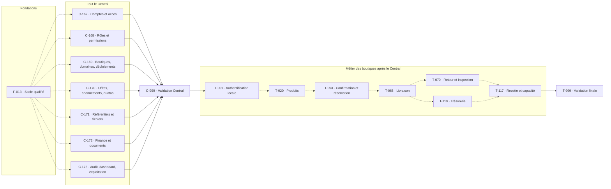

La réception d'un retour ne dépend pas d'une indemnisation ; l'émission d'une facture ne dépend pas nécessairement d'une remise de fonds. Les branches détaillées conservent ces distinctions.

## 10. Diagrammes détaillés des fondations et du Central

Chaque flèche pleine est un prérequis direct du tableau. Un nœud sous « Prérequis hors de ce bloc » est rappelé pour lecture, pas recréé comme tâche. Les blocs d'au plus douze tâches évitent un dessin unique de centaines de nœuds. Les recettes de jonction sont séparées pour éviter de réunir des centaines de prérequis dans une seule figure. Les blocs suivent le même tri vague/ID que les tableaux ; rechercher un ID retrouve son bloc.


### Fondations — bloc 1 : F-001 à F-012

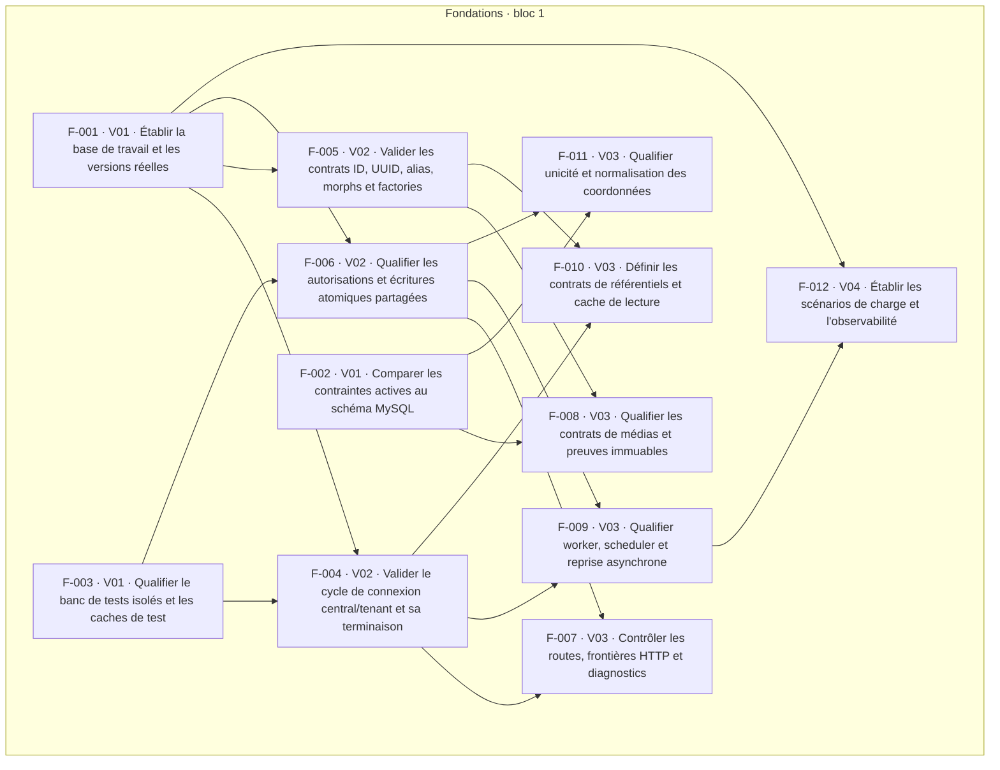


### Fondations — bloc 2 : F-013 à F-013

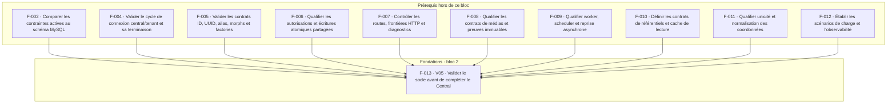


### Central — bloc 1 : C-001 à C-022

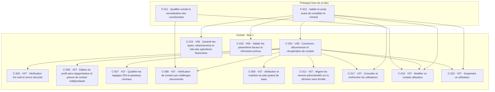


### Central — bloc 2 : C-023 à C-039

```mermaid
flowchart TD
  subgraph PRE["Prérequis hors de ce bloc"]
    F-013["F-013 · Valider le socle avant de compléter le Central"]
    C-001["C-001 · Connexion, déconnexion et récupération de compte"]
  end
  subgraph LOT["Central · bloc 2"]
    C-023["C-023 · V07 · Réactiver un utilisateur"]
    C-024["C-024 · V07 · Archiver un utilisateur"]
    C-025["C-025 · V07 · Consulter son dossier professionnel"]
    C-026["C-026 · V07 · Consulter l'historique administratif d'un utilisateur"]
    C-027["C-027 · V07 · Consulter les administrateurs du SaaS"]
    C-030["C-030 · V07 · Modifier les informations d'un administrateur"]
    C-032["C-032 · V07 · Consulter ses permissions effectives"]
    C-035["C-035 · V07 · Suspendre un administrateur"]
    C-036["C-036 · V07 · Réactiver un administrateur"]
    C-037["C-037 · V07 · Archiver un administrateur"]
    C-038["C-038 · V07 · Consulter les rôles SaaS"]
    C-039["C-039 · V07 · Créer un rôle SaaS"]
  end
  F-013 --> C-023
  C-001 --> C-023
  F-013 --> C-024
  C-001 --> C-024
  F-013 --> C-025
  C-001 --> C-025
  F-013 --> C-026
  C-001 --> C-026
  F-013 --> C-027
  C-001 --> C-027
  F-013 --> C-030
  C-001 --> C-030
  F-013 --> C-032
  C-001 --> C-032
  F-013 --> C-035
  C-001 --> C-035
  F-013 --> C-036
  C-001 --> C-036
  F-013 --> C-037
  C-001 --> C-037
  F-013 --> C-038
  C-001 --> C-038
  F-013 --> C-039
  C-001 --> C-039
```


### Central — bloc 3 : C-040 à C-055

```mermaid
flowchart TD
  subgraph PRE["Prérequis hors de ce bloc"]
    F-013["F-013 · Valider le socle avant de compléter le Central"]
    C-001["C-001 · Connexion, déconnexion et récupération de compte"]
  end
  subgraph LOT["Central · bloc 3"]
    C-040["C-040 · V07 · Modifier le nom et les informations d'un rôle"]
    C-041["C-041 · V07 · Supprimer un rôle personnalisable inutilisé"]
    C-042["C-042 · V07 · Consulter les permissions associées à un rôle"]
    C-043["C-043 · V07 · Ajouter ou retirer des permissions d'un rôle"]
    C-044["C-044 · V07 · Définir ou modifier la durée de chaque permission du rôle"]
    C-045["C-045 · V07 · Consulter les administrateurs possédant un rôle"]
    C-046["C-046 · V07 · Consulter et rechercher le catalogue des permissions"]
    C-047["C-047 · V07 · Consulter et rechercher toutes les boutiques"]
    C-050["C-050 · V07 · Suspendre une boutique"]
    C-052["C-052 · V07 · Archiver une boutique"]
    C-053["C-053 · V07 · Consulter l'historique administratif d'une boutique"]
    C-055["C-055 · V07 · Consulter les domaines des boutiques"]
  end
  F-013 --> C-040
  C-001 --> C-040
  F-013 --> C-041
  C-001 --> C-041
  F-013 --> C-042
  C-001 --> C-042
  F-013 --> C-043
  C-001 --> C-043
  F-013 --> C-044
  C-001 --> C-044
  F-013 --> C-045
  C-001 --> C-045
  F-013 --> C-046
  C-001 --> C-046
  F-013 --> C-047
  C-001 --> C-047
  F-013 --> C-050
  C-001 --> C-050
  F-013 --> C-052
  C-001 --> C-052
  F-013 --> C-053
  C-001 --> C-053
  F-013 --> C-055
  C-001 --> C-055
```


### Central — bloc 4 : C-061 à C-086

```mermaid
flowchart TD
  subgraph PRE["Prérequis hors de ce bloc"]
    F-013["F-013 · Valider le socle avant de compléter le Central"]
    C-001["C-001 · Connexion, déconnexion et récupération de compte"]
  end
  subgraph LOT["Central · bloc 4"]
    C-061["C-061 · V07 · Consulter les déploiements des BDD boutiques"]
    C-065["C-065 · V07 · Consulter les erreurs techniques nettoyées"]
    C-066["C-066 · V07 · Consulter les fonctionnalités commerciales"]
    C-067["C-067 · V07 · Créer une fonctionnalité"]
    C-068["C-068 · V07 · Modifier les paramètres d'une fonctionnalité"]
    C-069["C-069 · V07 · Activer ou désactiver une fonctionnalité"]
    C-070["C-070 · V07 · Archiver une fonctionnalité inutilisée"]
    C-071["C-071 · V07 · Consulter les plans et leurs versions"]
    C-073["C-073 · V07 · Modifier les informations modifiables d'un plan"]
    C-078["C-078 · V07 · Consulter et rechercher les abonnements"]
    C-084["C-084 · V07 · Consulter les échéances de paiement"]
    C-086["C-086 · V07 · Consulter l'historique des abonnements"]
  end
  F-013 --> C-061
  C-001 --> C-061
  F-013 --> C-065
  C-001 --> C-065
  F-013 --> C-066
  C-001 --> C-066
  F-013 --> C-067
  C-001 --> C-067
  F-013 --> C-068
  C-001 --> C-068
  F-013 --> C-069
  C-001 --> C-069
  F-013 --> C-070
  C-001 --> C-070
  F-013 --> C-071
  C-001 --> C-071
  F-013 --> C-073
  C-001 --> C-073
  F-013 --> C-078
  C-001 --> C-078
  F-013 --> C-084
  C-001 --> C-084
  F-013 --> C-086
  C-001 --> C-086
```


### Central — bloc 5 : C-087 à C-102

```mermaid
flowchart TD
  subgraph PRE["Prérequis hors de ce bloc"]
    F-013["F-013 · Valider le socle avant de compléter le Central"]
    C-001["C-001 · Connexion, déconnexion et récupération de compte"]
  end
  subgraph LOT["Central · bloc 5"]
    C-087["C-087 · V07 · Consulter les quotas et leur consommation"]
    C-089["C-089 · V07 · Consulter les décisions et changements de quotas"]
    C-090["C-090 · V07 · Consulter les pays"]
    C-091["C-091 · V07 · Ajouter un pays"]
    C-092["C-092 · V07 · Modifier les informations d'un pays"]
    C-093["C-093 · V07 · Activer ou désactiver un pays"]
    C-094["C-094 · V07 · Archiver un pays non utilisé"]
    C-095["C-095 · V07 · Consulter les wilayas et communes"]
    C-099["C-099 · V07 · Activer ou désactiver une zone"]
    C-100["C-100 · V07 · Archiver une zone autorisée"]
    C-101["C-101 · V07 · Consulter les transporteurs"]
    C-102["C-102 · V07 · Ajouter un transporteur"]
  end
  F-013 --> C-087
  C-001 --> C-087
  F-013 --> C-089
  C-001 --> C-089
  F-013 --> C-090
  C-001 --> C-090
  F-013 --> C-091
  C-001 --> C-091
  F-013 --> C-092
  C-001 --> C-092
  F-013 --> C-093
  C-001 --> C-093
  F-013 --> C-094
  C-001 --> C-094
  F-013 --> C-095
  C-001 --> C-095
  F-013 --> C-099
  C-001 --> C-099
  F-013 --> C-100
  C-001 --> C-100
  F-013 --> C-101
  C-001 --> C-101
  F-013 --> C-102
  C-001 --> C-102
```


### Central — bloc 6 : C-103 à C-120

```mermaid
flowchart TD
  subgraph PRE["Prérequis hors de ce bloc"]
    F-013["F-013 · Valider le socle avant de compléter le Central"]
    C-001["C-001 · Connexion, déconnexion et récupération de compte"]
  end
  subgraph LOT["Central · bloc 6"]
    C-103["C-103 · V07 · Modifier les informations d'un transporteur"]
    C-104["C-104 · V07 · Activer ou désactiver un transporteur"]
    C-105["C-105 · V07 · Archiver un transporteur autorisé"]
    C-106["C-106 · V07 · Consulter les correspondances géographiques"]
    C-110["C-110 · V07 · Archiver une correspondance"]
    C-111["C-111 · V07 · Consulter les bureaux de retrait"]
    C-115["C-115 · V07 · Activer ou désactiver un bureau"]
    C-116["C-116 · V07 · Archiver un bureau"]
    C-117["C-117 · V07 · Consulter les fichiers centraux"]
    C-118["C-118 · V07 · Importer un fichier autorisé"]
    C-119["C-119 · V07 · Télécharger un fichier privé autorisé"]
    C-120["C-120 · V07 · Archiver un fichier dont le retrait est permis"]
  end
  F-013 --> C-103
  C-001 --> C-103
  F-013 --> C-104
  C-001 --> C-104
  F-013 --> C-105
  C-001 --> C-105
  F-013 --> C-106
  C-001 --> C-106
  F-013 --> C-110
  C-001 --> C-110
  F-013 --> C-111
  C-001 --> C-111
  F-013 --> C-115
  C-001 --> C-115
  F-013 --> C-116
  C-001 --> C-116
  F-013 --> C-117
  C-001 --> C-117
  F-013 --> C-118
  C-001 --> C-118
  F-013 --> C-119
  C-001 --> C-119
  F-013 --> C-120
  C-001 --> C-120
```


### Central — bloc 7 : C-121 à C-151

```mermaid
flowchart TD
  subgraph PRE["Prérequis hors de ce bloc"]
    F-013["F-013 · Valider le socle avant de compléter le Central"]
    C-001["C-001 · Connexion, déconnexion et récupération de compte"]
    C-015["C-015 · Garantir les types, rattachements et clés des opérations financières"]
  end
  subgraph LOT["Central · bloc 7"]
    C-121["C-121 · V07 · Consulter les règles de facturation"]
    C-122["C-122 · V07 · Créer une règle de facturation"]
    C-123["C-123 · V07 · Modifier une règle encore modifiable"]
    C-126["C-126 · V07 · Consulter les compteurs et numérotations"]
    C-127["C-127 · V07 · Consulter et rechercher les factures"]
    C-131["C-131 · V07 · Consulter les avoirs"]
    C-134["C-134 · V07 · Consulter les paiements déclarés"]
    C-138["C-138 · V07 · Consulter les remboursements"]
    C-144["C-144 · V07 · Consulter les envois des documents"]
    C-147["C-147 · V07 · Consulter et rechercher les activités centrales"]
    C-148["C-148 · V07 · Exporter les activités autorisées"]
    C-151["C-151 · V07 · Consulter les opérations techniques centrales"]
  end
  F-013 --> C-121
  C-001 --> C-121
  F-013 --> C-122
  C-001 --> C-122
  C-015 --> C-122
  F-013 --> C-123
  C-001 --> C-123
  C-015 --> C-123
  F-013 --> C-126
  C-001 --> C-126
  C-015 --> C-126
  F-013 --> C-127
  C-001 --> C-127
  F-013 --> C-131
  C-001 --> C-131
  F-013 --> C-134
  C-001 --> C-134
  F-013 --> C-138
  C-001 --> C-138
  F-013 --> C-144
  C-001 --> C-144
  F-013 --> C-147
  C-001 --> C-147
  F-013 --> C-148
  C-001 --> C-148
  F-013 --> C-151
  C-001 --> C-151
```


### Central — bloc 8 : C-002 à C-098

```mermaid
flowchart TD
  subgraph PRE["Prérequis hors de ce bloc"]
    C-001["C-001 · Connexion, déconnexion et récupération de compte"]
    C-003["C-003 · Vérification d'e-mail et renvoi sécurisé"]
    C-009["C-009 · Attribution et maintien du plan gratuit de base"]
    C-005["C-005 · Édition du profil sans réapprobation et preuve de contact indépendante"]
    F-008["F-008 · Qualifier les contrats de médias et preuves immuables"]
    F-013["F-013 · Valider le socle avant de compléter le Central"]
    F-011["F-011 · Qualifier unicité et normalisation des coordonnées"]
    C-039["C-039 · Créer un rôle SaaS"]
    C-043["C-043 · Ajouter ou retirer des permissions d'un rôle"]
    C-032["C-032 · Consulter ses permissions effectives"]
    C-067["C-067 · Créer une fonctionnalité"]
    C-091["C-091 · Ajouter un pays"]
  end
  subgraph LOT["Central · bloc 8"]
    C-002["C-002 · V08 · Inscription publique guidée sans création de boutique"]
    C-004["C-004 · V08 · Session limitée et parcours prioritaire du commerçant"]
    C-006["C-006 · V08 · Photo privée centrale et avatar par défaut"]
    C-014["C-014 · V08 · Présentation publique/compte des offres et droits lisibles"]
    C-018["C-018 · V08 · Créer un compte utilisateur"]
    C-028["C-028 · V08 · Créer et inviter un administrateur"]
    C-033["C-033 · V08 · Attribuer ou retirer individuellement les permissions du personnel (transition Spatie validée le 21 octobre 2026)"]
    C-054["C-054 · V08 · Modifier la priorité d'activation des boutiques d'un propriétaire"]
    C-072["C-072 · V08 · Créer un nouveau plan"]
    C-096["C-096 · V08 · Ajouter une zone géographique"]
    C-097["C-097 · V08 · Modifier une zone géographique"]
    C-098["C-098 · V08 · Importer des wilayas et communes"]
  end
  C-001 --> C-002
  C-003 --> C-002
  C-009 --> C-002
  C-001 --> C-004
  C-003 --> C-004
  C-005 --> C-006
  F-008 --> C-006
  C-009 --> C-014
  F-013 --> C-018
  C-001 --> C-018
  C-009 --> C-018
  F-011 --> C-018
  F-013 --> C-028
  C-001 --> C-028
  C-039 --> C-028
  C-043 --> C-028
  F-013 --> C-033
  C-001 --> C-033
  C-032 --> C-033
  F-013 --> C-054
  C-001 --> C-054
  C-009 --> C-054
  F-013 --> C-072
  C-001 --> C-072
  C-067 --> C-072
  F-013 --> C-096
  C-001 --> C-096
  C-091 --> C-096
  F-013 --> C-097
  C-001 --> C-097
  C-091 --> C-097
  F-013 --> C-098
  C-001 --> C-098
  C-091 --> C-098
```


### Central — bloc 9 : C-124 à C-107

```mermaid
flowchart TD
  subgraph PRE["Prérequis hors de ce bloc"]
    F-013["F-013 · Valider le socle avant de compléter le Central"]
    C-001["C-001 · Connexion, déconnexion et récupération de compte"]
    C-016["C-016 · Valider les paramètres fiscaux et d'émission prévus"]
    C-122["C-122 · Créer une règle de facturation"]
    C-015["C-015 · Garantir les types, rattachements et clés des opérations financières"]
    C-017["C-017 · Consulter et rechercher les utilisateurs"]
    C-047["C-047 · Consulter et rechercher toutes les boutiques"]
    C-078["C-078 · Consulter et rechercher les abonnements"]
    C-004["C-004 · Session limitée et parcours prioritaire du commerçant"]
    C-009["C-009 · Attribution et maintien du plan gratuit de base"]
    C-018["C-018 · Créer un compte utilisateur"]
    C-028["C-028 · Créer et inviter un administrateur"]
    C-043["C-043 · Ajouter ou retirer des permissions d'un rôle"]
    C-033["C-033 · Attribuer ou retirer individuellement les permissions du personnel (transition Spatie validée le 21 octobre 2026)"]
    C-069["C-069 · Activer ou désactiver une fonctionnalité"]
    C-072["C-072 · Créer un nouveau plan"]
    C-096["C-096 · Ajouter une zone géographique"]
    C-102["C-102 · Ajouter un transporteur"]
  end
  subgraph LOT["Central · bloc 9"]
    C-124["C-124 · V08 · Activer ou désactiver une règle"]
    C-125["C-125 · V08 · Créer une nouvelle version de règle"]
    C-149["C-149 · V08 · Consulter le tableau de bord général"]
    C-010["C-010 · V09 · Première boutique obligatoire puis créations supplémentaires explicites"]
    C-020["C-020 · V09 · Approuver le compte et valider son dossier"]
    C-021["C-021 · V09 · Refuser le compte et rejeter son dossier avec motif obligatoire"]
    C-029["C-029 · V09 · Renvoyer une invitation"]
    C-031["C-031 · V09 · Attribuer, retirer ou remplacer ses rôles"]
    C-034["C-034 · V09 · Renouveler explicitement une attribution de rôle ou de permission (avec la fonctionaliter déjà existante de atribution et creation de role)"]
    C-074["C-074 · V09 · Définir les fonctionnalités et quotas d'un plan"]
    C-077["C-077 · V09 · Archiver une offre autorisée"]
    C-107["C-107 · V09 · Créer une correspondance"]
  end
  F-013 --> C-124
  C-001 --> C-124
  C-016 --> C-124
  C-122 --> C-124
  F-013 --> C-125
  C-001 --> C-125
  C-015 --> C-125
  C-122 --> C-125
  F-013 --> C-149
  C-001 --> C-149
  C-017 --> C-149
  C-047 --> C-149
  C-078 --> C-149
  C-004 --> C-010
  C-009 --> C-010
  F-013 --> C-020
  C-001 --> C-020
  C-018 --> C-020
  F-013 --> C-021
  C-001 --> C-021
  C-018 --> C-021
  F-013 --> C-029
  C-001 --> C-029
  C-028 --> C-029
  F-013 --> C-031
  C-001 --> C-031
  C-043 --> C-031
  C-028 --> C-031
  F-013 --> C-034
  C-001 --> C-034
  C-033 --> C-034
  F-013 --> C-074
  C-001 --> C-074
  C-069 --> C-074
  C-072 --> C-074
  F-013 --> C-077
  C-001 --> C-077
  C-072 --> C-077
  F-013 --> C-107
  C-001 --> C-107
  C-096 --> C-107
  C-102 --> C-107
```


### Central — bloc 10 : C-108 à C-049

```mermaid
flowchart TD
  subgraph PRE["Prérequis hors de ce bloc"]
    F-013["F-013 · Valider le socle avant de compléter le Central"]
    C-001["C-001 · Connexion, déconnexion et récupération de compte"]
    C-096["C-096 · Ajouter une zone géographique"]
    C-102["C-102 · Ajouter un transporteur"]
    C-010["C-010 · Première boutique obligatoire puis créations supplémentaires explicites"]
    F-009["F-009 · Qualifier worker, scheduler et reprise asynchrone"]
    C-074["C-074 · Définir les fonctionnalités et quotas d'un plan"]
    C-099["C-099 · Activer ou désactiver une zone"]
    C-104["C-104 · Activer ou désactiver un transporteur"]
    C-115["C-115 · Activer ou désactiver un bureau"]
    F-010["F-010 · Définir les contrats de référentiels et cache de lecture"]
  end
  subgraph LOT["Central · bloc 10"]
    C-108["C-108 · V09 · Modifier une correspondance"]
    C-109["C-109 · V09 · Importer les codes des transporteurs"]
    C-112["C-112 · V09 · Ajouter un bureau"]
    C-113["C-113 · V09 · Modifier un bureau"]
    C-114["C-114 · V09 · Importer les bureaux officiels"]
    C-011["C-011 · V10 · Provisionnement technique et activation éligible sans seconde approbation"]
    C-075["C-075 · V10 · Créer une nouvelle version d'un plan"]
    C-076["C-076 · V10 · Activer ou désactiver la commercialisation d'un plan"]
    C-163["C-163 · V10 · Publier les lectures centrales autorisées aux boutiques"]
    C-012["C-012 · V11 · Domaine initial et disponibilité centrale d'une boutique"]
    C-048["C-048 · V11 · Créer une boutique depuis l'administration"]
    C-049["C-049 · V11 · Modifier les informations centrales d'une boutique"]
  end
  F-013 --> C-108
  C-001 --> C-108
  C-096 --> C-108
  C-102 --> C-108
  F-013 --> C-109
  C-001 --> C-109
  C-096 --> C-109
  C-102 --> C-109
  F-013 --> C-112
  C-001 --> C-112
  C-096 --> C-112
  C-102 --> C-112
  F-013 --> C-113
  C-001 --> C-113
  C-096 --> C-113
  C-102 --> C-113
  F-013 --> C-114
  C-001 --> C-114
  C-096 --> C-114
  C-102 --> C-114
  C-010 --> C-011
  F-009 --> C-011
  F-013 --> C-075
  C-001 --> C-075
  C-074 --> C-075
  F-013 --> C-076
  C-001 --> C-076
  C-074 --> C-076
  C-099 --> C-163
  C-104 --> C-163
  C-109 --> C-163
  C-115 --> C-163
  F-010 --> C-163
  C-011 --> C-012
  F-013 --> C-048
  C-001 --> C-048
  C-010 --> C-048
  C-011 --> C-048
  F-013 --> C-049
  C-001 --> C-049
  C-011 --> C-049
```


### Central — bloc 11 : C-051 à C-081

```mermaid
flowchart TD
  subgraph PRE["Prérequis hors de ce bloc"]
    F-013["F-013 · Valider le socle avant de compléter le Central"]
    C-001["C-001 · Connexion, déconnexion et récupération de compte"]
    C-011["C-011 · Provisionnement technique et activation éligible sans seconde approbation"]
    F-009["F-009 · Qualifier worker, scheduler et reprise asynchrone"]
    C-076["C-076 · Activer ou désactiver la commercialisation d'un plan"]
    C-075["C-075 · Créer une nouvelle version d'un plan"]
    C-018["C-018 · Créer un compte utilisateur"]
    C-014["C-014 · Présentation publique/compte des offres et droits lisibles"]
    C-012["C-012 · Domaine initial et disponibilité centrale d'une boutique"]
  end
  subgraph LOT["Central · bloc 11"]
    C-051["C-051 · V11 · Réactiver une boutique éligible"]
    C-062["C-062 · V11 · Lancer un provisionnement autorisé"]
    C-063["C-063 · V11 · Lancer une migration vers une version prévue"]
    C-064["C-064 · V11 · Relancer un déploiement en échec"]
    C-079["C-079 · V11 · Attribuer un abonnement à un utilisateur"]
    C-080["C-080 · V11 · Changer le plan d'un abonnement"]
    C-154["C-154 · V11 · Raccorder les offres commercialisées au parcours propriétaire"]
    C-056["C-056 · V12 · Ajouter un domaine à une boutique"]
    C-057["C-057 · V12 · Modifier les informations d'un domaine"]
    C-058["C-058 · V12 · Lancer la vérification d'un domaine"]
    C-060["C-060 · V12 · Retirer ou archiver un domaine"]
    C-081["C-081 · V12 · Modifier les dates de période selon les transitions autorisées"]
  end
  F-013 --> C-051
  C-001 --> C-051
  C-011 --> C-051
  F-013 --> C-062
  C-001 --> C-062
  C-011 --> C-062
  F-009 --> C-062
  F-013 --> C-063
  C-001 --> C-063
  C-011 --> C-063
  F-009 --> C-063
  F-013 --> C-064
  C-001 --> C-064
  C-011 --> C-064
  F-009 --> C-064
  F-013 --> C-079
  C-001 --> C-079
  C-076 --> C-079
  C-075 --> C-079
  C-018 --> C-079
  F-013 --> C-080
  C-001 --> C-080
  C-076 --> C-080
  C-075 --> C-080
  C-018 --> C-080
  C-014 --> C-154
  C-076 --> C-154
  F-013 --> C-056
  C-001 --> C-056
  C-012 --> C-056
  F-013 --> C-057
  C-001 --> C-057
  C-012 --> C-057
  F-013 --> C-058
  C-001 --> C-058
  C-012 --> C-058
  F-013 --> C-060
  C-001 --> C-060
  C-012 --> C-060
  F-013 --> C-081
  C-001 --> C-081
  C-079 --> C-081
```


### Central — bloc 12 : C-082 à C-164

```mermaid
flowchart TD
  subgraph PRE["Prérequis hors de ce bloc"]
    F-013["F-013 · Valider le socle avant de compléter le Central"]
    C-001["C-001 · Connexion, déconnexion et récupération de compte"]
    C-079["C-079 · Attribuer un abonnement à un utilisateur"]
    C-054["C-054 · Modifier la priorité d'activation des boutiques d'un propriétaire"]
    C-012["C-012 · Domaine initial et disponibilité centrale d'une boutique"]
    C-058["C-058 · Lancer la vérification d'un domaine"]
    C-015["C-015 · Garantir les types, rattachements et clés des opérations financières"]
    C-124["C-124 · Activer ou désactiver une règle"]
    F-008["F-008 · Qualifier les contrats de médias et preuves immuables"]
    C-081["C-081 · Modifier les dates de période selon les transitions autorisées"]
    C-074["C-074 · Définir les fonctionnalités et quotas d'un plan"]
    C-056["C-056 · Ajouter un domaine à une boutique"]
    C-060["C-060 · Retirer ou archiver un domaine"]
  end
  subgraph LOT["Central · bloc 12"]
    C-082["C-082 · V12 · Modifier le renouvellement futur"]
    C-083["C-083 · V12 · Mettre fin à un abonnement selon sa date d'effet"]
    C-085["C-085 · V12 · Créer une échéance autorisée"]
    C-088["C-088 · V12 · Lancer un recalcul contrôlé des quotas et états des boutiques"]
    C-059["C-059 · V13 · Définir le domaine principal"]
    C-128["C-128 · V13 · Préparer une facture"]
    C-137["C-137 · V13 · Rapprocher un paiement avec les fonds et documents correspondants"]
    C-152["C-152 · V13 · Lancer une réconciliation des abonnements"]
    C-155["C-155 · V13 · Expiration payante et retour gratuit sans réinitialiser les boutiques"]
    C-156["C-156 · V13 · Consommation atomique et libération des quotas par portée/période"]
    C-157["C-157 · V13 · Espace propriétaire : échéances et déclaration de paiement"]
    C-164["C-164 · V13 · Restaurer une adresse archivée sans perdre la réservation globale"]
  end
  F-013 --> C-082
  C-001 --> C-082
  C-079 --> C-082
  F-013 --> C-083
  C-001 --> C-083
  C-079 --> C-083
  F-013 --> C-085
  C-001 --> C-085
  C-079 --> C-085
  F-013 --> C-088
  C-001 --> C-088
  C-079 --> C-088
  C-054 --> C-088
  F-013 --> C-059
  C-001 --> C-059
  C-012 --> C-059
  C-058 --> C-059
  F-013 --> C-128
  C-001 --> C-128
  C-015 --> C-128
  C-085 --> C-128
  C-124 --> C-128
  F-013 --> C-137
  C-001 --> C-137
  C-015 --> C-137
  C-085 --> C-137
  F-008 --> C-137
  F-013 --> C-152
  C-001 --> C-152
  C-088 --> C-152
  C-081 --> C-155
  C-088 --> C-155
  C-074 --> C-156
  C-088 --> C-156
  C-085 --> C-157
  F-008 --> C-157
  C-056 --> C-164
  C-060 --> C-164
```


### Central — bloc 13 : C-166 à C-158

```mermaid
flowchart TD
  subgraph PRE["Prérequis hors de ce bloc"]
    C-079["C-079 · Attribuer un abonnement à un utilisateur"]
    C-080["C-080 · Changer le plan d'un abonnement"]
    C-083["C-083 · Mettre fin à un abonnement selon sa date d'effet"]
    F-013["F-013 · Valider le socle avant de compléter le Central"]
    C-001["C-001 · Connexion, déconnexion et récupération de compte"]
    C-128["C-128 · Préparer une facture"]
    F-008["F-008 · Qualifier les contrats de médias et preuves immuables"]
    C-015["C-015 · Garantir les types, rattachements et clés des opérations financières"]
    C-085["C-085 · Créer une échéance autorisée"]
    C-157["C-157 · Espace propriétaire : échéances et déclaration de paiement"]
    C-119["C-119 · Télécharger un fichier privé autorisé"]
    F-009["F-009 · Qualifier worker, scheduler et reprise asynchrone"]
  end
  subgraph LOT["Central · bloc 13"]
    C-166["C-166 · V13 · Intégrer les permissions détaillées d'abonnement sans altérer les droits existants"]
    C-129["C-129 · V14 · Émettre définitivement une facture"]
    C-135["C-135 · V14 · Valider un paiement après vérification"]
    C-136["C-136 · V14 · Rejeter une déclaration de paiement"]
    C-130["C-130 · V15 · Télécharger le PDF d'une facture"]
    C-132["C-132 · V15 · Préparer un avoir"]
    C-145["C-145 · V15 · Demander l'envoi d'un document"]
    C-133["C-133 · V16 · Émettre un avoir"]
    C-161["C-161 · V16 · Gérer intention/résultat incertain et remise SaaS"]
    C-139["C-139 · V17 · Préparer un remboursement"]
    C-146["C-146 · V17 · Relancer un envoi échoué autorisé"]
    C-158["C-158 · V17 · Solde SaaS, fonds conservés et paiements partiels"]
  end
  C-079 --> C-166
  C-080 --> C-166
  C-083 --> C-166
  F-013 --> C-129
  C-001 --> C-129
  C-128 --> C-129
  F-008 --> C-129
  F-013 --> C-135
  C-001 --> C-135
  C-015 --> C-135
  C-085 --> C-135
  F-008 --> C-135
  C-157 --> C-135
  F-013 --> C-136
  C-001 --> C-136
  C-015 --> C-136
  C-085 --> C-136
  F-008 --> C-136
  C-157 --> C-136
  F-013 --> C-130
  C-001 --> C-130
  C-129 --> C-130
  C-119 --> C-130
  F-013 --> C-132
  C-001 --> C-132
  C-129 --> C-132
  F-013 --> C-145
  C-001 --> C-145
  C-129 --> C-145
  F-009 --> C-145
  F-013 --> C-133
  C-001 --> C-133
  C-132 --> C-133
  C-145 --> C-161
  F-013 --> C-139
  C-001 --> C-139
  C-135 --> C-139
  C-133 --> C-139
  F-013 --> C-146
  C-001 --> C-146
  C-145 --> C-146
  C-161 --> C-146
  C-135 --> C-158
  C-133 --> C-158
```


### Central — bloc 14 : C-160 à C-159

```mermaid
flowchart TD
  subgraph PRE["Prérequis hors de ce bloc"]
    C-129["C-129 · Émettre définitivement une facture"]
    C-133["C-133 · Émettre un avoir"]
    C-012["C-012 · Domaine initial et disponibilité centrale d'une boutique"]
    C-161["C-161 · Gérer intention/résultat incertain et remise SaaS"]
    F-012["F-012 · Établir les scénarios de charge et l'observabilité"]
    F-013["F-013 · Valider le socle avant de compléter le Central"]
    C-001["C-001 · Connexion, déconnexion et récupération de compte"]
    C-139["C-139 · Préparer un remboursement"]
    C-130["C-130 · Télécharger le PDF d'une facture"]
    C-158["C-158 · Solde SaaS, fonds conservés et paiements partiels"]
    C-137["C-137 · Rapprocher un paiement avec les fonds et documents correspondants"]
  end
  subgraph LOT["Central · bloc 14"]
    C-160["C-160 · V17 · Récupérer une émission PREPARING sans renuméroter"]
    C-165["C-165 · V17 · Recette de la desserte réelle, des e-mails et de la supervision"]
    C-140["C-140 · V18 · Approuver un remboursement"]
    C-141["C-141 · V18 · Rejeter un remboursement"]
    C-162["C-162 · V18 · Lecture/téléchargement des documents et transferts du propriétaire"]
    C-142["C-142 · V19 · Enregistrer un remboursement réellement exécuté"]
    C-143["C-143 · V20 · Vérifier et rapprocher un remboursement"]
    C-150["C-150 · V21 · Consulter les indicateurs financiers globaux"]
    C-153["C-153 · V21 · Lancer un rapprochement financier central"]
    C-159["C-159 · V21 · Contrepassation financière centrale liée à l'original"]
  end
  C-129 --> C-160
  C-133 --> C-160
  C-012 --> C-165
  C-161 --> C-165
  F-012 --> C-165
  F-013 --> C-140
  C-001 --> C-140
  C-139 --> C-140
  F-013 --> C-141
  C-001 --> C-141
  C-139 --> C-141
  C-130 --> C-162
  C-133 --> C-162
  C-158 --> C-162
  F-013 --> C-142
  C-001 --> C-142
  C-140 --> C-142
  F-013 --> C-143
  C-001 --> C-143
  C-142 --> C-143
  C-137 --> C-143
  F-013 --> C-150
  C-001 --> C-150
  C-137 --> C-150
  C-143 --> C-150
  C-133 --> C-150
  F-013 --> C-153
  C-001 --> C-153
  C-137 --> C-153
  C-143 --> C-153
  C-158 --> C-159
  C-143 --> C-159
```


### Jonction C-171 — Recette intégrée — Référentiels et fichiers

```mermaid
flowchart TD
  subgraph PRE["Prérequis hors de ce bloc"]
    C-090["C-090 · Consulter les pays"]
    C-091["C-091 · Ajouter un pays"]
    C-092["C-092 · Modifier les informations d'un pays"]
    C-093["C-093 · Activer ou désactiver un pays"]
    C-094["C-094 · Archiver un pays non utilisé"]
    C-095["C-095 · Consulter les wilayas et communes"]
    C-096["C-096 · Ajouter une zone géographique"]
    C-097["C-097 · Modifier une zone géographique"]
    C-098["C-098 · Importer des wilayas et communes"]
    C-099["C-099 · Activer ou désactiver une zone"]
    C-100["C-100 · Archiver une zone autorisée"]
    C-101["C-101 · Consulter les transporteurs"]
    C-102["C-102 · Ajouter un transporteur"]
    C-103["C-103 · Modifier les informations d'un transporteur"]
    C-104["C-104 · Activer ou désactiver un transporteur"]
    C-105["C-105 · Archiver un transporteur autorisé"]
    C-106["C-106 · Consulter les correspondances géographiques"]
    C-107["C-107 · Créer une correspondance"]
    C-108["C-108 · Modifier une correspondance"]
    C-109["C-109 · Importer les codes des transporteurs"]
    C-110["C-110 · Archiver une correspondance"]
    C-111["C-111 · Consulter les bureaux de retrait"]
    C-112["C-112 · Ajouter un bureau"]
    C-113["C-113 · Modifier un bureau"]
    C-114["C-114 · Importer les bureaux officiels"]
    C-115["C-115 · Activer ou désactiver un bureau"]
    C-116["C-116 · Archiver un bureau"]
    C-117["C-117 · Consulter les fichiers centraux"]
    C-118["C-118 · Importer un fichier autorisé"]
    C-119["C-119 · Télécharger un fichier privé autorisé"]
    C-120["C-120 · Archiver un fichier dont le retrait est permis"]
    C-163["C-163 · Publier les lectures centrales autorisées aux boutiques"]
  end
  subgraph LOT["Recette intégrée — Référentiels et fichiers"]
    C-171["C-171 · V11 · Recette intégrée — Référentiels et fichiers"]
  end
  C-090 --> C-171
  C-091 --> C-171
  C-092 --> C-171
  C-093 --> C-171
  C-094 --> C-171
  C-095 --> C-171
  C-096 --> C-171
  C-097 --> C-171
  C-098 --> C-171
  C-099 --> C-171
  C-100 --> C-171
  C-101 --> C-171
  C-102 --> C-171
  C-103 --> C-171
  C-104 --> C-171
  C-105 --> C-171
  C-106 --> C-171
  C-107 --> C-171
  C-108 --> C-171
  C-109 --> C-171
  C-110 --> C-171
  C-111 --> C-171
  C-112 --> C-171
  C-113 --> C-171
  C-114 --> C-171
  C-115 --> C-171
  C-116 --> C-171
  C-117 --> C-171
  C-118 --> C-171
  C-119 --> C-171
  C-120 --> C-171
  C-163 --> C-171
```


### Jonction C-167 — Recette intégrée — Accès, comptes et décisions

```mermaid
flowchart TD
  subgraph PRE["Prérequis hors de ce bloc"]
    C-001["C-001 · Connexion, déconnexion et récupération de compte"]
    C-002["C-002 · Inscription publique guidée sans création de boutique"]
    C-003["C-003 · Vérification d'e-mail et renvoi sécurisé"]
    C-004["C-004 · Session limitée et parcours prioritaire du commerçant"]
    C-005["C-005 · Édition du profil sans réapprobation et preuve de contact indépendante"]
    C-006["C-006 · Photo privée centrale et avatar par défaut"]
    C-007["C-007 · Qualifier les réglages 2FA et passkeys centraux"]
    C-008["C-008 · Vérification de contact par challenges documentés"]
    C-009["C-009 · Attribution et maintien du plan gratuit de base"]
    C-010["C-010 · Première boutique obligatoire puis créations supplémentaires explicites"]
    C-011["C-011 · Provisionnement technique et activation éligible sans seconde approbation"]
    C-012["C-012 · Domaine initial et disponibilité centrale d'une boutique"]
    C-013["C-013 · Aligner les renvois administratifs sur la décision sans throttle"]
    C-017["C-017 · Consulter et rechercher les utilisateurs"]
    C-018["C-018 · Créer un compte utilisateur"]
    C-019["C-019 · Modifier un compte utilisateur"]
    C-020["C-020 · Approuver le compte et valider son dossier"]
    C-021["C-021 · Refuser le compte et rejeter son dossier avec motif obligatoire"]
    C-022["C-022 · Suspendre un utilisateur"]
    C-023["C-023 · Réactiver un utilisateur"]
    C-024["C-024 · Archiver un utilisateur"]
    C-025["C-025 · Consulter son dossier professionnel"]
    C-026["C-026 · Consulter l'historique administratif d'un utilisateur"]
    C-027["C-027 · Consulter les administrateurs du SaaS"]
    C-028["C-028 · Créer et inviter un administrateur"]
    C-029["C-029 · Renvoyer une invitation"]
    C-030["C-030 · Modifier les informations d'un administrateur"]
    C-031["C-031 · Attribuer, retirer ou remplacer ses rôles"]
    C-032["C-032 · Consulter ses permissions effectives"]
    C-033["C-033 · Attribuer ou retirer individuellement les permissions du personnel (transition Spatie validée le 21 octobre 2026)"]
    C-034["C-034 · Renouveler explicitement une attribution de rôle ou de permission (avec la fonctionaliter déjà existante de atribution et creation de role)"]
    C-035["C-035 · Suspendre un administrateur"]
    C-036["C-036 · Réactiver un administrateur"]
    C-037["C-037 · Archiver un administrateur"]
  end
  subgraph LOT["Recette intégrée — Accès, comptes et décisions"]
    C-167["C-167 · V12 · Recette intégrée — Accès, comptes et décisions"]
  end
  C-001 --> C-167
  C-002 --> C-167
  C-003 --> C-167
  C-004 --> C-167
  C-005 --> C-167
  C-006 --> C-167
  C-007 --> C-167
  C-008 --> C-167
  C-009 --> C-167
  C-010 --> C-167
  C-011 --> C-167
  C-012 --> C-167
  C-013 --> C-167
  C-017 --> C-167
  C-018 --> C-167
  C-019 --> C-167
  C-020 --> C-167
  C-021 --> C-167
  C-022 --> C-167
  C-023 --> C-167
  C-024 --> C-167
  C-025 --> C-167
  C-026 --> C-167
  C-027 --> C-167
  C-028 --> C-167
  C-029 --> C-167
  C-030 --> C-167
  C-031 --> C-167
  C-032 --> C-167
  C-033 --> C-167
  C-034 --> C-167
  C-035 --> C-167
  C-036 --> C-167
  C-037 --> C-167
```


### Jonction C-168 — Recette intégrée — Rôles et catalogue des droits

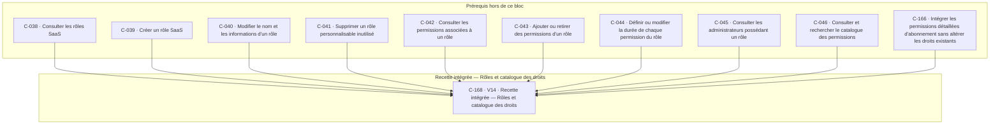


### Jonction C-169 — Recette intégrée — Boutiques, domaines et déploiements

```mermaid
flowchart TD
  subgraph PRE["Prérequis hors de ce bloc"]
    C-047["C-047 · Consulter et rechercher toutes les boutiques"]
    C-048["C-048 · Créer une boutique depuis l'administration"]
    C-049["C-049 · Modifier les informations centrales d'une boutique"]
    C-050["C-050 · Suspendre une boutique"]
    C-051["C-051 · Réactiver une boutique éligible"]
    C-052["C-052 · Archiver une boutique"]
    C-053["C-053 · Consulter l'historique administratif d'une boutique"]
    C-054["C-054 · Modifier la priorité d'activation des boutiques d'un propriétaire"]
    C-055["C-055 · Consulter les domaines des boutiques"]
    C-056["C-056 · Ajouter un domaine à une boutique"]
    C-057["C-057 · Modifier les informations d'un domaine"]
    C-058["C-058 · Lancer la vérification d'un domaine"]
    C-059["C-059 · Définir le domaine principal"]
    C-060["C-060 · Retirer ou archiver un domaine"]
    C-061["C-061 · Consulter les déploiements des BDD boutiques"]
    C-062["C-062 · Lancer un provisionnement autorisé"]
    C-063["C-063 · Lancer une migration vers une version prévue"]
    C-064["C-064 · Relancer un déploiement en échec"]
    C-065["C-065 · Consulter les erreurs techniques nettoyées"]
    C-164["C-164 · Restaurer une adresse archivée sans perdre la réservation globale"]
  end
  subgraph LOT["Recette intégrée — Boutiques, domaines et déploiements"]
    C-169["C-169 · V14 · Recette intégrée — Boutiques, domaines et déploiements"]
  end
  C-047 --> C-169
  C-048 --> C-169
  C-049 --> C-169
  C-050 --> C-169
  C-051 --> C-169
  C-052 --> C-169
  C-053 --> C-169
  C-054 --> C-169
  C-055 --> C-169
  C-056 --> C-169
  C-057 --> C-169
  C-058 --> C-169
  C-059 --> C-169
  C-060 --> C-169
  C-061 --> C-169
  C-062 --> C-169
  C-063 --> C-169
  C-064 --> C-169
  C-065 --> C-169
  C-164 --> C-169
```


### Jonction C-170 — Recette intégrée — Offres, abonnements et quotas

```mermaid
flowchart TD
  subgraph PRE["Prérequis hors de ce bloc"]
    C-014["C-014 · Présentation publique/compte des offres et droits lisibles"]
    C-066["C-066 · Consulter les fonctionnalités commerciales"]
    C-067["C-067 · Créer une fonctionnalité"]
    C-068["C-068 · Modifier les paramètres d'une fonctionnalité"]
    C-069["C-069 · Activer ou désactiver une fonctionnalité"]
    C-070["C-070 · Archiver une fonctionnalité inutilisée"]
    C-071["C-071 · Consulter les plans et leurs versions"]
    C-072["C-072 · Créer un nouveau plan"]
    C-073["C-073 · Modifier les informations modifiables d'un plan"]
    C-074["C-074 · Définir les fonctionnalités et quotas d'un plan"]
    C-075["C-075 · Créer une nouvelle version d'un plan"]
    C-076["C-076 · Activer ou désactiver la commercialisation d'un plan"]
    C-077["C-077 · Archiver une offre autorisée"]
    C-078["C-078 · Consulter et rechercher les abonnements"]
    C-079["C-079 · Attribuer un abonnement à un utilisateur"]
    C-080["C-080 · Changer le plan d'un abonnement"]
    C-081["C-081 · Modifier les dates de période selon les transitions autorisées"]
    C-082["C-082 · Modifier le renouvellement futur"]
    C-083["C-083 · Mettre fin à un abonnement selon sa date d'effet"]
    C-084["C-084 · Consulter les échéances de paiement"]
    C-085["C-085 · Créer une échéance autorisée"]
    C-086["C-086 · Consulter l'historique des abonnements"]
    C-087["C-087 · Consulter les quotas et leur consommation"]
    C-088["C-088 · Lancer un recalcul contrôlé des quotas et états des boutiques"]
    C-089["C-089 · Consulter les décisions et changements de quotas"]
    C-154["C-154 · Raccorder les offres commercialisées au parcours propriétaire"]
    C-155["C-155 · Expiration payante et retour gratuit sans réinitialiser les boutiques"]
    C-156["C-156 · Consommation atomique et libération des quotas par portée/période"]
  end
  subgraph LOT["Recette intégrée — Offres, abonnements et quotas"]
    C-170["C-170 · V14 · Recette intégrée — Offres, abonnements et quotas"]
  end
  C-014 --> C-170
  C-066 --> C-170
  C-067 --> C-170
  C-068 --> C-170
  C-069 --> C-170
  C-070 --> C-170
  C-071 --> C-170
  C-072 --> C-170
  C-073 --> C-170
  C-074 --> C-170
  C-075 --> C-170
  C-076 --> C-170
  C-077 --> C-170
  C-078 --> C-170
  C-079 --> C-170
  C-080 --> C-170
  C-081 --> C-170
  C-082 --> C-170
  C-083 --> C-170
  C-084 --> C-170
  C-085 --> C-170
  C-086 --> C-170
  C-087 --> C-170
  C-088 --> C-170
  C-089 --> C-170
  C-154 --> C-170
  C-155 --> C-170
  C-156 --> C-170
```


### Jonction C-172 — Recette intégrée — Finance et documents

```mermaid
flowchart TD
  subgraph PRE["Prérequis hors de ce bloc"]
    C-015["C-015 · Garantir les types, rattachements et clés des opérations financières"]
    C-016["C-016 · Valider les paramètres fiscaux et d'émission prévus"]
    C-121["C-121 · Consulter les règles de facturation"]
    C-122["C-122 · Créer une règle de facturation"]
    C-123["C-123 · Modifier une règle encore modifiable"]
    C-124["C-124 · Activer ou désactiver une règle"]
    C-125["C-125 · Créer une nouvelle version de règle"]
    C-126["C-126 · Consulter les compteurs et numérotations"]
    C-127["C-127 · Consulter et rechercher les factures"]
    C-128["C-128 · Préparer une facture"]
    C-129["C-129 · Émettre définitivement une facture"]
    C-130["C-130 · Télécharger le PDF d'une facture"]
    C-131["C-131 · Consulter les avoirs"]
    C-132["C-132 · Préparer un avoir"]
    C-133["C-133 · Émettre un avoir"]
    C-134["C-134 · Consulter les paiements déclarés"]
    C-135["C-135 · Valider un paiement après vérification"]
    C-136["C-136 · Rejeter une déclaration de paiement"]
    C-137["C-137 · Rapprocher un paiement avec les fonds et documents correspondants"]
    C-138["C-138 · Consulter les remboursements"]
    C-139["C-139 · Préparer un remboursement"]
    C-140["C-140 · Approuver un remboursement"]
    C-141["C-141 · Rejeter un remboursement"]
    C-142["C-142 · Enregistrer un remboursement réellement exécuté"]
    C-143["C-143 · Vérifier et rapprocher un remboursement"]
    C-144["C-144 · Consulter les envois des documents"]
    C-145["C-145 · Demander l'envoi d'un document"]
    C-146["C-146 · Relancer un envoi échoué autorisé"]
    C-157["C-157 · Espace propriétaire : échéances et déclaration de paiement"]
    C-158["C-158 · Solde SaaS, fonds conservés et paiements partiels"]
    C-159["C-159 · Contrepassation financière centrale liée à l'original"]
    C-160["C-160 · Récupérer une émission PREPARING sans renuméroter"]
    C-161["C-161 · Gérer intention/résultat incertain et remise SaaS"]
    C-162["C-162 · Lecture/téléchargement des documents et transferts du propriétaire"]
  end
  subgraph LOT["Recette intégrée — Finance et documents"]
    C-172["C-172 · V22 · Recette intégrée — Finance et documents"]
  end
  C-015 --> C-172
  C-016 --> C-172
  C-121 --> C-172
  C-122 --> C-172
  C-123 --> C-172
  C-124 --> C-172
  C-125 --> C-172
  C-126 --> C-172
  C-127 --> C-172
  C-128 --> C-172
  C-129 --> C-172
  C-130 --> C-172
  C-131 --> C-172
  C-132 --> C-172
  C-133 --> C-172
  C-134 --> C-172
  C-135 --> C-172
  C-136 --> C-172
  C-137 --> C-172
  C-138 --> C-172
  C-139 --> C-172
  C-140 --> C-172
  C-141 --> C-172
  C-142 --> C-172
  C-143 --> C-172
  C-144 --> C-172
  C-145 --> C-172
  C-146 --> C-172
  C-157 --> C-172
  C-158 --> C-172
  C-159 --> C-172
  C-160 --> C-172
  C-161 --> C-172
  C-162 --> C-172
```


### Jonction C-173 — Recette intégrée — Audit, indicateurs et exploitation

```mermaid
flowchart TD
  subgraph PRE["Prérequis hors de ce bloc"]
    C-147["C-147 · Consulter et rechercher les activités centrales"]
    C-148["C-148 · Exporter les activités autorisées"]
    C-149["C-149 · Consulter le tableau de bord général"]
    C-150["C-150 · Consulter les indicateurs financiers globaux"]
    C-151["C-151 · Consulter les opérations techniques centrales"]
    C-152["C-152 · Lancer une réconciliation des abonnements"]
    C-153["C-153 · Lancer un rapprochement financier central"]
    C-165["C-165 · Recette de la desserte réelle, des e-mails et de la supervision"]
  end
  subgraph LOT["Recette intégrée — Audit, indicateurs et exploitation"]
    C-173["C-173 · V22 · Recette intégrée — Audit, indicateurs et exploitation"]
  end
  C-147 --> C-173
  C-148 --> C-173
  C-149 --> C-173
  C-150 --> C-173
  C-151 --> C-173
  C-152 --> C-173
  C-153 --> C-173
  C-165 --> C-173
```


### Jonction C-999 — Valider tout le Central et autoriser la phase métier boutiques

```mermaid
flowchart TD
  subgraph PRE["Prérequis hors de ce bloc"]
    C-167["C-167 · Recette intégrée — Accès, comptes et décisions"]
    C-168["C-168 · Recette intégrée — Rôles et catalogue des droits"]
    C-169["C-169 · Recette intégrée — Boutiques, domaines et déploiements"]
    C-170["C-170 · Recette intégrée — Offres, abonnements et quotas"]
    C-171["C-171 · Recette intégrée — Référentiels et fichiers"]
    C-172["C-172 · Recette intégrée — Finance et documents"]
    C-173["C-173 · Recette intégrée — Audit, indicateurs et exploitation"]
  end
  subgraph LOT["Valider tout le Central et autoriser la phase métier boutiques"]
    C-999["C-999 · V23 · Valider tout le Central et autoriser la phase métier boutiques"]
  end
  C-167 --> C-999
  C-168 --> C-999
  C-169 --> C-999
  C-170 --> C-999
  C-171 --> C-999
  C-172 --> C-999
  C-173 --> C-999
```


## 11. Diagrammes détaillés des boutiques

Même convention que le §10. Toutes les racines Tenant sont reliées à C-999, directement ou par leurs prérequis ; aucune branche commerciale ne commence avant ce jalon. T-999 rejoint aussi les branches indépendantes telles que médias personnels, invitations, adresses, tags, avis, ajustements et transformations de stock.


### Boutiques — bloc 1 : T-001 à T-019

```mermaid
flowchart TD
  subgraph PRE["Prérequis hors de ce bloc"]
    C-999["C-999 · Valider tout le Central et autoriser la phase métier boutiques"]
  end
  subgraph LOT["Boutiques · bloc 1"]
    T-001["T-001 · V24 · Activer l'authentification locale de boutique"]
    T-002["T-002 · V25 · Vérification locale des contacts et récupération de compte"]
    T-003["T-003 · V25 · Modifier le profil personnel et la photo locale"]
    T-004["T-004 · V25 · Créer, consulter et modifier les rôles locaux"]
    T-006["T-006 · V25 · Consulter, modifier, suspendre ou archiver les membres locaux"]
    T-010["T-010 · V25 · Journaliser les mutations locales et consulter l'audit autorisé"]
    T-037["T-037 · V25 · Sélectionner wilayas/communes/bureaux centraux autorisés"]
    T-005["T-005 · V26 · Configurer les durées et la composition des rôles locaux"]
    T-012["T-012 · V26 · Afficher et modifier le profil singleton de boutique"]
    T-016["T-016 · V26 · Téléverser, rattacher et lire les médias locaux autorisés"]
    T-018["T-018 · V26 · Gérer la hiérarchie des catégories"]
    T-019["T-019 · V26 · Gérer les étiquettes et leurs liaisons produit"]
  end
  C-999 --> T-001
  T-001 --> T-002
  T-001 --> T-003
  T-001 --> T-004
  T-001 --> T-006
  T-001 --> T-010
  T-001 --> T-037
  T-004 --> T-005
  T-001 --> T-012
  T-010 --> T-012
  T-001 --> T-016
  T-010 --> T-016
  T-001 --> T-018
  T-010 --> T-018
  T-001 --> T-019
  T-010 --> T-019
```


### Boutiques — bloc 2 : T-007 à T-021

```mermaid
flowchart TD
  subgraph PRE["Prérequis hors de ce bloc"]
    T-005["T-005 · Configurer les durées et la composition des rôles locaux"]
    T-006["T-006 · Consulter, modifier, suspendre ou archiver les membres locaux"]
    T-012["T-012 · Afficher et modifier le profil singleton de boutique"]
    T-016["T-016 · Téléverser, rattacher et lire les médias locaux autorisés"]
    T-018["T-018 · Gérer la hiérarchie des catégories"]
    T-002["T-002 · Vérification locale des contacts et récupération de compte"]
  end
  subgraph LOT["Boutiques · bloc 2"]
    T-007["T-007 · V27 · Inviter un membre d'équipe dans le quota"]
    T-009["T-009 · V27 · Attribuer, retirer ou renouveler les autorisations locales"]
    T-013["T-013 · V27 · Gérer les adresses publiques et horaires"]
    T-014["T-014 · V27 · Gérer les liens sociaux publics"]
    T-015["T-015 · V27 · Configurer présentation, contacts, logo et thème"]
    T-017["T-017 · V27 · Gérer et publier les pages de contenu"]
    T-020["T-020 · V27 · Créer et modifier un produit physique simple"]
    T-008["T-008 · V28 · Accepter une invitation et attribuer les droits locaux"]
    T-011["T-011 · V28 · Protéger les coûts, marges et actions financières"]
    T-022["T-022 · V28 · Définir les axes et valeurs d'options"]
    T-036["T-036 · V28 · Versionner les conditions et prouver leur acceptation réelle"]
    T-021["T-021 · V29 · Gérer les variantes achetables, prix et coûts"]
  end
  T-005 --> T-007
  T-005 --> T-009
  T-006 --> T-009
  T-012 --> T-013
  T-012 --> T-014
  T-012 --> T-015
  T-012 --> T-017
  T-016 --> T-017
  T-018 --> T-020
  T-007 --> T-008
  T-002 --> T-008
  T-009 --> T-011
  T-020 --> T-022
  T-017 --> T-036
  T-020 --> T-021
  T-011 --> T-021
```


### Boutiques — bloc 3 : T-038 à T-043

```mermaid
flowchart TD
  subgraph PRE["Prérequis hors de ce bloc"]
    T-001["T-001 · Activer l'authentification locale de boutique"]
    T-011["T-011 · Protéger les coûts, marges et actions financières"]
    T-010["T-010 · Journaliser les mutations locales et consulter l'audit autorisé"]
    T-016["T-016 · Téléverser, rattacher et lire les médias locaux autorisés"]
    T-012["T-012 · Afficher et modifier le profil singleton de boutique"]
    T-021["T-021 · Gérer les variantes achetables, prix et coûts"]
    T-022["T-022 · Définir les axes et valeurs d'options"]
    T-006["T-006 · Consulter, modifier, suspendre ou archiver les membres locaux"]
    T-037["T-037 · Sélectionner wilayas/communes/bureaux centraux autorisés"]
  end
  subgraph LOT["Boutiques · bloc 3"]
    T-038["T-038 · V29 · Configurer les comptes transporteur privés de boutique"]
    T-092["T-092 · V29 · Saisir et contrôler les autres dépenses réelles"]
    T-094["T-094 · V29 · Configurer les règles locales de facturation"]
    T-023["T-023 · V30 · Composer les variantes à partir des options"]
    T-024["T-024 · V30 · Associer les images aux produits et variantes"]
    T-025["T-025 · V30 · Configurer la personnalisation en texte libre"]
    T-026["T-026 · V30 · Publier ou retirer un produit sans casser son historique"]
    T-027["T-027 · V30 · Configurer les promotions automatiques"]
    T-039["T-039 · V30 · Configurer transporteur, livreur employé ou propriétaire"]
    T-040["T-040 · V30 · Gérer les exceptions de codes propres au compte"]
    T-042["T-042 · V30 · Importer ou relever les estimations de coût transporteur"]
    T-043["T-043 · V30 · Versionner les règles de prix du retour"]
  end
  T-001 --> T-038
  T-011 --> T-038
  T-010 --> T-038
  T-011 --> T-092
  T-016 --> T-092
  T-012 --> T-094
  T-011 --> T-094
  T-021 --> T-023
  T-022 --> T-023
  T-021 --> T-024
  T-016 --> T-024
  T-021 --> T-025
  T-021 --> T-026
  T-021 --> T-027
  T-038 --> T-039
  T-006 --> T-039
  T-038 --> T-040
  T-037 --> T-040
  T-038 --> T-042
  T-037 --> T-042
  T-038 --> T-043
```


### Boutiques — bloc 4 : T-051 à T-033

```mermaid
flowchart TD
  subgraph PRE["Prérequis hors de ce bloc"]
    T-021["T-021 · Gérer les variantes achetables, prix et coûts"]
    T-010["T-010 · Journaliser les mutations locales et consulter l'audit autorisé"]
    T-038["T-038 · Configurer les comptes transporteur privés de boutique"]
    T-092["T-092 · Saisir et contrôler les autres dépenses réelles"]
    T-094["T-094 · Configurer les règles locales de facturation"]
    T-026["T-026 · Publier ou retirer un produit sans casser son historique"]
    T-017["T-017 · Gérer et publier les pages de contenu"]
    T-024["T-024 · Associer les images aux produits et variantes"]
    T-015["T-015 · Configurer présentation, contacts, logo et thème"]
    T-023["T-023 · Composer les variantes à partir des options"]
    T-037["T-037 · Sélectionner wilayas/communes/bureaux centraux autorisés"]
    T-039["T-039 · Configurer transporteur, livreur employé ou propriétaire"]
  end
  subgraph LOT["Boutiques · bloc 4"]
    T-051["T-051 · V30 · Enregistrer le stock initial et les mouvements physiques"]
    T-056["T-056 · V30 · Réserver les opérations transporteur dans une outbox locale"]
    T-093["T-093 · V30 · Annuler un brouillon ou contrepasser une dépense comptabilisée"]
    T-095["T-095 · V30 · Réserver les numéros de facture et d'avoir"]
    T-028["T-028 · V31 · Recueillir et modérer les avis produits"]
    T-029["T-029 · V31 · Publier une page de vente reliée à un produit"]
    T-030["T-030 · V31 · Afficher le catalogue, catégories et fiches produits"]
    T-041["T-041 · V31 · Configurer les prix de livraison facturés au client"]
    T-052["T-052 · V31 · Ajuster le stock avec motif et rapprochement"]
    T-057["T-057 · V31 · Implémenter le contrat commun DHD/EcoTrack"]
    T-031["T-031 · V32 · Mesurer visites et sources minimales"]
    T-033["T-033 · V32 · Créer et retrouver le panier d'un visiteur"]
  end
  T-021 --> T-051
  T-010 --> T-051
  T-038 --> T-056
  T-010 --> T-056
  T-092 --> T-093
  T-094 --> T-095
  T-026 --> T-028
  T-017 --> T-029
  T-026 --> T-029
  T-026 --> T-030
  T-024 --> T-030
  T-015 --> T-030
  T-023 --> T-030
  T-037 --> T-041
  T-039 --> T-041
  T-051 --> T-052
  T-056 --> T-057
  T-030 --> T-031
  T-030 --> T-033
```


### Boutiques — bloc 5 : T-044 à T-035

```mermaid
flowchart TD
  subgraph PRE["Prérequis hors de ce bloc"]
    T-041["T-041 · Configurer les prix de livraison facturés au client"]
    T-021["T-021 · Gérer les variantes achetables, prix et coûts"]
    T-036["T-036 · Versionner les conditions et prouver leur acceptation réelle"]
    T-010["T-010 · Journaliser les mutations locales et consulter l'audit autorisé"]
    T-057["T-057 · Implémenter le contrat commun DHD/EcoTrack"]
    T-042["T-042 · Importer ou relever les estimations de coût transporteur"]
    T-040["T-040 · Gérer les exceptions de codes propres au compte"]
    T-031["T-031 · Mesurer visites et sources minimales"]
    T-033["T-033 · Créer et retrouver le panier d'un visiteur"]
    T-025["T-025 · Configurer la personnalisation en texte libre"]
    T-027["T-027 · Configurer les promotions automatiques"]
    T-009["T-009 · Attribuer, retirer ou renouveler les autorisations locales"]
    T-006["T-006 · Consulter, modifier, suspendre ou archiver les membres locaux"]
    T-011["T-011 · Protéger les coûts, marges et actions financières"]
  end
  subgraph LOT["Boutiques · bloc 5"]
    T-044["T-044 · V32 · Configurer les règles de livraison offerte au client"]
    T-047["T-047 · V32 · Créer et consulter les révisions immuables de commande"]
    T-058["T-058 · V32 · Gérer les tentatives, délais et résultats incertains"]
    T-060["T-060 · V32 · Synchroniser les tarifs et références utiles du compte"]
    T-032["T-032 · V33 · Enregistrer les événements de navigation utiles"]
    T-034["T-034 · V33 · Ajouter, modifier ou retirer les lignes de panier"]
    T-046["T-046 · V33 · Saisir une commande manuellement dans le SaaS"]
    T-048["T-048 · V33 · Modifier le brouillon commercial avant la remise physique"]
    T-049["T-049 · V33 · Consulter, rechercher et affecter les commandes"]
    T-059["T-059 · V33 · Synchroniser activités et statut courant transporteur"]
    T-099["T-099 · V33 · Préparer une correction économique commerciale"]
    T-035["T-035 · V34 · Expirer et purger les paniers selon la durée prévue"]
  end
  T-041 --> T-044
  T-021 --> T-047
  T-041 --> T-047
  T-036 --> T-047
  T-010 --> T-047
  T-057 --> T-058
  T-057 --> T-060
  T-042 --> T-060
  T-040 --> T-060
  T-031 --> T-032
  T-033 --> T-034
  T-025 --> T-034
  T-027 --> T-034
  T-021 --> T-046
  T-041 --> T-046
  T-036 --> T-046
  T-009 --> T-046
  T-047 --> T-046
  T-047 --> T-048
  T-047 --> T-049
  T-006 --> T-049
  T-058 --> T-059
  T-047 --> T-099
  T-011 --> T-099
  T-034 --> T-035
```


### Boutiques — bloc 6 : T-045 à T-062

```mermaid
flowchart TD
  subgraph PRE["Prérequis hors de ce bloc"]
    T-034["T-034 · Ajouter, modifier ou retirer les lignes de panier"]
    T-041["T-041 · Configurer les prix de livraison facturés au client"]
    T-044["T-044 · Configurer les règles de livraison offerte au client"]
    T-036["T-036 · Versionner les conditions et prouver leur acceptation réelle"]
    T-047["T-047 · Créer et consulter les révisions immuables de commande"]
    T-049["T-049 · Consulter, rechercher et affecter les commandes"]
    T-099["T-099 · Préparer une correction économique commerciale"]
    T-010["T-010 · Journaliser les mutations locales et consulter l'audit autorisé"]
    T-031["T-031 · Mesurer visites et sources minimales"]
    T-051["T-051 · Enregistrer le stock initial et les mouvements physiques"]
    T-032["T-032 · Enregistrer les événements de navigation utiles"]
    T-048["T-048 · Modifier le brouillon commercial avant la remise physique"]
    T-094["T-094 · Configurer les règles locales de facturation"]
    T-056["T-056 · Réserver les opérations transporteur dans une outbox locale"]
    T-095["T-095 · Réserver les numéros de facture et d'avoir"]
    T-016["T-016 · Téléverser, rattacher et lire les médias locaux autorisés"]
    T-058["T-058 · Gérer les tentatives, délais et résultats incertains"]
    T-040["T-040 · Gérer les exceptions de codes propres au compte"]
  end
  subgraph LOT["Boutiques · bloc 6"]
    T-045["T-045 · V34 · Valider le checkout et créer une commande non confirmée"]
    T-050["T-050 · V34 · Consigner le résultat du contact téléphonique"]
    T-100["T-100 · V34 · Finaliser ou contrepasser la correction économique"]
    T-112["T-112 · V34 · Traiter les demandes d'accès, export et rectification documentées"]
    T-053["T-053 · V35 · Valider la commande après confirmation par téléphone"]
    T-107["T-107 · V35 · Afficher les agrégats de trafic et conversion"]
    T-054["T-054 · V36 · Réconcilier les réservations après révision autorisée"]
    T-055["T-055 · V36 · Effectuer le contrôle opérationnel distinct de la confirmation"]
    T-096["T-096 · V36 · Détecter les obligations d'émission"]
    T-061["T-061 · V37 · Créer le colis complet pour une révision contrôlée"]
    T-097["T-097 · V37 · Préparer la facture historique et son snapshot"]
    T-062["T-062 · V38 · Créer ou mettre à jour l'envoi chez le transporteur"]
  end
  T-034 --> T-045
  T-041 --> T-045
  T-044 --> T-045
  T-036 --> T-045
  T-047 --> T-045
  T-049 --> T-050
  T-099 --> T-100
  T-010 --> T-112
  T-049 --> T-112
  T-031 --> T-112
  T-050 --> T-053
  T-051 --> T-053
  T-032 --> T-107
  T-045 --> T-107
  T-053 --> T-054
  T-048 --> T-054
  T-053 --> T-055
  T-094 --> T-096
  T-053 --> T-096
  T-055 --> T-061
  T-041 --> T-061
  T-056 --> T-061
  T-054 --> T-061
  T-096 --> T-097
  T-095 --> T-097
  T-016 --> T-097
  T-061 --> T-062
  T-058 --> T-062
  T-040 --> T-062
```


### Boutiques — bloc 7 : T-081 à T-067

```mermaid
flowchart TD
  subgraph PRE["Prérequis hors de ce bloc"]
    T-061["T-061 · Créer le colis complet pour une révision contrôlée"]
    T-042["T-042 · Importer ou relever les estimations de coût transporteur"]
    T-011["T-011 · Protéger les coûts, marges et actions financières"]
    T-097["T-097 · Préparer la facture historique et son snapshot"]
    T-047["T-047 · Créer et consulter les révisions immuables de commande"]
    T-016["T-016 · Téléverser, rattacher et lire les médias locaux autorisés"]
    T-062["T-062 · Créer ou mettre à jour l'envoi chez le transporteur"]
    T-058["T-058 · Gérer les tentatives, délais et résultats incertains"]
    T-100["T-100 · Finaliser ou contrepasser la correction économique"]
    T-112["T-112 · Traiter les demandes d'accès, export et rectification documentées"]
    T-035["T-035 · Expirer et purger les paniers selon la durée prévue"]
    T-056["T-056 · Réserver les opérations transporteur dans une outbox locale"]
    T-059["T-059 · Synchroniser activités et statut courant transporteur"]
  end
  subgraph LOT["Boutiques · bloc 7"]
    T-081["T-081 · V38 · Constater les frais transporteur réellement reconnus"]
    T-098["T-098 · V38 · Émettre et consulter le PDF privé d'une facture"]
    T-106["T-106 · V38 · Produire les documents internes de commande et colis"]
    T-063["T-063 · V39 · Valider l'envoi et imprimer son étiquette"]
    T-066["T-066 · V39 · Annuler l'opération d'envoi lorsque l'API le permet"]
    T-082["T-082 · V39 · Corriger les frais par contrepassation et nouvelle ligne"]
    T-083["T-083 · V39 · Constater les trop-payés et créances transporteur"]
    T-101["T-101 · V39 · Émettre un avoir lié à la facture originale"]
    T-113["T-113 · V39 · Appliquer rétention, purge et gels de conservation"]
    T-064["T-064 · V40 · Enregistrer la remise physique au livreur"]
    T-065["T-065 · V41 · Suivre livraison, échecs et événements sans preuve de réception"]
    T-067["T-067 · V42 · Ouvrir et demander le retour du colis entier"]
  end
  T-061 --> T-081
  T-042 --> T-081
  T-011 --> T-081
  T-097 --> T-098
  T-047 --> T-106
  T-061 --> T-106
  T-016 --> T-106
  T-062 --> T-063
  T-062 --> T-066
  T-058 --> T-066
  T-081 --> T-082
  T-081 --> T-083
  T-098 --> T-101
  T-100 --> T-101
  T-112 --> T-113
  T-035 --> T-113
  T-056 --> T-113
  T-098 --> T-113
  T-063 --> T-064
  T-064 --> T-065
  T-059 --> T-065
  T-065 --> T-067
  T-058 --> T-067
```


### Boutiques — bloc 8 : T-073 à T-075

```mermaid
flowchart TD
  subgraph PRE["Prérequis hors de ce bloc"]
    T-065["T-065 · Suivre livraison, échecs et événements sans preuve de réception"]
    T-047["T-047 · Créer et consulter les révisions immuables de commande"]
    T-100["T-100 · Finaliser ou contrepasser la correction économique"]
    T-067["T-067 · Ouvrir et demander le retour du colis entier"]
    T-058["T-058 · Gérer les tentatives, délais et résultats incertains"]
    T-051["T-051 · Enregistrer le stock initial et les mouvements physiques"]
    T-016["T-016 · Téléverser, rattacher et lire les médias locaux autorisés"]
    T-043["T-043 · Versionner les règles de prix du retour"]
    T-011["T-011 · Protéger les coûts, marges et actions financières"]
    T-059["T-059 · Synchroniser activités et statut courant transporteur"]
    T-021["T-021 · Gérer les variantes achetables, prix et coûts"]
  end
  subgraph LOT["Boutiques · bloc 8"]
    T-073["T-073 · V42 · Consigner la déclaration d'encaissement"]
    T-078["T-078 · V42 · Déclarer les incidents par ligne et causes"]
    T-108["T-108 · V42 · Afficher ventes, commandes et livraison par période"]
    T-068["T-068 · V43 · Valider le retour dans le protocole transporteur"]
    T-069["T-069 · V43 · Enregistrer le retour physiquement reçu en boutique"]
    T-074["T-074 · V43 · Constater les encaissements réels et leurs corrections"]
    T-070["T-070 · V44 · Inspecter le retour et répartir le stock"]
    T-071["T-071 · V44 · Constater le coût réel du retour"]
    T-079["T-079 · V44 · Partager le budget entre remplacements et remboursements"]
    T-084["T-084 · V44 · Importer les lots externes de reversement"]
    T-072["T-072 · V45 · Enregistrer une transformation physique entre variantes"]
    T-075["T-075 · V45 · Créer le renvoi impayé après retour contrôlé"]
  end
  T-065 --> T-073
  T-047 --> T-078
  T-065 --> T-078
  T-065 --> T-108
  T-100 --> T-108
  T-067 --> T-068
  T-058 --> T-068
  T-067 --> T-069
  T-051 --> T-069
  T-073 --> T-074
  T-016 --> T-074
  T-069 --> T-070
  T-069 --> T-071
  T-043 --> T-071
  T-011 --> T-071
  T-078 --> T-079
  T-074 --> T-079
  T-059 --> T-084
  T-074 --> T-084
  T-070 --> T-072
  T-021 --> T-072
  T-070 --> T-075
  T-074 --> T-075
  T-047 --> T-075
```


### Boutiques — bloc 9 : T-080 à T-090

```mermaid
flowchart TD
  subgraph PRE["Prérequis hors de ce bloc"]
    T-079["T-079 · Partager le budget entre remplacements et remboursements"]
    T-021["T-021 · Gérer les variantes achetables, prix et coûts"]
    T-051["T-051 · Enregistrer le stock initial et les mouvements physiques"]
    T-084["T-084 · Importer les lots externes de reversement"]
    T-016["T-016 · Téléverser, rattacher et lire les médias locaux autorisés"]
    T-074["T-074 · Constater les encaissements réels et leurs corrections"]
    T-100["T-100 · Finaliser ou contrepasser la correction économique"]
    T-075["T-075 · Créer le renvoi impayé après retour contrôlé"]
    T-071["T-071 · Constater le coût réel du retour"]
    T-081["T-081 · Constater les frais transporteur réellement reconnus"]
    T-083["T-083 · Constater les trop-payés et créances transporteur"]
    T-078["T-078 · Déclarer les incidents par ligne et causes"]
    T-057["T-057 · Implémenter le contrat commun DHD/EcoTrack"]
    T-011["T-011 · Protéger les coûts, marges et actions financières"]
    T-053["T-053 · Valider la commande après confirmation par téléphone"]
  end
  subgraph LOT["Boutiques · bloc 9"]
    T-080["T-080 · V45 · Créer une commande de remplacement gratuit"]
    T-085["T-085 · V45 · Enregistrer et consulter les bordereaux de remise"]
    T-102["T-102 · V45 · Préparer le remboursement d'un client réellement encaissé"]
    T-076["T-076 · V46 · Ajouter manuellement une récupération des frais de retour"]
    T-086["T-086 · V46 · Affecter les reversements produits aux colis"]
    T-087["T-087 · V46 · Régler les frais transporteur"]
    T-088["T-088 · V46 · Rapprocher le remboursement d'une créance"]
    T-089["T-089 · V46 · Constater les indemnisations transporteur"]
    T-091["T-091 · V46 · Synchroniser espèces et reversements du transporteur"]
    T-103["T-103 · V46 · Approuver ou refuser un remboursement"]
    T-077["T-077 · V47 · Contrôler les cycles successifs retour puis renvoi"]
    T-090["T-090 · V47 · Contrepasser une allocation de règlement précise"]
  end
  T-079 --> T-080
  T-021 --> T-080
  T-051 --> T-080
  T-084 --> T-085
  T-016 --> T-085
  T-079 --> T-102
  T-074 --> T-102
  T-100 --> T-102
  T-075 --> T-076
  T-071 --> T-076
  T-085 --> T-086
  T-074 --> T-086
  T-085 --> T-087
  T-081 --> T-087
  T-083 --> T-088
  T-085 --> T-088
  T-078 --> T-089
  T-085 --> T-089
  T-057 --> T-091
  T-084 --> T-091
  T-085 --> T-091
  T-102 --> T-103
  T-011 --> T-103
  T-075 --> T-077
  T-076 --> T-077
  T-053 --> T-077
  T-086 --> T-090
  T-087 --> T-090
  T-088 --> T-090
  T-089 --> T-090
```


### Boutiques — bloc 10 : T-104 à T-999

```mermaid
flowchart TD
  subgraph PRE["Prérequis hors de ce bloc"]
    T-103["T-103 · Approuver ou refuser un remboursement"]
    T-101["T-101 · Émettre un avoir lié à la facture originale"]
    T-100["T-100 · Finaliser ou contrepasser la correction économique"]
    T-070["T-070 · Inspecter le retour et répartir le stock"]
    T-081["T-081 · Constater les frais transporteur réellement reconnus"]
    T-092["T-092 · Saisir et contrôler les autres dépenses réelles"]
    T-089["T-089 · Constater les indemnisations transporteur"]
    T-011["T-011 · Protéger les coûts, marges et actions financières"]
    T-091["T-091 · Synchroniser espèces et reversements du transporteur"]
    T-060["T-060 · Synchroniser les tarifs et références utiles du compte"]
    T-068["T-068 · Valider le retour dans le protocole transporteur"]
    T-066["T-066 · Annuler l'opération d'envoi lorsque l'API le permet"]
    T-058["T-058 · Gérer les tentatives, délais et résultats incertains"]
    T-086["T-086 · Affecter les reversements produits aux colis"]
    T-087["T-087 · Régler les frais transporteur"]
    T-088["T-088 · Rapprocher le remboursement d'une créance"]
    T-107["T-107 · Afficher les agrégats de trafic et conversion"]
    T-108["T-108 · Afficher ventes, commandes et livraison par période"]
    T-077["T-077 · Contrôler les cycles successifs retour puis renvoi"]
    T-080["T-080 · Créer une commande de remplacement gratuit"]
    T-082["T-082 · Corriger les frais par contrepassation et nouvelle ligne"]
    T-090["T-090 · Contrepasser une allocation de règlement précise"]
    T-106["T-106 · Produire les documents internes de commande et colis"]
    T-009["T-009 · Attribuer, retirer ou renouveler les autorisations locales"]
    T-113["T-113 · Appliquer rétention, purge et gels de conservation"]
    T-003["T-003 · Modifier le profil personnel et la photo locale"]
    T-008["T-008 · Accepter une invitation et attribuer les droits locaux"]
    T-013["T-013 · Gérer les adresses publiques et horaires"]
    T-014["T-014 · Gérer les liens sociaux publics"]
    T-019["T-019 · Gérer les étiquettes et leurs liaisons produit"]
    T-028["T-028 · Recueillir et modérer les avis produits"]
    T-029["T-029 · Publier une page de vente reliée à un produit"]
    T-046["T-046 · Saisir une commande manuellement dans le SaaS"]
    T-052["T-052 · Ajuster le stock avec motif et rapprochement"]
    T-072["T-072 · Enregistrer une transformation physique entre variantes"]
    T-093["T-093 · Annuler un brouillon ou contrepasser une dépense comptabilisée"]
  end
  subgraph LOT["Boutiques · bloc 10"]
    T-104["T-104 · V47 · Enregistrer l'exécution et vérifier le remboursement réel"]
    T-109["T-109 · V47 · Calculer la rentabilité économique sans double comptage"]
    T-114["T-114 · V47 · Recetter l'activation DHD et EcoTrack sur comptes de test"]
    T-105["T-105 · V48 · Corriger un remboursement par une contrepassation liée"]
    T-110["T-110 · V48 · Rapprocher encaissements, remises et paiements réels"]
    T-111["T-111 · V49 · Assembler le tableau de bord de boutique autorisé"]
    T-116["T-116 · V49 · Recetter le cycle vente, retour, remède et finance"]
    T-115["T-115 · V50 · Valider l'isolation de tous les parcours locaux"]
    T-117["T-117 · V51 · Mesurer la capacité multi-BDD et les coûts des parcours"]
    T-999["T-999 · V52 · Valider Aydra Central et boutiques de bout en bout"]
  end
  T-103 --> T-104
  T-101 --> T-104
  T-100 --> T-109
  T-070 --> T-109
  T-081 --> T-109
  T-092 --> T-109
  T-089 --> T-109
  T-011 --> T-109
  T-091 --> T-114
  T-060 --> T-114
  T-068 --> T-114
  T-066 --> T-114
  T-058 --> T-114
  T-104 --> T-105
  T-086 --> T-110
  T-087 --> T-110
  T-088 --> T-110
  T-089 --> T-110
  T-104 --> T-110
  T-092 --> T-110
  T-107 --> T-111
  T-108 --> T-111
  T-109 --> T-111
  T-110 --> T-111
  T-077 --> T-116
  T-080 --> T-116
  T-105 --> T-116
  T-082 --> T-116
  T-090 --> T-116
  T-109 --> T-116
  T-110 --> T-116
  T-106 --> T-116
  T-111 --> T-115
  T-009 --> T-115
  T-113 --> T-115
  T-114 --> T-117
  T-115 --> T-117
  T-116 --> T-117
  T-003 --> T-999
  T-008 --> T-999
  T-013 --> T-999
  T-014 --> T-999
  T-019 --> T-999
  T-028 --> T-999
  T-029 --> T-999
  T-046 --> T-999
  T-052 --> T-999
  T-072 --> T-999
  T-093 --> T-999
  T-117 --> T-999
```


## 12. Organisation parallèle des deux développeurs

Ce dessin est une **proposition**, pas une affectation : les tableaux gardent Non attribué. Les flèches sont des prérequis réels ; les autres prérequis de chaque tâche restent ceux du tableau.

```mermaid
flowchart TD
  subgraph DISP["Disponible sur les acquis constatés"]
    F-001["F-001 · Reconnaissance terminée"]
    F-002["F-002 · Proposition Mourad : vérifier contraintes MySQL"]
    F-005["F-005 · Proposition Merrakchi : contrats modèles et alias"]
    F-008["F-008 · Synchronisation médias et preuves"]
    F-001 --> F-005
    F-002 --> F-008
    F-005 --> F-008
  end
  subgraph APRES["Après qualification du socle, deux chantiers Central possibles"]
    C-067["C-067 · Catalogue features existant à valider"]
    C-091["C-091 · Pays existants à valider"]
    C-072["C-072 · Proposition Mourad : création de plans"]
    C-096["C-096 · Proposition Merrakchi : création de zones"]
    C-170["C-170 · Recette offres et quotas"]
    C-171["C-171 · Recette référentiels"]
    C-999["C-999 · Barrière Central"]
    C-067 --> C-072
    C-091 --> C-096
    C-072 --> C-170
    C-096 --> C-171
    C-170 --> C-999
    C-171 --> C-999
  end
```

Les deux premiers travaux sont indépendants : un contrôle en lecture seule des contraintes de données et une vérification des contrats/classes existants. F-008 attend leurs deux résultats. Les deux chantiers Central ultérieurs partagent le socle de permissions et la navigation, pas leurs règles métier. C-999 attend aussi les cinq autres recettes, omises ici pour garder le dessin lisible.

## 13. Que peut-on développer maintenant ?

**Première vague non clôturée : vague 01, F-002.** Priorité : comparer le schéma réellement déployé aux contraintes documentées, en lecture seule, avant de construire les nouveaux modules sur des hypothèses SQL. La lecture des migrations et le parseur PHP ne suffisent pas à connaître l'état de MySQL.

F-001 et F-003 sont terminées au sens de leurs livrables documentaires : état/version du dépôt et identification du harnais de tests. F-003 ne prétend pas qu'une suite MySQL a été exécutée.

Sont également disponibles selon leurs prérequis déjà clôturés : **F-004, F-005 et F-006**. Commencer leurs contrôles statiques/contrats ne nécessite pas de recommencer la reconnaissance. Leurs recettes créant des BDD temporaires demandent l'autorisation prévue par AGENTS.md ; aucune autorisation de mutation des bases réelles n'est présumée.

Pour travailler à deux immédiatement : **F-002 et F-005**. Examiner respectivement schéma/contraintes et contrats de modèles/factories/morphs. Aucun changement de schéma n'est effectué en phase d'audit. Les observations se rejoignent avant F-008/F-013.

**Premier nouveau chantier métier Central après F-013 : M09**, en commençant par C-071/C-072 puis les quotas et versions d'offre selon le graphe. Le catalogue M08 et le plan gratuit sont réutilisés. En parallèle, M13 peut démarrer après validation des pays existants. La possibilité de travailler un contrat ou une maquette sans le brancher ne signifie pas que le prérequis d'intégration est terminé.

À ne pas commencer maintenant : les fonctionnalités commerciales Tenant. Les données d'exemple en boutique ne dispensent pas de C-999.

## 14. Proposition de répartition à deux

Proposition seulement ; choisir le responsable dans les tableaux au début de chaque tâche.

| Période | Mourad pourrait prendre | Merrakchi pourrait prendre | Synchronisation et conflits à éviter |
|---|---|---|---|
| Maintenant | F-002, audit de schéma sans écriture | F-005, contrats modèles et compatibilité | Comparer FK, alias, UUID/morphs ; ne pas modifier tous deux les mêmes modèles. |
| Socle | Contexte/transactions F-004/F-006 | Médias/cache selon leurs prérequis F-008/F-010 | Stabiliser contrats de connexion, erreurs et médias avant F-013. |
| Central catalogue | M09 plans, puis M10–11 abonnements/quotas | M13–16 géographie et transporteurs | Réserver CentralRoleCatalog, seeders, admin.php et menu ; changements courts et revue croisée. |
| Central finance | M18–20 règles, documents et avoirs | M21–22 paiements/remboursements, après noyau C-015 | Contrat owner/devise/operation_key partagé ; pas de divergence entre somme de lignes et plafonds de transfert. |
| Central intégration | Parcours propriétaire/documents | M23–26 envois, audit et exploitation selon graphe | Même média probant et événements ; ni envoi d'un brouillon ni activation d'offre par paiement. |
| Après C-999 | T1–T8 catalogue, panier et commandes | T24–25 équipe et comptes transporteur, puis T10–12 | Contrats variante, révision, permissions et snapshot transporteur avant de joindre le colis. |
| Après confirmation/colis | T9 stock/retours/renvois | T13–T23 finance et facturation selon prérequis | Budget SAV commun, retour réel distinct de cash ; revue des verrous et plafonds. |
| Fin | Recette vente/SAV et capacité | Isolation/permissions/confidentialité | Validation croisée T-999 ; aucune personne ne valide seule son périmètre sensible. |

Cette répartition n'autorise pas à ignorer un prérequis : rembourser nécessite les preuves d'encaissement et le budget de remède ; développer un connecteur dépend de l'outbox et des comptes locaux. Une facture suit son déclencheur fiscal et n'attend pas artificiellement un reversement transporteur.

Avant deux changements dans un fichier partagé : convenir du contrat minimal, désigner un intégrateur pour ce fichier, intégrer un diff limité puis relire les deux fonctionnalités ensemble. Il s'agit d'une règle de travail, pas d'une nouvelle fonctionnalité ni d'une dépendance dans le DAG.

## 15. Critères de validation et conditions de fin

### 15.1 Critères communs à chaque ligne

Une tâche est terminée quand son résultat visible ou son contrat technique est réalisé, les entrées et l'autorisation serveur sont contrôlées, la persistance respecte la vraie portée SQL et les erreurs ne produisent pas un faux succès. Vérifier l'appelant, le retour Controller/Response/Livewire, les droits d'accès direct et les principaux cas limites, pas seulement la méthode du Service.

Les critères du tableau s'appliquent avec ceux du groupe ci-dessous. Pour une ligne déjà implémentée : lire et tester l'existant, corriger seulement les écarts établis. Pour une ligne absente : raccorder toutes les couches nécessaires sans inventer de table ou de permission technique. Une version/état attendu et un verrou ne se retirent pas sans preuve de leur redondance.

Tests ciblés puis intégration proportionnée au risque. Pour les BDD temporaires ou les vrais appels externes, obtenir l'accord adapté. Commandes à exécuter **plus tard**, après choix des tests et accord nécessaire, depuis la racine PowerShell :

```powershell
$aydraPhp = 'C:\Users\habou\.config\herd\bin\php85\php.exe'
& $aydraPhp artisan test --filter=MerchantApprovalWorkflowTest
& $aydraPhp artisan test --filter=TenantDeploymentExecutionTest
```

Ces commandes sont des exemples sur des fichiers de tests existants, pas des résultats de cette mission. Pour les futurs modules sans test actuel, créer le test dans le contexte documenté avant de choisir son filtre. Ne pas lancer composer test comme vérification documentaire : ce script vide la configuration puis exécute plusieurs contrôles et la suite entière. Les chemins de caches de test doivent rester isolés du site.

### 15.2 Recettes Central

| Groupe / IDs | Scénarios minimaux avant clôture |
|---|---|
| Accès et comptes C-167 | Mauvais identifiants neutres ; PENDING/REJECTED limité ; e-mail non vérifié prioritaire ; approbation après refus ; motif obligatoire et historique ; profil modifié conserve approbation/suspension ; propriétaire sans boutique vers setup, puis preparing et ready sans boucle. |
| Invitations et profils C-167/C-168 | Lien à usage unique/expiré et renvoi ; preuve d'e-mail au bon moment ; délégation d'un droit encore valide ; interdiction commerçant/root/auto-attribution ; droits omis conservés, renouvellement explicite, expiration même cron arrêté. |
| Rôles C-168 | Noms et signatures/durées uniques ; profils sans effet rétroactif sur membres ; retirer une permission personnelle sans toucher au profil ; permissions masquées et dates conservées ; suppression refusée si référencée/protégée. |
| Boutiques et déploiements C-169 | Double soumission, quota concurrent, aucune boutique auto à inscription/approbation ; panne DDL/profil/job et reprise idempotente ; RUNNING abandonné historisé ; version serveur prévue ; suspension/archives préservées, pas de DROP. |
| Domaines C-169 | Host/IDNA/réservation globale, alias initial et domaines archivés ; DNS et HTTPS séparés ; timeout conserve preuves existantes ; changement pendant contrôle détecté ; principal éligible même tenant ; pas de redirection de POST ni d'URL externe utilisateur. |
| Offres/quotas C-170 | shops système protégé ; fonctionnalité liée non désactivable ; versions utilisées immuables ; lignes subscription type 1/2 et période correcte ; expiration/retour gratuit et priorités ; quota et compteur sous concurrence ; pas d'override ad hoc. |
| Référentiels/médias C-171 | DZ actif au lancement, FR/SA/SD/EG prévus ; unicité selon portée, commune dans la bonne wilaya ; pays inactif non sélectionnable sans casser l'historique ; cache invalidé après commit ; upload et lecture privée par parent ; preuves figées. |
| Documents C-172 | Règle/version/snapshot, compteur concurrent, facture/avoir/lignes de même origine ; PREPARING repris sans nouveau numéro, PDF/hash immuables après émission ; original conservé après édition de profil. |
| Argent/envois C-172 | 3 000 dus, deux paiements réels de 1 000 et 2 000, avoir de 500 puis remboursement de 500 : fonds conservés 2 500 et reste zéro ; plafonds/contrepassations/concurrence ; déclaration sans auto-validation ; UNCERTAIN réconcilié avant renvoi. |
| Audit/indicateurs/exploitation C-173 | Audit atomique sans secrets, export autorisé ; pas de lecture de commandes privées par SaaS ; droit financier séparé ; scheduler/worker réellement observés et erreurs nettoyées ; aucune nouvelle permission de relance dupliquée. |

### 15.3 Recettes boutiques

| Groupe / IDs | Scénarios minimaux avant clôture |
|---|---|
| T24, T-115 | Guard/session/membres de deux boutiques isolés, UUID central propriétaire immuable ; invitations concurrentes et quota au moment de l'acceptation ; dates 1–9 999, permissions communes entre rôles refusées, expiration réelle ; cache et fichiers privés séparés. |
| T1–T5, T-003/T-013/T-014/T-019/T-028/T-029 | Singleton et réglages par défaut ; adresses/liens multiples, horaires de nuit ; hiérarchie sans cycle, variante standard, axes/valeurs cohérents ; prix serveur et promotions sans coupon ; texte personnalisé et avis modérés ; SEO et pages sûres. |
| T6–T8, T-116 | Panier sans réservation, lignes personnalisées distinctes ; checkout et saisie manuelle sans double commande ; révisions immuables et données historiques ; clic Valider confirme et réserve atomiquement ; appel sans réponse ne valide rien. |
| T9, T-052/T-072/T-116 | Solde physique/réservé/quarantaine, deux confirmations sur la dernière unité ; modification de révision et réservation cohérentes ; retour transporteur ≠ réception boutique ; inspection complète et transformation source/cible réelle sans réinterpréter une variante. |
| T10–T12, T-114 | Référentiels centraux actifs plus autorisation locale/compte réel ; prix client/estimation/frais réels séparés ; snapshots géo et tarifs versionnés ; outbox, retry, réponse tardive et résultat incertain ; un colis complet et remise physique distincte de validation API. |
| T18/T22, T-116 | Budget commun entre remplacement et remboursements draft/approved/performed ; pas de libération du budget par simple annulation logistique ; renvoi impayé après réception/inspection et encaissement réel zéro, un enfant par retour ; récupération de frais manuelle, gratuit prouvé vs inconnu. |
| T13/T16/T17/T23, T-116 | Livré ≠ déclaré encaissé ≠ preuve réelle ≠ remis ; lots multi-boutiques partiellement justifiés ; quatre types de règlement plafonnés ; créance de trop-payé ≠ indemnité ; contrepassations exactes sans cash fictif ; rentabilité ≠ trésorerie. |
| T14/T20–T23, T-093/T-116 | Dépense comptabilisée inversée, pas effacée ; correction économique datée séparée de son enregistrement ; obligation d'émission versionnée ; numéro/snapshot/PDF immuables et reprises ; avoir et remboursement ne sont pas confondus ; aucun envoi au client. |
| T15, T-115 | Export/rectification autorisés, rétention et gel validés, purge sans perte de preuve nécessaire, phase/auteur/motif/temps dans activity_log ; secrets/payloads minimisés, aucun registre parallèle. |
| Charge, T-117 | Mesures reproductibles sur volumes convenus : requêtes, pagination, mémoire, connexions MySQL, débit worker et invalidation du cache ; pas de préchargement des 10 000 boutiques. |

T-999 ne se ferme que lorsque **toutes** les branches Tenant sont clôturées, leurs critères observés et les limites restantes explicitement acceptées. Une infrastructure non observée ou un contrat transporteur supposé ne devient pas « Terminé » par déclaration.

## 16. Matrice de traçabilité et couverture

### 16.1 Les 26 modules administratifs et leurs actions

Chaque code de permission ci-dessous renvoie à la ligne du §6 qui le nomme explicitement. Les modules sont ici dans l'ordre de I pour faciliter le contrôle de couverture, alors que le tableau principal reste trié par dépendances.

| Source I | Source S / DC | Tâches administratives | Actions distinctes | Exclusion / remarque |
|---|---|---|---:|---|


| M01 Utilisateurs | C1 | C-017, C-018, C-019, C-020, C-021, C-022, C-023, C-024, C-025, C-026 | 10 | Critères du groupe au §15 ; pas de nouvelle capacité technique. |

| M02 Personnel SaaS | C2.1 | C-027, C-028, C-029, C-030, C-031, C-032, C-033, C-034, C-035, C-036, C-037 | 11 | Critères du groupe au §15 ; pas de nouvelle capacité technique. |

| M03 Rôles SaaS | C2.1 | C-038, C-039, C-040, C-041, C-042, C-043, C-044, C-045 | 8 | Critères du groupe au §15 ; pas de nouvelle capacité technique. |

| M04 Catalogue permissions | C2.1 | C-046 | 1 | Lecture seule ; édition du catalogue retirée. |

| M05 Boutiques centrales | C1 | C-047, C-048, C-049, C-050, C-051, C-052, C-053, C-054 | 8 | Critères du groupe au §15 ; pas de nouvelle capacité technique. |

| M06 Domaines | C1 | C-055, C-056, C-057, C-058, C-059, C-060 | 6 | Critères du groupe au §15 ; pas de nouvelle capacité technique. |

| M07 Déploiements | C7 | C-061, C-062, C-063, C-064, C-065 | 5 | Critères du groupe au §15 ; pas de nouvelle capacité technique. |

| M08 Fonctionnalités commerciales | C2 | C-066, C-067, C-068, C-069, C-070 | 5 | Critères du groupe au §15 ; pas de nouvelle capacité technique. |

| M09 Plans et offres | C4 | C-071, C-072, C-073, C-074, C-075, C-076, C-077 | 7 | Critères du groupe au §15 ; pas de nouvelle capacité technique. |

| M10 Abonnements | C4 | C-078, C-079, C-080, C-081, C-082, C-083, C-084, C-085, C-086 | 9 | Ancien droit saas.subscriptions.manage suivi dans C-166, sans suppression silencieuse. |

| M11 Quotas | C5 | C-087, C-088, C-089 | 3 | Critères du groupe au §15 ; pas de nouvelle capacité technique. |

| M12 Pays | C1 | C-090, C-091, C-092, C-093, C-094 | 5 | Critères du groupe au §15 ; pas de nouvelle capacité technique. |

| M13 Wilayas et communes | C5 | C-095, C-096, C-097, C-098, C-099, C-100 | 6 | Critères du groupe au §15 ; pas de nouvelle capacité technique. |

| M14 Transporteurs communs | C10 | C-101, C-102, C-103, C-104, C-105 | 5 | Critères du groupe au §15 ; pas de nouvelle capacité technique. |

| M15 Correspondances transporteurs | C10 | C-106, C-107, C-108, C-109, C-110 | 5 | Critères du groupe au §15 ; pas de nouvelle capacité technique. |

| M16 Points de retrait | C10 | C-111, C-112, C-113, C-114, C-115, C-116 | 6 | Critères du groupe au §15 ; pas de nouvelle capacité technique. |

| M17 Médias centraux | C9 | C-117, C-118, C-119, C-120 | 4 | Critères du groupe au §15 ; pas de nouvelle capacité technique. |

| M18 Règles et numérotation SaaS | C8.1 | C-121, C-122, C-123, C-124, C-125, C-126 | 6 | Critères du groupe au §15 ; pas de nouvelle capacité technique. |

| M19 Factures SaaS | C8.1 | C-127, C-128, C-129, C-130 | 4 | Critères du groupe au §15 ; pas de nouvelle capacité technique. |

| M20 Avoirs SaaS | C8.1 | C-131, C-132, C-133 | 3 | Critères du groupe au §15 ; pas de nouvelle capacité technique. |

| M21 Paiements SaaS | C8.3 | C-134, C-135, C-136, C-137 | 4 | Critères du groupe au §15 ; pas de nouvelle capacité technique. |

| M22 Remboursements SaaS | C8.3 | C-138, C-139, C-140, C-141, C-142, C-143 | 6 | Critères du groupe au §15 ; pas de nouvelle capacité technique. |

| M23 Envois de documents SaaS | C8.2 | C-144, C-145, C-146 | 3 | Critères du groupe au §15 ; pas de nouvelle capacité technique. |

| M24 Journal central | C6 | C-147, C-148 | 2 | Critères du groupe au §15 ; pas de nouvelle capacité technique. |

| M25 Dashboard administratif | C5 | C-149, C-150 | 2 | Dashboard central générique actuel insuffisant. |

| M26 Exploitation centrale | C5,C8 | C-151, C-152, C-153 | 3 | Critères du groupe au §15 ; pas de nouvelle capacité technique. |


### 16.2 Tables centrales : 27 sur 27

DC est contrôlé avec les sections C correspondantes de S. La couverture concerne les capacités actives ; les anciennes migrations ne changent pas cet inventaire.

| Table centrale | Section S / DC | IDs de couverture | Particularité |
|---|---|---|---|

| `countries` | C1 | C-090, C-091, C-092, C-093, C-094, C-003, C-008, F-010, F-011 | Règles et relations conservées selon la source. |

| `users` | C1 | C-001, C-002, C-003, C-004, C-005, C-006, C-017, C-018, C-019, C-020, C-021, C-022, C-023, C-024, C-025, C-026 | Règles et relations conservées selon la source. |

| `tenants` | C1 | C-010, C-011, C-012, C-047, C-048, C-049, C-050, C-051, C-052, C-053, C-054 | Règles et relations conservées selon la source. |

| `domains` | C1 | C-055, C-056, C-057, C-058, C-059, C-060, C-164 | Règles et relations conservées selon la source. |

| `contact_verifications` | C1 | C-003, C-008 | Règles et relations conservées selon la source. |

| `features` | C2 | C-066, C-067, C-068, C-069, C-070 | Règles et relations conservées selon la source. |

| `permissions` | C2.1 | C-032, C-033, C-046 | Règles et relations conservées selon la source. |

| `roles` | C2.1 | C-038, C-039, C-040, C-041 | Règles et relations conservées selon la source. |

| `role_has_permissions` | C2.1 | C-042, C-043, C-044 | Composition de départ, pas de droit effectif central hérité. |

| `model_has_roles` | C2.1 | C-031, C-034, C-045 | Règles et relations conservées selon la source. |

| `model_has_permissions` | C2.1 | C-032, C-033, C-034 | Droits individuels réellement effectifs. |

| `plans` | C4 | C-009, C-071, C-072, C-073, C-075, C-076, C-077 | Règles et relations conservées selon la source. |

| `plan_features` | C4 | C-074, C-088, C-156 | Règles et relations conservées selon la source. |

| `subscriptions` | C4 | C-078, C-079, C-080, C-081, C-082, C-083, C-084, C-085, C-086, C-155, C-166 | Abonnement et échéances dans une table typée. |

| `feature_usage` | C5 | C-087, C-088, C-089, C-156 | Règles et relations conservées selon la source. |

| `geographic_areas` | C5 | C-095, C-096, C-097, C-098, C-099, C-100 | Règles et relations conservées selon la source. |

| `activity_log` | C6 | C-026, C-053, C-086, C-089, C-147, C-148, F-006 | Règles et relations conservées selon la source. |

| `tenant_schema_deployments` | C7 | C-011, C-061, C-062, C-063, C-064, C-065 | Règles et relations conservées selon la source. |

| `saas_invoices` | C8 | C-127, C-128, C-129, C-130, C-131, C-132, C-133, C-160 | Règles et relations conservées selon la source. |

| `saas_invoice_lines` | C8 | C-128, C-129, C-132, C-133 | Règles et relations conservées selon la source. |

| `saas_billing_settings` | C8 | C-121, C-122, C-123, C-124, C-125, C-126 | Règles et relations conservées selon la source. |

| `saas_document_deliveries` | C8 | C-144, C-145, C-146, C-161 | Règles et relations conservées selon la source. |

| `saas_transfers` | C8 | C-134, C-135, C-136, C-137, C-138, C-139, C-140, C-141, C-142, C-143, C-157, C-158, C-159 | Paiement/remboursement, plafonds et contrepassations. |

| `media` | C9 | C-006, C-117, C-118, C-119, C-120, F-008 | Règles et relations conservées selon la source. |

| `shipping_carriers` | C10 | C-101, C-102, C-103, C-104, C-105 | Règles et relations conservées selon la source. |

| `carrier_geo_mappings` | C10 | C-106, C-107, C-108, C-109, C-110 | Règles et relations conservées selon la source. |

| `pickup_points` | C10 | C-111, C-112, C-113, C-114, C-115, C-116 | Localisation par geographic_areas, pas de commune/wilaya en doublon. |


### 16.3 Tables boutiques : 59 sur 59

Les sections T de S et les explications de DT sont croisées ; une même fonctionnalité peut utiliser plusieurs tables et une table typée servir plusieurs fonctionnalités.

| Table locale | Section S / DT | IDs de couverture | Particularité |
|---|---|---|---|

| `shop` | T1 | T-012, T-015 | Portée locale ; références centrales par contrat UUID, pas de FK inter-BDD. |

| `shop_addresses` | T1 | T-013, T-014 | ADDRESS et SOCIAL, plusieurs lieux et réseaux. |

| `content_pages` | T1 | T-017, T-029, T-036 | Portée locale ; références centrales par contrat UUID, pas de FK inter-BDD. |

| `media` | T1,T14 | T-016, T-003, T-024, T-098 | Portée locale ; références centrales par contrat UUID, pas de FK inter-BDD. |

| `categories` | T2,T4 | T-018, T-019 | CATEGORY et TAG, hiérarchie seulement CATEGORY. |

| `products` | T2 | T-020, T-025, T-026 | Portée locale ; références centrales par contrat UUID, pas de FK inter-BDD. |

| `product_variants` | T2–T3 | T-021, T-023, T-051 | Portée locale ; références centrales par contrat UUID, pas de FK inter-BDD. |

| `product_options` | T3 | T-022, T-023 | AXIS et VALUE, pas la variante achetable. |

| `variant_option_values` | T3 | T-022, T-023 | Portée locale ; références centrales par contrat UUID, pas de FK inter-BDD. |

| `product_tags` | T4 | T-019 | Portée locale ; références centrales par contrat UUID, pas de FK inter-BDD. |

| `product_promotions` | T5 | T-027 | Portée locale ; références centrales par contrat UUID, pas de FK inter-BDD. |

| `product_reviews` | T5 | T-028 | Portée locale ; références centrales par contrat UUID, pas de FK inter-BDD. |

| `visitors` | T6 | T-031, T-113 | Portée locale ; références centrales par contrat UUID, pas de FK inter-BDD. |

| `visit_sessions` | T6 | T-031, T-113 | Portée locale ; références centrales par contrat UUID, pas de FK inter-BDD. |

| `navigation_events` | T6 | T-032, T-107 | Portée locale ; références centrales par contrat UUID, pas de FK inter-BDD. |

| `carts` | T7 | T-033, T-035 | Portée locale ; références centrales par contrat UUID, pas de FK inter-BDD. |

| `cart_items` | T7 | T-034 | Portée locale ; références centrales par contrat UUID, pas de FK inter-BDD. |

| `orders` | T8 | T-045, T-046, T-047, T-075, T-080 | Portée locale ; références centrales par contrat UUID, pas de FK inter-BDD. |

| `order_revisions` | T8 | T-047, T-048, T-053 | Portée locale ; références centrales par contrat UUID, pas de FK inter-BDD. |

| `order_items` | T8 | T-047, T-048, T-053 | Portée locale ; références centrales par contrat UUID, pas de FK inter-BDD. |

| `order_history` | T8 | T-049, T-050, T-053 | Portée locale ; références centrales par contrat UUID, pas de FK inter-BDD. |

| `stock_movements` | T9 | T-051, T-052, T-054, T-070, T-072 | Portée locale ; références centrales par contrat UUID, pas de FK inter-BDD. |

| `order_returns` | T9 | T-067, T-069, T-070, T-075 | Portée locale ; références centrales par contrat UUID, pas de FK inter-BDD. |

| `return_items` | T9 | T-067, T-069, T-070, T-075 | Portée locale ; références centrales par contrat UUID, pas de FK inter-BDD. |

| `shipping_providers` | T10 | T-039 | Portée locale ; références centrales par contrat UUID, pas de FK inter-BDD. |

| `shipping_rates` | T10,T25 | T-041, T-042, T-043 | Portée locale ; références centrales par contrat UUID, pas de FK inter-BDD. |

| `free_shipping_rules` | T10 | T-044 | Portée locale ; références centrales par contrat UUID, pas de FK inter-BDD. |

| `shipments` | T11 | T-061, T-064 | Portée locale ; références centrales par contrat UUID, pas de FK inter-BDD. |

| `shipment_events` | T11 | T-065 | Portée locale ; références centrales par contrat UUID, pas de FK inter-BDD. |

| `carrier_operations` | T12 | T-056, T-057, T-058, T-059, T-066, T-068, T-091, T-114 | Portée locale ; références centrales par contrat UUID, pas de FK inter-BDD. |

| `carrier_operation_attempts` | T12 | T-056, T-057, T-058, T-059, T-066, T-068, T-091, T-114 | Portée locale ; références centrales par contrat UUID, pas de FK inter-BDD. |

| `collections` | T13 | T-073 | Portée locale ; références centrales par contrat UUID, pas de FK inter-BDD. |

| `remittance_statements` | T13 | T-085 | Portée locale ; références centrales par contrat UUID, pas de FK inter-BDD. |

| `carrier_settlement_lines` | T13,T16–T17 | T-086, T-087, T-088, T-089, T-090 | Quatre types de règlement, inverses liés à l'original. |

| `expenses` | T14 | T-092, T-093 | Portée locale ; références centrales par contrat UUID, pas de FK inter-BDD. |

| `customer_adjustments` | T14 | T-102, T-103, T-104, T-105 | Portée locale ; références centrales par contrat UUID, pas de FK inter-BDD. |

| `order_documents` | T14 | T-106 | Portée locale ; références centrales par contrat UUID, pas de FK inter-BDD. |

| `activity_log` | T15 | T-010, T-112, T-113 | Audit et opérations sur données personnelles, sans registre séparé. |

| `carrier_fees` | T16 | T-081, T-082, T-071 | Portée locale ; références centrales par contrat UUID, pas de FK inter-BDD. |

| `carrier_receivables` | T16 | T-083, T-088 | Portée locale ; références centrales par contrat UUID, pas de FK inter-BDD. |

| `collection_entries` | T16 | T-074 | Portée locale ; références centrales par contrat UUID, pas de FK inter-BDD. |

| `invoices` | T17 | T-097, T-098, T-101 | Facture et avoir locaux, aucun envoi client. |

| `order_incidents` | T18 | T-078, T-079, T-080 | Portée locale ; références centrales par contrat UUID, pas de FK inter-BDD. |

| `order_incident_details` | T18 | T-078, T-079, T-080 | Portée locale ; références centrales par contrat UUID, pas de FK inter-BDD. |

| `billing_rules` | T20 | T-094, T-095 | RULE et SEQUENCE dans la même table. |

| `sales_terms_acceptances` | T21 | T-036 | Portée locale ; références centrales par contrat UUID, pas de FK inter-BDD. |

| `billing_obligations` | T22 | T-096, T-098 | Portée locale ; références centrales par contrat UUID, pas de FK inter-BDD. |

| `commercial_corrections` | T23 | T-099, T-100 | Portée locale ; références centrales par contrat UUID, pas de FK inter-BDD. |

| `commercial_correction_lines` | T23 | T-099, T-100 | Portée locale ; références centrales par contrat UUID, pas de FK inter-BDD. |

| `users` | T24 | T-001, T-002, T-003, T-006 | Portée locale ; références centrales par contrat UUID, pas de FK inter-BDD. |

| `permissions` | T24 | T-004, T-005, T-009, T-011 | Portée locale ; références centrales par contrat UUID, pas de FK inter-BDD. |

| `roles` | T24 | T-004, T-005, T-009, T-011 | Portée locale ; références centrales par contrat UUID, pas de FK inter-BDD. |

| `role_has_permissions` | T24 | T-004, T-005, T-009, T-011 | Portée locale ; références centrales par contrat UUID, pas de FK inter-BDD. |

| `model_has_roles` | T24 | T-004, T-005, T-009, T-011 | Portée locale ; références centrales par contrat UUID, pas de FK inter-BDD. |

| `model_has_permissions` | T24 | T-004, T-005, T-009, T-011 | Portée locale ; références centrales par contrat UUID, pas de FK inter-BDD. |

| `team_invitations` | T24 | T-007, T-008 | Portée locale ; références centrales par contrat UUID, pas de FK inter-BDD. |

| `contact_verifications` | T24 | T-002 | Portée locale ; références centrales par contrat UUID, pas de FK inter-BDD. |

| `carrier_accounts` | T25 | T-038, T-040, T-042, T-043 | Portée locale ; références centrales par contrat UUID, pas de FK inter-BDD. |

| `carrier_remittance_batches` | T25 | T-084, T-091 | Portée locale ; références centrales par contrat UUID, pas de FK inter-BDD. |


### 16.4 Exigences transversales non réduites à une table

| Source | Exigence | IDs | Couverture et limite |
|---|---|---|---|
| S §§3.1–3.4,6 | Identifiants, FK/UK/CHECK, types, argent et nullabilité | F-002, F-004, F-005 | Les cycles SQL, notamment order/revision, se résolvent dans les migrations techniques ; pas de cycle de tâches métier. |
| S §§7.1–7.3 | BDD réservée, quota, renommage et projection | C-010, C-011, C-049, C-054, C-155, C-156 | Un propriétaire peut posséder plusieurs BDD ; un seul profil shop par BDD ; nom réservé stable sans suffixe ID. |
| S §§7.4–7.8 ; C2.1–C2.2 | Auth, durée, audit, médias, différences Central/Tenant | F-006, F-008, C-001 à C-008, C-028 à C-045, T-001 à T-011 | Les profils centraux et rôles Tenant n'ont pas la même sémantique de droits effectifs. |
| S §§8–9 | Confirmation, révision, contrôle, stock et retours | T-047 à T-055, T-061 à T-072, T-116 | Le clic de confirmation, la validation API et la remise physique restent trois preuves différentes. |
| S §§6.5–6.6,6.8,10 | Plafonds SAV, finance et contrepassations | T-074 à T-110, T-116 | Budget commun des remèdes ; reconnaissance économique, documents et argent séparés. |
| S §11 et §13.2 | DHD/EcoTrack, activités, opérations, erreurs et gate réel | T-038 à T-043, T-056 à T-068, T-084, T-091, T-114 | Aucune exécution réelle ici ; comptes/contrat et réponses réelles à recetter après C-999. Connecteurs désactivés jusqu'à validation complète AUD-18. |
| S §12 | Vitrine, SEO, pages, personnalisation, avis et consentement | T-017, T-025 à T-036 | Pas de fonction de coupon, compte acheteur ou formulaire de consentement publicitaire inventé. |
| S §12 et T15 | Données personnelles, minimisation, export, rectification, purge | T-031, T-032, T-035, T-112, T-113 | Règles/durées légitimes et gels à confirmer avant purge ; aucune suppression automatique autorisée. |
| S §13 et §13.1 | Scénarios d'acceptation, capacité multi-BDD | F-012, C-167 à C-173, T-114 à T-117, C-999, T-999 | Les chiffres de capacité sont un scénario à mesurer, pas une mesure produite par cet audit. |
| S §14 et historiques V4.6–4.10 | Fusions typées et décisions remplacées | Matrices 27+59 et exclusions ci-dessous | L'historique est lu pour comprendre les décisions ; ses anciennes fonctionnalités abandonnées ne sont pas réactivées. |
| S décision 19 octobre ; architecture §39 | Coordonnée unique et édition sans réapprobation | F-011, C-002, C-005, C-019 | Un e-mail et au plus un téléphone centraux ; preuve du contact indépendante de la décision administrative. |
| S décision 18 octobre ; architecture §33 | Création explicite et préparation asynchrone | C-004, C-010 à C-012, C-062 à C-064 | Aucune boutique à inscription/approbation ; pas de deuxième validation de boutique. |
| S décision cache 20 octobre ; architecture §§36–37 | Cache de lecture et scopes utiles | F-010, C-014, C-154, C-163, T-012 à T-030, T-037 | Clés isolées, TTL/invalidation après commit ; aucun cache de permission/quota/statut/validation/uniqueness. |

### 16.5 Éléments explicitement non réintégrés

| Élément historique ou retiré | Source / décision | Traitement dans le plan |
|---|---|---|
| user_contacts, coordonnées centrales multiples | Décision 19 octobre en fin de S et AGENTS.md | Remplacés par users.email/phone uniques ; pas de nouvelle gestion de secondaires. |
| admin_restrictions et listes de cibles centrales | S C3 et I §1 | Retirés ; Policies, invariants et permissions globales conservés. |
| feature_overrides / permission_overrides | Décisions consolidées S C2/C4 et règles | Offres versionnées pour quotas ; droits Spatie datés, pas de couche de dérogations concurrente. |
| role_permission_templates | S C2.1 / architecture §41 | Composition dans role_has_permissions ; pas de recréation de cette table. |
| Modification des libellés du catalogue des permissions | I M04 | Exclue ; seule saas.permissions.view reste une fonction de cette page. |
| Annulation/clôture commerciales et suivi acheteur par lien | Décisions de simplification de S/DT | Non planifiés. L'annulation d'une opération transporteur T-066 est technique et distincte. |
| Preuve de réception du colis, signature/photo/OTP destinataire | S T11 / décisions historiques | Exclues ; statut du livreur fait foi pour la livraison, sans devenir preuve bancaire. |
| PDF d'accord téléphonique et envoi de messages aux acheteurs | S T8/T21 et décisions | Exclu ; clic Valider et audit. Les messages nécessaires à l'accès aux comptes et documents SaaS restent distincts. |
| Échange payé, crédit d'échange et code de commande retiré | S V4.8, T22 et notes historiques contradictoires | Non repris ; T-075–T-077 implémentent le renvoi impayé au prix complet après retour réel. |
| Coupons, caisse physique, comptes clients, portefeuille/avoir monétaire client | Décisions de périmètre dans S/DT | Pas de développement correspondant ; avoir fiscal et remboursement réel restent prévus. |
| Expédition/retour partiels au MVP | S T9/T11 et invariants | Un colis entier ; lignes/quantités du retour sont tout de même contrôlées à l'inspection. |
| Registre SQL séparé de confidentialité / préférences publicitaires | S T15 et historiques de fusion | activity_log pour les opérations de données ; pas de nouvelle table de registre ou de profilage individuel. |
| Sauvegarde/restauration administrée, rétention centrale métier et comptes transporteur centraux | S C8.4 et §14 | Exclus des fonctions cibles ; les secrets transporteur restent locaux ; ne pas les réintroduire sous « exploitation ». |
| Téléchargement automatique de toutes les boutiques dans le cache | architecture §36 et S §13.1 | Jamais planifié ; lectures à la demande, isolées, avec expiration/invalidation. |
| Boutique automatique pour remplir le quota, double approbation, réapprobation à l'édition | Décisions 18/20 octobre et architecture §§33,39 | Exclus du workflow ; préparation technique seulement après demande explicite. |
| Nouveaux modules commerciaux déduits des exemples de thème ou des imports | T1, I et limites | Pas d'éditeur de thèmes, facturation bancaire automatique ou capacité supplémentaire inventée. |

Les exclusions sont des décisions de périmètre, pas des lignes À faire. Si une décision future réintroduit un besoin, créer une nouvelle tâche et documenter explicitement ce changement plutôt que décocher un ancien historique.

## 17. Contradictions, incertitudes et décisions restant à prendre

### 17.1 Contradictions résolues par une décision explicite plus récente

| Constat dans les sources | Décision applicable / conséquence |
|---|---|
| I M01 contient encore « modification matérielle demande une nouvelle approbation » | Décision du 20 octobre, architecture §39 et code courant : toute édition conserve statut et décision. C-005/C-019, aucun retour PENDING automatique. |
| I M01 décrit une fois le motif du refus comme facultatif | Règle M01 actualisée et UserApprovalService : refus avec motif obligatoire. |
| I M05 garde une ancienne interdiction de création par le personnel SaaS | Module 05 actuel et TenantPolicy : administrateur autorisé crée pour un commerçant éligible, jamais pour un compte personnel ; C-048. |
| DC annonce « 28 tables » dans un titre | Extraction du bloc Mermaid et annexe S : 27 tables centrales actives ; admin_restrictions retiré. Aucun changement des sources dans cette mission. |
| Ancienne description users.status : seul ACTIVE se connecte | RegistrationJourney autorise PENDING/REJECTED en session limitée pour commerçant ; aucune ouverture de l'espace métier. Personnel non actif bloqué. |
| S §6.3 et historique V4.9 décrivent rôles centraux disjoints/hérités et restrictions | C2.1/C2.2 et architecture §41 sont actuels : profils de départ et droits directs individuels, root protégé ; les règles Tenant restent locales et distinctes. |
| Anciennes indications S §7.4 sur le callback Spatie | Réutiliser le mécanisme réellement installé du contexte, ses hooks et les décisions récentes C2.2 ; ne pas créer une seconde logique de vérification concurrente. |
| Scénarios anciens S §13 décrivant échange payé/crédit 8 000→10 000 | V4.8 et T22 remplacent ce périmètre par renvoi impayé type 4 à prix complet ; pas de crédit d'échange à réimplémenter. |
| Ancien ordre de mise en œuvre S §15 mélange Central et Tenant | Mission prout.txt : tout Central puis C-999 ; seul le socle technique de tenancy précède. |
| C8 cite encore d'anciens noms de permissions financières/restrictions | Les actions détaillées I M18–23 gouvernent les futurs écrans ; invariants financiers C8 conservés ; transition des droits existants explicitement validée avant retrait. |
| Documentation de recherche Laravel 12/PHP 8.4/Tenancy 4 | Versions installées du §2.3 et code vendor priment pour les API ; ne pas porter aveuglément un exemple historique. |
| Anciens chemins de modèles/Controllers/Services dans I | Classement architecture §46 et chemins réellement vérifiés ; les exemples de classes ne sont pas des classes absentes à générer systématiquement. |

### 17.2 Écarts ou décisions restant à traiter

| Sujet | Travail restant / décision | Tâche |
|---|---|---|
| Deux throttles sur renvois d'invitations administratives | Écart confirmé avec la décision sans throttle administratif ; corriger plus tard sous la portée de la tâche, pas pendant ce plan. | C-013 |
| État exact des contraintes/données MySQL | Examiner en lecture seule le schéma actif et les conflits ; aucun taux de conformité SQL n'est affirmé ici. Données conflictuelles : présenter, ne pas fusionner/supprimer. | F-002, F-011 |
| contact_verifications et téléphone | Le schéma prévoit des challenges ; préciser le canal de preuve réellement activé. La présence de la table ne signifie pas qu'un SMS/OTP est déjà opérationnel ni obligatoire dans la première démonstration. | C-008, T-002 |
| Fiscalité et déclencheurs d'émission | Validation humaine des règles, taxes, identité et déclencheurs avant activation. Pas d'avis juridique ni de conformité fiscale présumée dans ce plan. | C-016, C-124, T-094, T-096 |
| Domaines personnalisés sur localhost | Il faut un domaine public possédé, pointage vers un hébergement réellement joignable et certificat servi par l'infrastructure. Module 06 vérifie, il ne crée ni DNS ni certificat ; pas de promesse qu'un .com fonctionne localement. | C-058, C-165 |
| Worker, scheduler, SMTP, infrastructure | Fichiers présents, fonctionnement réel non observé ici. Ne pas consommer de jobs réels ni envoyer de messages lors d'un audit sans périmètre explicite. | F-009, C-165 |
| Offres payantes et abonnements | Le gratuit actuel ne valide pas la gestion administrative complète des versions, périodes et échéances ; respecter les modèles typés et dates historiques. | C-071 à C-089, C-155 |
| Durées de conservation et gel des pièces | Certaines validations réglementaires/opérationnelles restent listées dans S §14 ; fixer leur valeur avant purge réelle, pas de valeur inventée. | T-113 |
| DHD/EcoTrack | API documentée mais réponses/comptes/limites réels non testés ici ; vérifier le protocole au gate sans exposer les clés. | T-114 |
| Capacité pour 10 000 boutiques | Enveloppe de scénario seulement ; mesurer connexions MySQL, files, ressources et caches avec charge représentative et isolation. | F-012, T-117 |
| Tests et rendu visuel | Parsing PHP et syntaxe des 36 blocs Mermaid contrôlés ; suite applicative, MySQL vivant et rendu graphique non exécutés. | Recettes F/C/T concernées |
| Suivi manuel futur | Tous responsables restent Non attribué ; attribuer lors du démarrage. Les modifications de cases/statuts sont à préserver lors des révisions du plan. | §3 |

### 17.3 Contrôles de cohérence de ce document

Résultat du contrôle final : **305 IDs distincts, 890 dépendances directes, aucun cycle, 52 vagues ; C-999 en vague 23 et première vague Tenant en 24**. Les 305 tâches sont présentes dans les diagrammes détaillés, avec exactement les mêmes 890 liens que les tableaux. Les 137 actions administratives sont chacune représentées une fois ; 27 tables centrales et 59 tables locales sont reliées à des tâches. Les 92 chemins de fichiers de code explicitement cités ont été vérifiés comme existants. Les responsables restent tous Non attribué ; deux constats documentaires sont cochés et les 303 autres lignes attendent développement ou recette.

Les contrôles structuraux portent sur l'unicité des IDs, l'existence des prérequis, l'absence de cycle, les vagues strictement croissantes, la barrière Central/Tenant, la couverture des 137 actions et des 86 tables actives, et l'identité entre les arêtes des tableaux et des diagrammes détaillés. Ils ne certifient pas l'exécution de l'application.

La syntaxe des diagrammes est limitée volontairement à flowchart, subgraph, nœuds à libellé entre guillemets et flèches simples. Les **36 blocs ont été acceptés par le parseur syntaxique Mermaid déjà fourni avec VS Code**, sans installation. Ce contrôle utilise sa grammaire, avec les actions de création visuelle des nœuds/groupes neutralisées en mémoire pour fonctionner sans navigateur. Il ne produit aucun rendu et ne valide pas la disposition visuelle ; ouvrir l'aperçu Mermaid de l'éditeur pour la vérifier.

Ne modifier pour l'application de ce plan ni les décisions de sécurité ni les données sensibles sans l'autorisation adaptée. Le seul livrable de cette mission est ce fichier.

